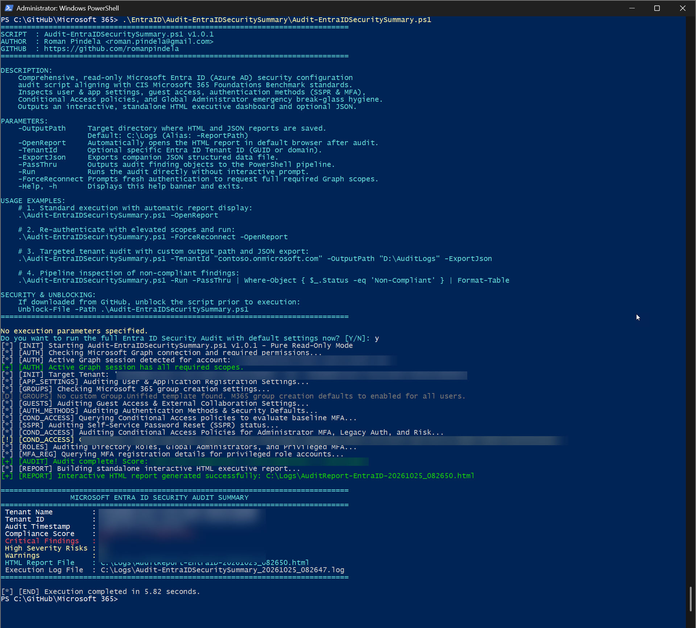
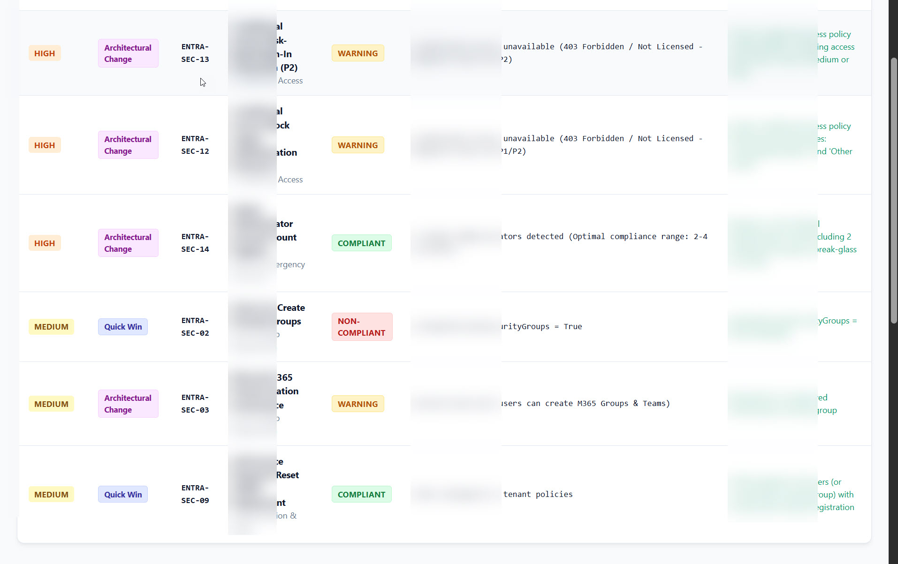

# Audit-EntraIDSecuritySummary

Enterprise-grade PowerShell security configuration audit and reporting utility for **Microsoft Entra ID (Azure AD)**. Performs an in-depth, read-only posture assessment aligned with the **CIS Microsoft 365 Foundations Benchmark** and Microsoft Cloud Security Best Practices, generating a standalone, interactive HTML executive dashboard.

---

## 1. Overview & Architecture

`Audit-EntraIDSecuritySummary.ps1` evaluates key identity, access, and governance controls across your Entra ID tenant without altering any tenant configuration (strictly **Read-Only**). It produces actionable insights divided into **Quick Wins** and **Architectural Changes**, pairing each finding with business risk rationales and concrete remediation steps in both the Microsoft Entra admin center and PowerShell.

```
                           [ Microsoft Entra ID Tenant Context ]
                                             │
      ┌───────────────────┬──────────────────┼──────────────────┬───────────────────┐
      ▼                   ▼                  ▼                  ▼                   ▼
[ Users & Apps ]   [ Guest Access ]   [ Auth & SSPR ]     [ Cond. Access ]   [ Privileged Roles ]
- App Registration - Role Restrictions - Security Defaults - Admin MFA Policy - Global Admin Count
- Security Groups  - Invite Governance - SSPR Status       - Block Legacy Auth- Break-Glass Hygiene
- Admin Portal     - External Sharing  - Admin MFA Reg.    - Risky Sign-in MFA- Admins Without MFA
- User Consent
```

### Core Assessment Pillars:
1. **User and Application Registration Settings:**
   - Evaluates whether standard users can register custom or third-party OAuth applications.
   - Audits self-service security group and Microsoft 365 group creation permissions.
   - Confirms whether non-administrators are restricted from accessing administrative portals.
   - Evaluates user consent settings to protect against consent phishing attacks.
2. **Guest Access and External Collaboration:**
   - Inspects guest user directory access restriction levels (`GuestUserRoleId`: Restricted vs Limited vs Default).
   - Verifies whether invitation permissions are restricted strictly to designated administrators.
3. **Authentication, SSPR, and Baseline MFA:**
   - Evaluates Security Defaults enforcement (or mutual coexistence with Conditional Access).
   - Checks Self-Service Password Reset (SSPR) configuration and authentication method registration.
   - Verifies whether privileged role holders (Global Admin, Security Admin, Privileged Role Admin) have registered multi-factor authentication methods.
4. **Conditional Access Policies (Entra ID P1/P2):**
   - Assesses active policies requiring MFA for all administrative directory roles.
   - Validates automated blocking of legacy authentication protocols (Exchange ActiveSync, POP3, IMAP, SMTP).
   - Evaluates real-time risk-based sign-in protection policies (Entra ID P2 Identity Protection).
5. **Privileged Roles & Emergency Access (Break-Glass) Hygiene:**
   - Audits the total number of Global Administrator accounts (recommending 2 to 4 accounts).
   - Identifies high-risk Global Administrators and privileged role holders lacking MFA protection.

---

## 2. Visual Overview & Live Execution

### 1. Standard Run & Console Execution Summary
Executing `Audit-EntraIDSecuritySummary.ps1` runs the full CIS Foundations & Microsoft Cloud Security assessment, validating policies, group settings, guest controls, authentication methods, Conditional Access rules, and privileged account MFA hygiene:



### 2. Standalone Interactive HTML Executive Dashboard
The audit automatically generates a self-contained, responsive single-file HTML report (`C:\Logs\AuditReport-EntraID-YYYYMMDD_HHMMSS.html`) featuring an SVG circular score gauge, executive metrics, quick win action matrix, recommendation cards, and privileged account MFA inventory:



### Dashboard Key Features:
The generated `.html` report (`AuditReport-EntraID-YYYYMMDD_HHMMSS.html`) is a self-contained, responsive single-file web dashboard requiring **zero external dependencies**:

- **Dynamic Circular Score Gauge (SVG)**: Real-time visual representation of overall compliance score (% Zgodność).
- **Executive Metric Cards**: Summary counters for Total Rules, Compliant, Critical/High Issues, and Warnings.
- **Action Summary Matrix**: Actionable table sorted by severity (Critical, High, Medium, Low) and implementation complexity (**Quick Win** vs **Architectural Change**).
- **Detailed Recommendation Cards**: Collapsible cards featuring:
  - Current configuration vs Recommended target state.
  - Business and technical risk impact ("Dlaczego to ustawienie jest istotne?").
  - Step-by-step remediation path in the Entra admin center.
  - Copyable PowerShell remediation commands with one-click clipboard copying.
- **Privileged Account Inventory**: Dedicated table enumerating all privileged accounts and their MFA enrollment status.
- **Client-Side Filtering & Live Search**: Instantaneous search across rule titles, categories, and severity levels.
- **Print / PDF Friendly**: Clean print styling optimized for executive briefings and compliance archiving.

---

## 3. Prerequisites & Permissions

### Minimum Requirements:
* **PowerShell**: **PowerShell 7.2+** recommended (fully compatible with Windows PowerShell 5.1).
* **PowerShell Modules**:
  ```powershell
  Install-Module -Name Microsoft.Graph.Authentication, Microsoft.Graph.Users, Microsoft.Graph.Identity.DirectoryManagement, Microsoft.Graph.Identity.SignIns -Scope CurrentUser
  ```

### Least Privilege Permissions (Read-Only):
The script requires strictly **Read-Only** Graph API scopes and performs no state modifications:
* `Policy.Read.All`: Inspect authorization, consent, and security defaults policies.
* `Directory.Read.All`: Discover directory settings, organizations, and directory objects.
* `RoleManagement.Read.Directory`: Inspect directory role memberships and definitions.
* `Policy.Read.ConditionalAccess`: Inspect Conditional Access policies.
* `Reports.Read.All`: Evaluate MFA registration status for privileged users.

---

## 4. Parameters

| Parameter | Type | Required | Default | Description |
| :--- | :---: | :---: | :---: | :--- |
| `-OutputPath` / `-ReportPath` | `string` | No | `C:\Logs` | Directory where HTML and JSON reports are saved. |
| `-OpenReport` | `switch` | No | `$false` | Automatically opens the generated HTML dashboard in your default browser. |
| `-TenantId` | `string` | No | `$null` | Specific Entra ID Tenant ID (GUID or verified domain) to target during authentication. |
| `-ExportJson` | `switch` | No | `$false` | Generates a companion machine-readable JSON structured data export. |
| `-PassThru` | `switch` | No | `$false` | Emits custom PowerShell objects (`[PSCustomObject]`) to the pipeline for downstream commands. |
| `-Run` | `switch` | No | `$false` | Executes the audit immediately without interactive confirmation prompts. |
| `-ForceReconnect` | `switch` | No | `$false` | Forces a fresh interactive Graph connection to consent to required read scopes. |
| `-Help` / `-h` | `switch` | No | `$false` | Displays the built-in help guide, usage examples, and exits. |

---

## 5. Usage Examples

### Example 1: Standard Audit with Automatic Browser Report Launch
Performs the full Entra ID security assessment and immediately opens the interactive HTML dashboard:
```powershell
.\Audit-EntraIDSecuritySummary.ps1 -OpenReport
```

### Example 2: Non-Interactive Automated Execution
Runs the audit silently in automated schedules or CI/CD pipelines without prompts:
```powershell
.\Audit-EntraIDSecuritySummary.ps1 -Run
```

### Example 3: Targeted Tenant Audit with JSON Export
Connects to a specific tenant and outputs both HTML and JSON reports into a dedicated directory:
```powershell
.\Audit-EntraIDSecuritySummary.ps1 -TenantId "contoso.onmicrosoft.com" -OutputPath "C:\Audits\EntraID" -ExportJson
```

### Example 4: Pipeline Filtering for Non-Compliant Rules
Streams audit findings to PowerShell pipeline and displays non-compliant items in a formatted table:
```powershell
.\Audit-EntraIDSecuritySummary.ps1 -Run -PassThru | Where-Object { $_.Status -eq 'Non-Compliant' } | Format-Table Id, Title, Severity, ActionPriority -AutoSize
```

### Example 5: Interactive Pipeline Analysis with `Out-GridView`
```powershell
.\Audit-EntraIDSecuritySummary.ps1 -Run -PassThru | Out-GridView -Title "Entra ID Security Audit Findings"
```

---

## 6. Audit Rules & Benchmark Reference Matrix

The audit evaluates **15 distinct security rules** mapped to CIS Microsoft 365 Foundations Benchmark standards:

| Rule ID | Category | Rule Title | CIS Ref | Severity | Action Type |
| :--- | :--- | :--- | :--- | :---: | :---: |
| `ENTRA-SEC-01` | Users & App Registration | Users Can Register Applications | 5.1.1 | High | Quick Win |
| `ENTRA-SEC-02` | Users & App Registration | Users Can Create Security Groups | 5.1.2 | Medium | Quick Win |
| `ENTRA-SEC-03` | Users & App Registration | Microsoft 365 Group Creation Governance | Best Practice | Medium | Architectural |
| `ENTRA-SEC-04` | Users & App Registration | Restrict Non-Admin Access to Admin Center | 5.1.4 | High | Quick Win |
| `ENTRA-SEC-05` | Users & App Registration | User Consent to Third-Party Applications | 5.1.3 | Critical | Quick Win |
| `ENTRA-SEC-06` | Guest Access | Guest User Directory Access Restrictions | 5.1.5 | High | Quick Win |
| `ENTRA-SEC-07` | Guest Access | Guest Invitation Permissions | 5.1.6 | High | Quick Win |
| `ENTRA-SEC-08` | Authentication & SSPR | Security Defaults / Baseline MFA | 5.2.1 | Critical | Quick Win |
| `ENTRA-SEC-09` | Authentication & SSPR | Self-Service Password Reset (SSPR) Deployment | 5.2.2 | Medium | Quick Win |
| `ENTRA-SEC-10` | Authentication & SSPR | MFA Registration for Privileged Roles | 5.2.3 | Critical | Quick Win |
| `ENTRA-SEC-11` | Conditional Access | CA: Enforce MFA for All Administrators | 5.3.1 | Critical | Quick Win |
| `ENTRA-SEC-12` | Conditional Access | CA: Block Legacy Authentication Protocols | 5.3.2 | High | Architectural |
| `ENTRA-SEC-13` | Conditional Access | CA: Risk-Based Sign-In Protection (P2) | 5.3.3 | High | Architectural |
| `ENTRA-SEC-14` | Roles & Emergency Accounts | Global Administrator Account Count Hygiene | 5.4.1 | High | Architectural |
| `ENTRA-SEC-15` | Roles & Emergency Accounts | Global Administrators Protected with MFA | Best Practice | Critical | Quick Win |

---

## 7. Enterprise Logging Standard (`Write-AuditLog`)

Execution logs and reports are automatically saved in `C:\Logs` (or `$env:LOCALAPPDATA\Logs\Audit-EntraIDSecuritySummary` if restricted):
* **File Naming**: `Audit-EntraIDSecuritySummary_YYYYMMDD_HHMMSS.log`
* **Log Sample**:
  ```text
  [2026-10-25 08:00:00] [INFO   ] [INIT      ] Starting Audit-EntraIDSecuritySummary.ps1 v1.0.1 - Pure Read-Only Mode
  [2026-10-25 08:00:02] [SUCCESS] [AUTH      ] Successfully connected to Microsoft Graph. Tenant ID: 72f988bf-86f1-41af-91ab-2d7cd011db47
  [2026-10-25 08:00:05] [INFO   ] [APP_SETTINGS] Auditing User & Application Registration Settings...
  [2026-10-25 08:00:08] [SUCCESS] [AUDIT     ] Audit complete! Score: 80% (12/15 Compliant, 2 Non-Compliant, 1 Warnings)
  [2026-10-25 08:00:10] [SUCCESS] [REPORT    ] Interactive HTML report generated successfully: C:\Logs\AuditReport-EntraID-20261025_080010.html
  ```

---

## 8. Security & Unblocking

When downloaded or cloned from GitHub, Windows PowerShell may block script execution by default. Unblock the script before running:
```powershell
Unblock-File -Path .\Audit-EntraIDSecuritySummary.ps1
```

---

## 9. Author & Version History

* **Author:** Roman Pindela
* **Email:** [roman.pindela@gmail.com](mailto:roman.pindela@gmail.com)
* **GitHub:** [https://github.com/romanpindela](https://github.com/romanpindela)
* **Version:** 1.0.1
* **Date:** 2026-10-25
* **License:** MIT License
