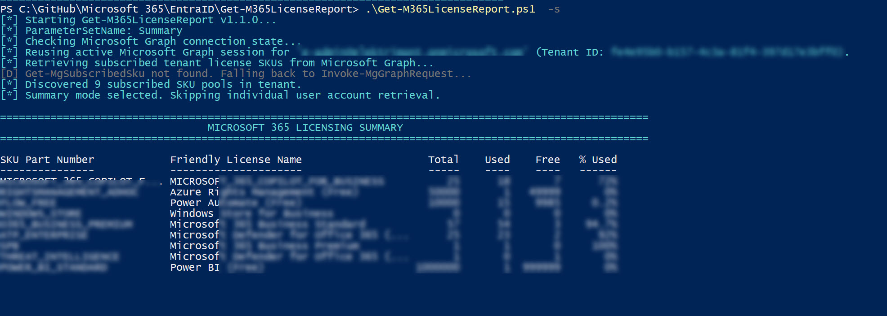
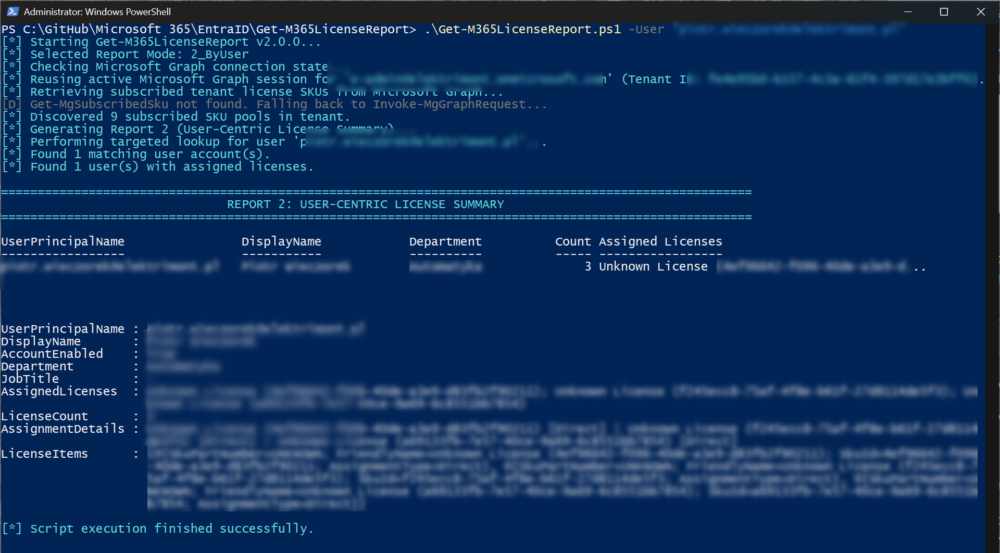
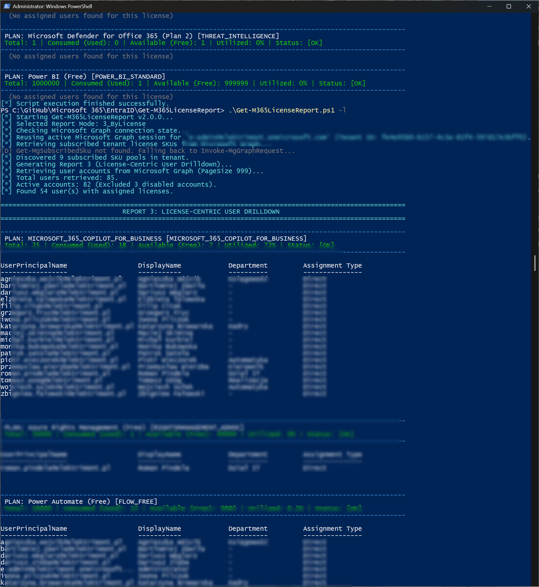
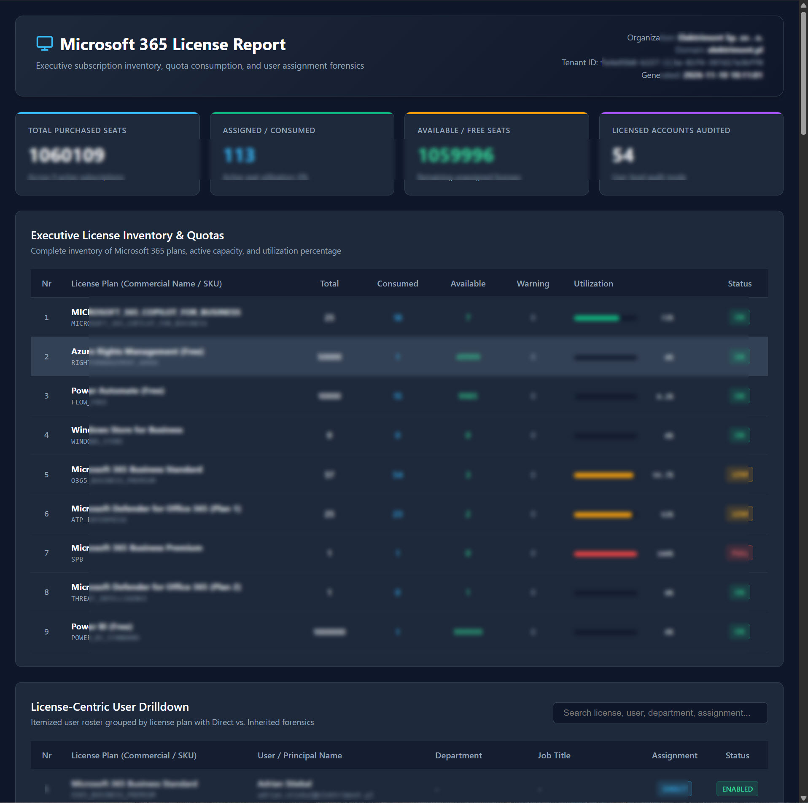
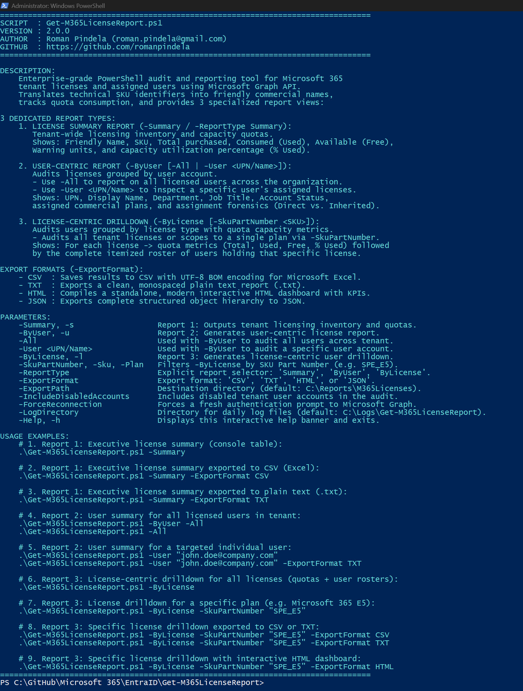

# Get-M365LicenseReport

[](https://microsoft.com/powershell)
[](https://learn.microsoft.com/graph/)
[](https://opensource.org/licenses/MIT)

An enterprise-grade Microsoft 365 licensing audit, quota tracking, and user drilldown tool built on the **Microsoft Graph SDK**. Designed and developed by **Roman Pindela**, this utility translates complex technical SKU identifiers into human-friendly product names, evaluates license consumption and capacity thresholds, identifies group-based licensing inheritance (`Direct` vs `Inherited`), and provides **3 specialized report architectures** with exports to **CSV (UTF-8 BOM)**, formatted **TXT**, **JSON**, and standalone **HTML Dashboards**.

---

## 📋 Table of Contents

- [Overview](#-overview)
- [3 Specialized Reports](#-3-specialized-reports)
  - [Report 1: License Summary](#report-1-license-summary)
  - [Report 2: User-Centric Audit](#report-2-user-centric-audit)
  - [Report 3: License-Centric User Drilldown](#report-3-license-centric-user-drilldown)
- [Workflow Architecture](#-workflow-architecture)
- [Parameters Reference](#-parameters-reference)
- [Export Formats](#-export-formats)
- [Usage Examples](#-usage-examples)
- [Logging & Audit Trail](#-logging--audit-trail)
- [Author & License](#-author--license)

---

## 🔍 Overview

Managing and optimizing Microsoft 365 license pools is critical for controlling operational expenditure and guaranteeing compliance. `Get-M365LicenseReport.ps1` restructures license auditing into three intuitive, dedicated views:

1. **License Inventory & Quotas**: Real-time tenant-level capacity monitoring.
2. **User-Centric Licensing Matrix**: Audit all accounts or target a specific user directly.
3. **License-Centric User Drilldown**: Group users under each license plan alongside capacity metrics (Total, Consumed, Available, % Utilized).

---

## 📊 3 Specialized Reports

### Report 1: License Summary (`-Summary`)
Displays the tenant subscription inventory:
- Commercial friendly names translated from raw SKU codes.
- Total purchased seats (`TotalUnits`).
- Assigned seats (`ConsumedUnits`).
- Available pool (`AvailableUnits`).
- Warning units and percentage utilized (`PercentUtilized`).
- Real-time capacity alert status (`[OK]`, `[LOW]`, `[FULL]`).



### Report 2: User-Centric Audit (`-ByUser [-All | -User <UPN>]`)
Audits licenses grouped by user account:
- **Tenant-Wide (`-All`)**: Audits all licensed users across the organization.
- **Targeted User (`-User <UPN/Name>`)**: Performs an instantaneous lookup of a single user without scanning the entire tenant.
- Attributes: UPN, Display Name, Department, Job Title, Account Enabled status, License Count, and Assigned Plans.



### Report 3: License-Centric User Drilldown (`-ByLicense [-SkuPartNumber <SKU>]`)
Audits users grouped by license type:
- **All Licenses or Specific Plan (`-SkuPartNumber <SKU>`)**: Scopes to all subscriptions or a single plan (e.g. `SPE_E5`).
- For each license: Prints the capacity quota header (`Total`, `Used`, `Free`, `% Utilized`, `Status`) followed by the itemized user roster.
- Forensic attribution: Identifies whether the license is assigned directly (`Direct`) or inherited via group licensing (`Inherited (Group Name)`).



---

## 🏗️ Workflow Architecture

```
[Start Get-M365LicenseReport.ps1]
  │
  ├── [No parameters or -Help / -h?] ──> Display Interactive CLI Guide & Exit
  │
  ├── 1. Initialize Logging (C:\Logs\Get-M365LicenseReport\)
  ├── 2. Verify or Establish Microsoft Graph Session
  ├── 3. Retrieve Tenant Subscribed SKUs (Get-MgSubscribedSku)
  │
  ├── [Route to Selected Report Mode]
  │     ├── Report 1 (-Summary)
  │     │     └── Output Quota Table (Total, Used, Free, % Used, Status)
  │     │
  │     ├── Report 2 (-ByUser [-All | -User <UPN>])
  │     │     └── Fetch Target User or Paged Tenant Users
  │     │     └── Output User-Centric Roster with Assigned Licenses
  │     │
  │     └── Report 3 (-ByLicense [-SkuPartNumber <SKU>])
  │           └── Fetch Licensed Users & Match Assignment States
  │           └── Output Quota Header + Itemized User Roster per SKU
  │
  ├── [Is -ExportFormat specified?]
  │     ├── CSV   ──> Export to Excel-ready UTF-8 BOM CSV
  │     ├── TXT   ──> Export Formatted Monospaced Plain Text Report (.txt)
  │     ├── HTML  ──> Compile Standalone Interactive HTML Dashboard
  │     └── JSON  ──> Export Complete Object Hierarchy
  │
  └── [End - Execution Logged to Daily Audit Trail]
```

---

## ⚙️ Parameters Reference

| Parameter | Aliases | Description |
|---|---|---|
| `-Summary` | `-SummaryOnly`, `-LicenseSummary`, `-s` | **Report 1**: Tenant-wide subscription inventory and quotas. |
| `-ByUser` | `-Users`, `-UserSummary`, `-u` | **Report 2**: User-centric license report. |
| `-All` | — | Used with `-ByUser` to audit all users across the tenant. |
| `-User` | `-UserPrincipalName`, `-UPN`, `-Search` | Used with `-ByUser` to audit a specific user account. |
| `-ByLicense` | `-LicenseReport`, `-Licenses`, `-l` | **Report 3**: License-centric user drilldown. |
| `-SkuPartNumber` | `-Sku`, `-License`, `-Plan` | Filters `-ByLicense` by SKU Part Number (e.g. `SPE_E5`). |
| `-ReportType` | `-Report`, `-Type` | Explicit report selector: `'Summary'`, `'ByUser'`, `'ByLicense'`. |
| `-ExportFormat` | — | Format: `'CSV'`, `'TXT'`, `'HTML'`, or `'JSON'`. |
| `-ExportPath` | — | Destination directory (default: `C:\Reports\M365Licenses`). |
| `-IncludeDisabledAccounts` | — | Includes disabled tenant user accounts. |
| `-ForceReconnection` | — | Forces a fresh authentication prompt to Microsoft Graph. |
| `-LogDirectory` | — | Daily log directory (default: `C:\Logs\Get-M365LicenseReport`). |
| `-Help` | `-h` | Displays the interactive CLI help banner. |

---

## 💾 Export Formats

- **CSV (`-ExportFormat CSV`)**: Clean, Excel-ready CSV encoded with UTF-8 BOM.
- **TXT (`-ExportFormat TXT`)**: Formatted monospaced plain text report with organization metadata and aligned tables.
- **HTML (`-ExportFormat HTML`)**: Modern, self-contained single-file HTML dashboard with KPI metric cards, progress bars, and client-side instant search.
- **JSON (`-ExportFormat JSON`)**: Hierarchical JSON structure with full metadata depth.

### Standalone Interactive HTML Dashboard


---

## 💻 Usage Examples

### 1. Interactive Help (Default)
Executing the script without arguments or with `-Help` / `-h` displays the interactive CLI banner and quick syntax reference:



```powershell
.\Get-M365LicenseReport.ps1
.\Get-M365LicenseReport.ps1 -h
```

### 2. Report 1: Tenant License Summary
```powershell
# Console table
.\Get-M365LicenseReport.ps1 -Summary

# Export to CSV (Excel)
.\Get-M365LicenseReport.ps1 -Summary -ExportFormat CSV

# Export to clean TXT report
.\Get-M365LicenseReport.ps1 -Summary -ExportFormat TXT
```

### 3. Report 2: User-Centric Audit
```powershell
# Audit all licensed users in tenant
.\Get-M365LicenseReport.ps1 -ByUser -All
.\Get-M365LicenseReport.ps1 -All

# Target a specific user
.\Get-M365LicenseReport.ps1 -User "john.doe@company.com"

# Target user with plain text export
.\Get-M365LicenseReport.ps1 -User "john.doe@company.com" -ExportFormat TXT
```

### 4. Report 3: License-Centric User Drilldown
```powershell
# Audit all licenses with quotas + user rosters
.\Get-M365LicenseReport.ps1 -ByLicense

# Audit users holding a specific plan (e.g. Microsoft 365 E5)
.\Get-M365LicenseReport.ps1 -ByLicense -SkuPartNumber "SPE_E5"

# Specific license drilldown exported to CSV or TXT
.\Get-M365LicenseReport.ps1 -ByLicense -SkuPartNumber "SPE_E5" -ExportFormat CSV
.\Get-M365LicenseReport.ps1 -ByLicense -SkuPartNumber "SPE_E5" -ExportFormat TXT

# Specific license drilldown with interactive HTML dashboard
.\Get-M365LicenseReport.ps1 -ByLicense -SkuPartNumber "SPE_E5" -ExportFormat HTML
```

---

## 📝 Logging & Audit Trail

All operations are logged automatically to `C:\Logs\Get-M365LicenseReport\Get-M365LicenseReport_yyyy-MM-dd.log`.

---

## 👤 Author & License

- **Author**: Roman Pindela
- **Email**: [roman.pindela@gmail.com](mailto:roman.pindela@gmail.com)
- **GitHub**: [https://github.com/romanpindela](https://github.com/romanpindela)
- **Version**: 2.0.0
- **License**: MIT
