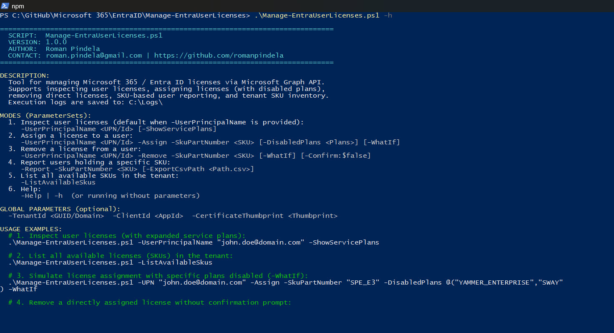
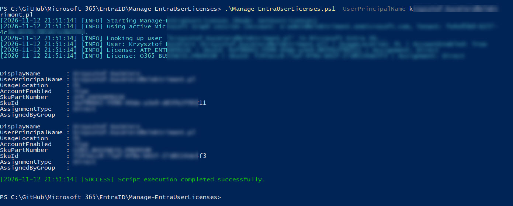
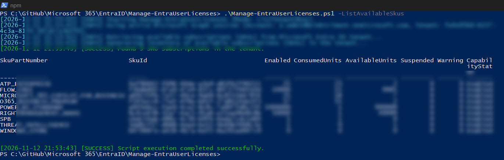

# Manage-EntraUserLicenses

[](https://microsoft.com/powershell)
[](https://learn.microsoft.com/graph/)
[](https://opensource.org/licenses/MIT)

A PowerShell administrative tool for comprehensive **Microsoft Entra ID / Microsoft 365** user license management and auditing via the **Microsoft Graph PowerShell SDK**.

The script supports both **single-user operations** (inspecting assigned licenses and service plans, assigning licenses with specific plans disabled, removing direct licenses) and **tenant-wide reporting** (listing available SKU subscriptions and auditing users holding a specified SKU with CSV export).

---

## 📋 Table of Contents

- [Features](#-features)
- [Prerequisites & Permissions](#-prerequisites--permissions)
- [Parameter Sets](#-parameter-sets)
- [Usage Examples](#-usage-examples)
- [Edge Case Handling](#-edge-case-handling)
- [Logging & Pipeline Output](#-logging--pipeline-output)
- [Author & Contact](#-author--contact)

---

## ✨ Features

- **Automatic SKU Translation:** Accepts friendly Microsoft technical names (`SkuPartNumber`, e.g., `SPE_E3`, `SPE_E5`, `ENTERPRISEPACK`) and automatically maps them to internal tenant `SkuId` GUIDs.
- **6 Operating Modes (`ParameterSets`):**
  1. `Help` *(default when run without parameters or with `-Help` / `-h`)* – displays interactive CLI help, mode overview, and usage examples.
  2. `GetUserLicenses` – inspects user licenses and optionally expands component service plans (`-ShowServicePlans`).
  3. `AssignLicense` (`-Assign`) – assigns a license after validating pool capacity, `UsageLocation`, and optional `-DisabledPlans`.
  4. `RemoveLicense` (`-Remove`) – removes direct licenses while detecting Group-Based Licensing inheritance.
  5. `ReportBySku` (`-Report`) – prints SKU pool summary and lists all assigned users (server-side Graph filtering, `Write-Progress` bar, optional CSV export).
  6. `ListTenantSkus` (`-ListAvailableSkus`) – lists all subscriptions available in the tenant (`Enabled`, `ConsumedUnits`, `AvailableUnits`, `Suspended`, `Warning`).
- **Safe Execution (`SupportsShouldProcess`):** Full support for `-WhatIf` and `-Confirm` on state-changing operations (`-Assign`, `-Remove`).
- **App-Only Automation:** Supports non-interactive authentication via `-TenantId`, `-ClientId`, and `-CertificateThumbprint`.
- **Clean Pipeline Output:** All results are emitted as `PSCustomObject`s for downstream filtering and formatting (`| Where-Object`, `| Export-Csv`, `| Out-GridView`).

---

## 🔧 Prerequisites & Permissions

### Environment & Modules
- **PowerShell 5.1 or 7.0+** (`#Requires -Version 5.1`)
- **Microsoft Graph PowerShell SDK** modules:
  - `Microsoft.Graph.Authentication`
  - `Microsoft.Graph.Users`
  - `Microsoft.Graph.Users.Actions`
  - `Microsoft.Graph.Identity.DirectoryManagement`

Install the SDK:
```powershell
Install-Module Microsoft.Graph -Scope CurrentUser
```

### Microsoft Graph Permissions (Scopes)
| Mode | Required Permissions (Delegated / Application) |
| :--- | :--- |
| Read & Reporting (`GetUserLicenses`, `-Report`, `-ListAvailableSkus`) | `User.Read.All`, `Organization.Read.All` *(or `Directory.Read.All`)* |
| License Modification (`-Assign`, `-Remove`) | `User.ReadWrite.All` *(or `LicenseAssignment.ReadWrite.All`)*, `Organization.Read.All` |

---

## 🧩 Parameter Sets

| Parameter Set | Mandatory Parameters | Optional Parameters |
| :--- | :--- | :--- |
| `Help` *(default)* | – | `-Help` *(Alias: `-h`)* |
| `GetUserLicenses` | `-UserPrincipalName` *(Position 0, Aliases: `UPN`, `Identity`)* | `-ShowServicePlans` |
| `AssignLicense` | `-UserPrincipalName`, `-Assign`, `-SkuPartNumber` | `-DisabledPlans`, `-WhatIf`, `-Confirm` |
| `RemoveLicense` | `-UserPrincipalName`, `-Remove`, `-SkuPartNumber` | `-WhatIf`, `-Confirm` |
| `ReportBySku` | `-Report`, `-SkuPartNumber` | `-ExportCsvPath` |
| `ListTenantSkus` | `-ListAvailableSkus` | – |

**Global Parameters (available in all modes):**
- `-TenantId` – Entra ID tenant identifier.
- `-ClientId` – App Registration client ID for App-Only authentication.
- `-CertificateThumbprint` – X.509 certificate thumbprint from `Cert:\CurrentUser\My` or `Cert:\LocalMachine\My`.

---

## 🚀 Usage Examples

### 1. Display built-in help (no parameters or `-Help` / `-h`)
```powershell
.\Manage-EntraUserLicenses.ps1
.\Manage-EntraUserLicenses.ps1 -h
```



### 2. Inspect a user's licenses
```powershell
.\Manage-EntraUserLicenses.ps1 -UserPrincipalName "john.doe@domain.com"
```



### 3. Inspect a user's licenses with expanded service plans
```powershell
.\Manage-EntraUserLicenses.ps1 -UPN "john.doe@domain.com" -ShowServicePlans
```

### 4. List all available SKUs in the tenant
```powershell
.\Manage-EntraUserLicenses.ps1 -ListAvailableSkus
```



### 5. Simulate assigning a license (`-WhatIf`) with disabled plans
```powershell
.\Manage-EntraUserLicenses.ps1 -UserPrincipalName "john.doe@domain.com" `
    -Assign `
    -SkuPartNumber "SPE_E3" `
    -DisabledPlans @("YAMMER_ENTERPRISE", "SWAY") `
    -WhatIf
```

### 6. Remove a directly assigned license without confirmation prompt (`-Confirm:$false`)
```powershell
.\Manage-EntraUserLicenses.ps1 -UserPrincipalName "john.doe@domain.com" `
    -Remove `
    -SkuPartNumber "SPE_E3" `
    -Confirm:$false
```

### 7. Generate a user report for a SKU and export to CSV
```powershell
.\Manage-EntraUserLicenses.ps1 -Report -SkuPartNumber "ENTERPRISEPACK" -ExportCsvPath "C:\Temp\Report_E3.csv"
```

### 8. Pipeline processing
```powershell
.\Manage-EntraUserLicenses.ps1 -Report -SkuPartNumber "SPE_E3" |
    Where-Object { $_.AccountEnabled -eq $true -and $_.AssignmentType -eq 'Direct' } |
    Format-Table DisplayName, UserPrincipalName, Department -AutoSize
```

### 9. Non-interactive App-Only execution (certificate-based)
```powershell
.\Manage-EntraUserLicenses.ps1 -ListAvailableSkus `
    -TenantId "00000000-0000-0000-0000-000000000000" `
    -ClientId "11111111-1111-1111-1111-111111111111" `
    -CertificateThumbprint "AABBCCDDEEFF00112233445566778899AABBCCDD"
```

---

## 🛡️ Edge Case Handling

| Edge Case | Script Behavior |
| :--- | :--- |
| **Missing `UsageLocation` on `-Assign`** | Detects null/empty `UsageLocation` before calling the API and returns a clear error instructing to set a country code (e.g., `PL`, `US`). |
| **Group-based license on `-Remove`** | Inspects `LicenseAssignmentStates.AssignedByGroup` and informs the administrator that the license is inherited from a group (including its `GroupId`) instead of returning a raw HTTP 400 error. |
| **Exhausted license pool** | Blocks assignment when `AvailableUnits <= 0` and reports the exact pool balance (`Enabled` / `ConsumedUnits`). |
| **Typo in `SkuPartNumber`** | Lists all active `SkuPartNumber` values available in the tenant as a hint. |
| **API Errors / Throttling** | Leverages Microsoft Graph SDK built-in retry handling and `try / catch` blocks with full error and stack trace logging. |

---

## 📝 Logging & Pipeline Output

- Every operational run automatically creates `C:\Logs\` (if missing) and writes logs to:
  `C:\Logs\<yyyyMMdd-HHmmss>-Manage-EntraUserLicenses-<COMPUTERNAME>-<USERNAME>.logs`
- Diagnostic messages (`[INFO]`, `[WARN]`, `[ERROR]`, `[SUCCESS]`) are written to the console (`Write-Host`) and log file with ISO 8601 timestamps (`[yyyy-MM-dd HH:mm:ss]`) without polluting the standard output pipeline.

---

## 👤 Author & Contact

- **Author**: Roman Pindela
- **Email**: [roman.pindela@gmail.com](mailto:roman.pindela@gmail.com)
- **GitHub**: [https://github.com/romanpindela](https://github.com/romanpindela)
