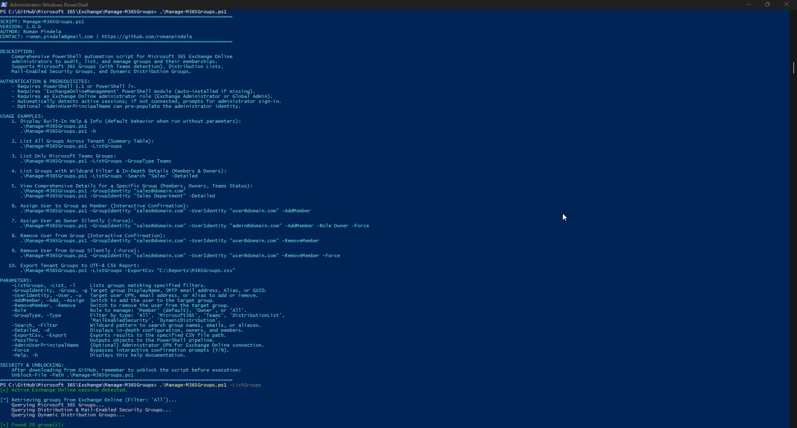
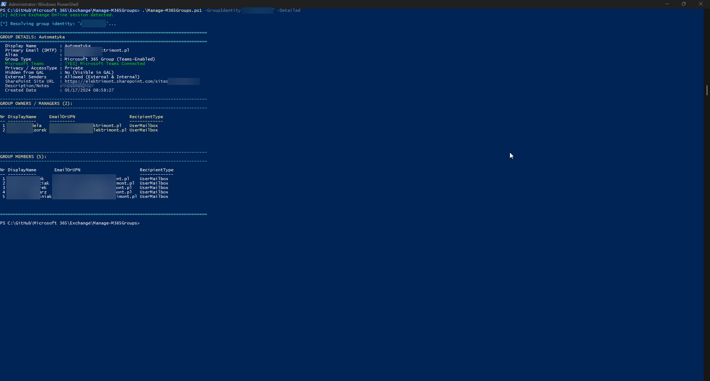

# Manage-M365Groups

A professional, enterprise-grade PowerShell automation script for Microsoft 365 and Exchange Online administrators to audit, inspect, and manage tenant groups and their memberships. It enables administrators to **list and filter groups** across all types, **auto-detect Microsoft Teams connectivity**, **inspect comprehensive group properties and members**, **assign users** as members or owners, and **safely remove users** with confirmation and orphan prevention.

---

## Features

- **Comprehensive Group Support**: Seamlessly discovers, audits, and manages:
  - **Microsoft 365 Groups** (Unified Groups)
  - **Microsoft Teams-enabled Groups** (automatically detected via `ResourceProvisioningOptions`)
  - **Distribution Lists** (Distribution Groups)
  - **Mail-Enabled Security Groups**
  - **Dynamic Distribution Groups** (query-based)
- **Deep Group Inspection (`-Detailed` / `-GroupIdentity`)**: Exposes rich metadata including:
  - Microsoft Teams connectivity status (`[YES] Microsoft Teams Connected` vs. `[NO]`)
  - Privacy / Access Type (`Public` vs. `Private`)
  - Connected SharePoint Site URL and Document Library paths
  - Primary SMTP, Alias, and all configured proxy email addresses
  - External senders policy (`RequireSenderAuthenticationEnabled`)
  - Global Address List (GAL) visibility
  - Complete list of Group Owners and Managers (DisplayName, UPN/Email, RecipientType)
  - Complete list of Group Members (DisplayName, UPN/Email, RecipientType)
  - Dynamic `RecipientFilter` and `RecipientContainer` expressions for Dynamic Distribution Groups
- **Member & Owner Assignment (`-AddMember`)**:
  - Assign users as standard **Members** or administrative **Owners** (`-Role Member` / `-Role Owner`).
  - Pre-validates user and group existence before modifying permissions.
  - Automatically verifies existing membership to prevent duplicate assignments.
  - Automatically adds owners to the member pool for full Teams/SharePoint collaboration access.
- **Member & Owner Removal (`-RemoveMember`)**:
  - Safely revoke user access from group membership or ownership.
  - **Sole Owner Safety Check**: Guards against removing the only remaining owner of a Microsoft 365 Group, preventing orphaned groups.
- **Pre-Execution Input Defense**:
  - Strict input sanitization guarding against malicious control characters and shell injections.
  - Regex validation of user and group email formats (`^[a-zA-Z0-9._%+-]+@[a-zA-Z0-9.-]+\.[a-zA-Z]{2,}$`).
  - Graceful handling of query-based Dynamic Groups (prevents static membership corruption).
- **Interactive & Automation Modes**:
  - Bilingual interactive confirmation prompts supporting English (`Y/N`) and Polish (`T/N`).
  - `-Force` parameter to bypass confirmation prompts for non-interactive automation or scheduled tasks.
- **Reporting & Pipeline Integration**:
  - Export discovered group inventories to UTF-8 CSV reports via `-ExportCsv`.
  - Pass custom objects to PowerShell pipeline using `-PassThru`.
- **Modern Authentication Flow**:
  - Automatically checks for existing active Exchange Online sessions.
  - Initiates interactive modern administrator sign-in (`Connect-ExchangeOnline`) if not connected.
  - Optional `-AdminUserPrincipalName` parameter to pre-populate administrative identity.

---

## Prerequisites

- **Operating System**: Windows 10/11 or Windows Server 2016/2019/2022/2025.
- **PowerShell**: PowerShell 5.1 or PowerShell 7+.
- **Exchange Online Module**: `ExchangeOnlineManagement` (v3.0.0 or later recommended).
  *If missing, the script will automatically install it for `CurrentUser` from PSGallery.*
  ```powershell
  Install-Module -Name ExchangeOnlineManagement -Scope CurrentUser -Repository PSGallery -Force
  ```
- **Administrative Role**: Account assigned **Exchange Administrator** or **Global Administrator** in Microsoft 365.

---

## Security & Unblocking

When downloading scripts from GitHub, PowerShell flags files downloaded from the internet. Remember to unblock the script prior to execution:

```powershell
Unblock-File -Path .\Manage-M365Groups.ps1
```

---

## Usage Examples

### 1. Display Built-In Help & Info (Default Execution)
Running the script without parameters (or using `-Help` / `-h`) displays syntax documentation, author information, and examples:

```powershell
.\Manage-M365Groups.ps1
# or
.\Manage-M365Groups.ps1 -h
```

---

### 2. List All Groups Across Tenant (Summary Table)
Queries and displays all tenant groups (M365 Groups, Teams, Distribution Lists, Security Groups, Dynamic Groups) in a structured table:

```powershell
.\Manage-M365Groups.ps1 -ListGroups
```

---

### 3. List Only Microsoft Teams Groups
Filters groups to display only those connected to Microsoft Teams:

```powershell
.\Manage-M365Groups.ps1 -ListGroups -GroupType Teams
```

---

### 4. Search Groups by Keyword with Full Details
Performs a wildcard search across group names, emails, and aliases, displaying complete configurations and membership lists:

```powershell
.\Manage-M365Groups.ps1 -ListGroups -Search "Sales" -Detailed
```

---

### 5. Inspect a Specific Group (Deep Audit)
Inspects a specific group by email address, display name, alias, or GUID:

```powershell
.\Manage-M365Groups.ps1 -GroupIdentity "finance@domain.com"
# or by Display Name
.\Manage-M365Groups.ps1 -GroupIdentity "Finance Department"
```

---

### 6. Assign User to Group as Member (Interactive & Silent)
Adds an internal user to the target group as a member:

```powershell
# Interactive (prompts for confirmation with Y/N or T/N)
.\Manage-M365Groups.ps1 -GroupIdentity "it-team@domain.com" -UserIdentity "john.doe@domain.com" -AddMember

# Silent execution (bypasses confirmation prompt via -Force)
.\Manage-M365Groups.ps1 -GroupIdentity "it-team@domain.com" -UserIdentity "john.doe@domain.com" -AddMember -Force
```

---

### 7. Assign User to Group as Owner
Adds a user with administrative Owner rights to a Microsoft 365 Group or Manager of a Distribution Group:

```powershell
.\Manage-M365Groups.ps1 -GroupIdentity "project-alpha@domain.com" -UserIdentity "lead@domain.com" -AddMember -Role Owner
```

---

### 8. Remove User from Group (Interactive & Silent)
Removes a user from group membership:

```powershell
# Interactive confirmation
.\Manage-M365Groups.ps1 -GroupIdentity "it-team@domain.com" -UserIdentity "john.doe@domain.com" -RemoveMember

# Silent removal via -Force
.\Manage-M365Groups.ps1 -GroupIdentity "it-team@domain.com" -UserIdentity "john.doe@domain.com" -RemoveMember -Force
```

---

### 9. Remove User from All Roles (Member and Owner)
Revokes both membership and ownership from the specified group:

```powershell
.\Manage-M365Groups.ps1 -GroupIdentity "project-alpha@domain.com" -UserIdentity "former-lead@domain.com" -RemoveMember -Role All -Force
```

---

### 10. Export Tenant Groups to CSV
Exports the inventory of discovered groups into a UTF-8 CSV report:

```powershell
.\Manage-M365Groups.ps1 -ListGroups -ExportCsv "C:\Reports\M365_Groups_Inventory.csv"
```

---

## Parameter Reference

| Parameter | Type | Required | Description |
| :--- | :--- | :--- | :--- |
| `-ListGroups` / `-List` / `-l` | `Switch` | No | Lists groups matching specified filters across the tenant. |
| `-GroupIdentity` / `-Group` / `-g` | `String` | Conditional | Target group DisplayName, SMTP email address, Alias, or GUID. When specified alone, displays comprehensive details. |
| `-UserIdentity` / `-User` / `-u` | `String` | Conditional | Target user UPN, primary SMTP email address, or Alias to add or remove. |
| `-AddMember` / `-Add` / `-Assign` | `Switch` | Conditional | Adds the specified user to the target group. |
| `-RemoveMember` / `-Remove` | `Switch` | Conditional | Removes the specified user from the target group. |
| `-Role` | `String` | No | Role to assign or revoke: `Member` (default), `Owner`, or `All` (removal only). |
| `-GroupType` / `-Type` | `String` | No | Filter by type: `All` (default), `Microsoft365`, `Teams`, `DistributionList`, `MailEnabledSecurity`, `DynamicDistribution`. |
| `-Search` / `-Filter` | `String` | No | Wildcard pattern to filter group names, emails, or aliases (e.g. `*Marketing*`). |
| `-Detailed` / `-d` | `Switch` | No | Displays in-depth configuration, owners, and members for listed groups. |
| `-ExportCsv` / `-Export` | `String` | No | File path to export results into a UTF-8 CSV report. |
| `-PassThru` | `Switch` | No | Emits custom objects to the PowerShell pipeline. |
| `-AdminUserPrincipalName` | `String` | No | Administrator UPN for Exchange Online connection. |
| `-Force` | `Switch` | No | Bypasses interactive confirmation prompts (`Y/N`). |
| `-Help` / `-h` | `Switch` | No | Displays built-in help and usage documentation. |

---

## Group Types & Capabilities Matrix

| Group Type | Underline EXO Object | Teams Support | Add/Remove Members | Owner Management | SharePoint Site |
| :--- | :--- | :---: | :---: | :---: | :---: |
| **Microsoft 365 Group** | `UnifiedGroup` | Optional / Auto-detected | `Add-UnifiedGroupLinks` / `Remove-UnifiedGroupLinks` | Yes (`Owners` link) | Yes |
| **Microsoft Teams Group** | `UnifiedGroup` (`Team` provisioned) | **Connected** | `Add-UnifiedGroupLinks` / `Remove-UnifiedGroupLinks` | Yes (`Owners` link) | Yes |
| **Distribution List** | `DistributionGroup` | No | `Add-DistributionGroupMember` / `Remove-DistributionGroupMember` | Yes (`ManagedBy`) | No |
| **Mail-Enabled Security** | `DistributionGroup` | No | `Add-DistributionGroupMember` / `Remove-DistributionGroupMember` | Yes (`ManagedBy`) | No |
| **Dynamic Distribution** | `DynamicDistributionGroup` | No | Rule-Based (`RecipientFilter`) | Yes (`ManagedBy`) | No |

---

## Screenshots & Output Examples

### 1. Standard Run & Built-In Help (`-h`)
Execution without parameters or with `-h` displays syntax, author info, and practical examples:



---

### 2. Listing Groups Across Tenant (`-ListGroups`)
Summary table displaying tenant groups, group classifications, Microsoft Teams connectivity status, and primary emails:


---

### 3. Detailed Group Inspection (`-GroupIdentity`)
In-depth view of a specific group displaying configuration, Teams integration, connected SharePoint URL, owners/managers, and complete membership list:



---

## Author & Contact

- **Author**: Roman Pindela
- **Email**: [roman.pindela@gmail.com](mailto:roman.pindela@gmail.com)
- **GitHub**: [https://github.com/romanpindela](https://github.com/romanpindela)
- **Version**: 1.0.0
