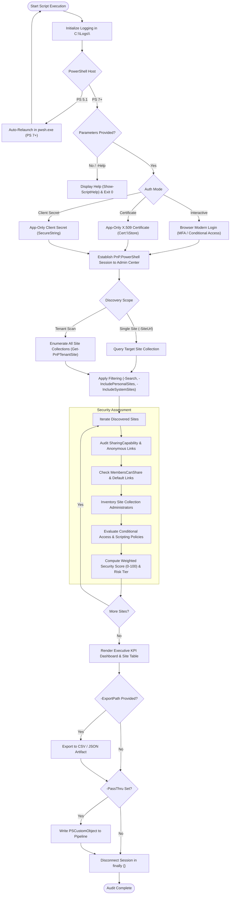

# Audit-ExchangeSecuritySummary

[](https://microsoft.com/powershell)
[](https://www.microsoft.com/sharepoint)
[](https://github.com/romanpindela)
[-brightgreen.svg)](https://github.com/PowerShell/PSScriptAnalyzer)
[](https://opensource.org/licenses/MIT)

Enterprise-grade PowerShell automation utility engineered for **Microsoft 365** and **SharePoint Online** administrators, security analysts, and compliance auditors. It performs systematic security posture assessments across tenant site collections, auditing external sharing capabilities, anonymous access link configurations, non-owner sharing permissions (`MembersCanShare`), Site Collection Administrator footprints, Conditional Access device policies, and custom script permissions.

---

## 🏛️ Author & Metadata

* **Author**: Roman Pindela
* **Email**: [roman.pindela@gmail.com](mailto:roman.pindela@gmail.com)
* **GitHub**: [https://github.com/romanpindela](https://github.com/romanpindela)
* **Version**: `1.0.0`
* **Release Date**: 2026-10-24
* **Target Platforms**: Windows 10, Windows 11, Windows Server 2016/2019/2022/2025
* **Execution Engine**: PowerShell 7+ (pwsh.exe) with automatic elevation from Windows PowerShell 5.1
* **Standards Compliance**: CleanCode, Zero-Warning PSScriptAnalyzer, Microsoft 365 Security Best Practices

---

## 🌟 Key Capabilities & Overview

1. **Comprehensive Tenant & Site Discovery**
   - Discovers and audits all active SharePoint Online site collections across the Microsoft 365 tenant.
   - Supports targeted auditing of single site collections (`-SiteUrl`) or keyword-filtered subsets (`-Search`).
   - Intelligently filters out personal OneDrive sites and system-internal templates (e.g., App Catalog, Hub sites, Search centers) unless explicitly requested (`-IncludePersonalSites`, `-IncludeSystemSites`).

2. **External Sharing Policy & Governance Assessment**
   - Classifies each site collection's `SharingCapability`:
     - `Disabled`: External collaboration blocked entirely (most secure).
     - `ExistingGuests`: Access limited to guests already provisioned in Microsoft Entra ID.
     - `ExternalUserSharingOnly`: Authenticated external users only.
     - `ExternalUserAndGuestSharing`: Anyone / Anonymous links permitted (highest risk).
   - Audits default link configurations (`DefaultSharingLinkType`, `DefaultLinkPermission`).
   - Flags whether non-owners can invite guests or share resources (`MembersCanShare` derived from `DisableSharingForNonOwnersStatus`).

3. **Administrative Footprint & Privilege Inventory**
   - Catalogs Primary Site Owners and Site Collection Administrators.
   - Detects administrative sprawl (flagging sites with > 3 admins holding unrestricted site authority).

4. **Conditional Access & Device Security Restrictions**
   - Checks `ConditionalAccessPolicy` status (`AllowFullAccess`, `AllowLimitedAccess`, `BlockAccess`).
   - Reports whether unmanaged devices are permitted to download non-web-viewable files (`AllowDownloadingNonWebViewableFiles`).
   - Validates custom scripting restrictions (`DenyAddAndCustomizePages`) to protect against script injection vulnerabilities.

5. **Multi-Factor Weighted Security Scoring Engine**
   - Calculates a normalized Security Posture Score (0–100) per site based on configuration risk weights.
   - Categorizes risk into actionable tiers: **Low (85–100)**, **Medium (65–84)**, **High (45–64)**, and **Critical (<45)**.
   - Provides clear, human-readable risk factor summaries for instant remediation.

6. **Flexible Authentication Architectures**
   - **Interactive Modern Authentication**: Seamless browser sign-in with full MFA and Conditional Access support.
   - **App-Only Certificate Authentication (Daemon)**: X.509 certificate authentication for scheduled tasks and unattended pipelines.
   - **App-Only Client Secret Authentication**: Secure credential-based authentication using Entra ID application registrations.

7. **Resilience & Observability**
   - Automatic HTTP 429 / 503 throttling handling with exponential backoff and randomized jitter.
   - Centralized telemetry logging in `C:\Logs\` (with fallback to `$env:LOCALAPPDATA\Logs`).
   - Guaranteed resource cleanup and session termination (`Disconnect-PnPOnline`) in `finally {}` blocks.

---

## 📐 Architecture & Workflow

### Process Flowchart (Mermaid)



### Scan & Assessment Hierarchy (ASCII)

```text
SharePoint Online Tenant: https://contoso-admin.sharepoint.com
 │
 ├── [Tenant Discovery Engine]
 │    ├── Excludes: Personal Sites (OneDrive) unless -IncludePersonalSites
 │    └── Excludes: System Templates (AppCatalog, Hubs, Search) unless -IncludeSystemSites
 │
 ├── [Site Collection Assessment] https://contoso.sharepoint.com/sites/finance
 │    │
 │    ├── Sharing Capability: ExternalUserAndGuestSharing (Anonymous Links Active) [-30 pts]
 │    ├── Access Governance : MembersCanShare = True (Non-owners invite guests)   [-20 pts]
 │    ├── Administration    : 4 Site Collection Admins (Privilege Sprawl)         [-10 pts]
 │    ├── Device Access     : AllowFullAccess (No unmanaged device restrictions)  [-10 pts]
 │    └── Custom Scripts    : DenyAddAndCustomizePages = Enabled                  [+15 pts]
 │
 ├── [Security Scoring & Classification]
 │    ├── Raw Score : 40 / 100
 │    ├── Risk Tier : CRITICAL RISK
 │    └── Findings  : Anonymous links allowed; Non-owners can share; Admin sprawl; Unrestricted downloads
 │
 └── [Reporting & Output Engine]
      ├── Rich Color-Coded Console Dashboard
      ├── UTF-8 CSV / Indented JSON Export Artifacts
      └── Centralized Telemetry in C:\Logs\
```

---

## 🛠️ Prerequisites & Installation

### 1. PowerShell Version Requirement
* **PowerShell 7.4+ (Core)** is required.
* If invoked from Windows PowerShell 5.1, the script automatically detects and relaunches in `pwsh.exe`.
* To install PowerShell 7:
  ```powershell
  winget install --id Microsoft.PowerShell --source winget
  ```

### 2. Required Module
* **`PnP.PowerShell`** (v2.x or v3.x):
  ```powershell
  Install-Module -Name PnP.PowerShell -Scope CurrentUser -Repository PSGallery -Force -AllowClobber
  ```
  *(The script can automatically prompt and install `PnP.PowerShell` if executed with `-Force` or during interactive sessions).*

### 3. Required Role & Permissions
* **Interactive Mode**: User must possess the **SharePoint Administrator** or **Global Administrator** role in Microsoft 365.
* **App-Only Daemon Mode**: Microsoft Entra ID App Registration with SharePoint Online Application permission `Sites.FullControl.All` or `Sites.Read.All` and granted admin consent.

### 4. Unblock Downloaded Script Directive
When downloading scripts from GitHub or remote locations, Windows marks them as untrusted:
```powershell
Unblock-File -Path ".\Audit-ExchangeSecuritySummary.ps1"
```

---

## ⚙️ Parameters Reference

| Parameter | Type | Required | Default | Description |
| :--- | :--- | :---: | :---: | :--- |
| `-SiteUrl` | `String` | No | `$null` | URL of a specific site collection to audit. If omitted, audits all tenant sites. Accepts pipeline input. |
| `-AdminUrl` | `String` | No | Auto-derived | SharePoint Online Admin Center URL (e.g., `https://contoso-admin.sharepoint.com`). |
| `-TenantId`, `-Tenant` | `String` | No | Auto-derived | Microsoft 365 tenant domain (e.g., `contoso.onmicrosoft.com`) or Tenant GUID. |
| `-ClientId` | `String` | No | `$null` | Microsoft Entra ID Application (Client) ID. |
| `-CertificateThumbprint` | `String` | No | `$null` | Thumbprint of the local X.509 certificate for certificate-based daemon authentication. |
| `-ClientSecret` | `SecureString`| No | `$null` | SecureString containing the client secret for Entra ID app authentication. |
| `-Interactive` | `Switch` | No | `False` | Forces interactive browser sign-in prompt with MFA support. |
| `-Search` | `String` | No | `$null` | Keyword filter matching site Title or URL. |
| `-IncludePersonalSites` | `Switch` | No | `False` | Includes personal OneDrive for Business site collections. |
| `-IncludeSystemSites` | `Switch` | No | `False` | Includes internal system templates (AppCatalog, Hubs, Search, eDiscovery). |
| `-ExportPath` | `String` | No | `$null` | Destination file path to export audit records (.csv or .json). Directories created automatically. |
| `-ExportFormat` | `String` | No | `'CSV'` | Export format: `'CSV'` (default) or `'JSON'`. |
| `-PassThru` | `Switch` | No | `False` | Emits raw `[PSCustomObject]` instances to the pipeline for downstream commands. |
| `-Force` | `Switch` | No | `False` | Bypasses interactive prompts (auto-approves module installation). |
| `-Help`, `-h` | `Switch` | No | `False` | Displays comprehensive built-in documentation and exits cleanly (`exit 0`). |

---

## 📊 Security Posture Scoring Methodology

Each site collection begins with a baseline score of **100 points**. Penalties are applied based on risk exposure:

| Risk Category | Evaluated Property | Condition | Score Impact |
| :--- | :--- | :--- | :---: |
| **External Sharing** | `SharingCapability` | `ExternalUserAndGuestSharing` (Anyone links) | **-30** |
| | | `ExternalUserSharingOnly` (Authenticated external) | **-15** |
| | | `ExistingGuests` (Pre-existing directory guests) | **-5** |
| | | `Disabled` | **0** |
| **Access Governance** | `MembersCanShare` | Non-owners permitted to share (`True`) | **-20** |
| | `DefaultSharingLinkType` | Defaults to `AnonymousAccess` | **-15** |
| | | Defaults to `Internal` (Company-wide) | **-5** |
| **Admin Sprawl** | `AdminCount` | > 5 Site Collection Administrators | **-15** |
| | | 4 – 5 Site Collection Administrators | **-10** |
| | | 1 – 3 Site Collection Administrators | **0** |
| **Device Access** | `ConditionalAccessPolicy` | `AllowFullAccess` (Unmanaged devices unrestricted) | **-10** |
| | | `AllowLimitedAccess` or `BlockAccess` | **0** |
| **Script Injection** | `DenyAddAndCustomizePages` | `False` (Custom scripts allowed) | **-10** |

### Risk Tier Categorization

* 🟢 **Low Risk (85 – 100)**: Compliant with enterprise security baselines. External sharing is restricted or disabled, non-owner sharing is disabled, and administrative count is minimal.
* 🟡 **Medium Risk (65 – 84)**: Moderate exposure. Controlled external sharing enabled with authenticated guests; administrative footprint is acceptable.
* 🟠 **High Risk (45 – 64)**: Significant vulnerability exposure. Anyone links enabled or non-owners can invite collaborators without administrative oversight.
* 🔴 **Critical Risk (< 45)**: Severe posture breakdown. Anonymous sharing enabled, open non-owner sharing, excessive admins, and unrestricted device downloads. Immediate remediation required.

---

## 💻 Usage Examples

### Example 1: Interactive Full Tenant Scan
Audits all collaborative site collections across the tenant using modern browser sign-in:
```powershell
.\Audit-ExchangeSecuritySummary.ps1 -TenantId "contoso.onmicrosoft.com" -Interactive
```

### Example 2: Target Single High-Risk Site Collection
Performs a targeted posture evaluation of a sensitive business unit:
```powershell
.\Audit-ExchangeSecuritySummary.ps1 -SiteUrl "https://contoso.sharepoint.com/sites/legal" -Interactive
```

### Example 3: Search Filtered Sites with CSV Export
Filters site collections matching the keyword `"Finance"` and exports findings to CSV:
```powershell
.\Audit-ExchangeSecuritySummary.ps1 -TenantId "contoso.onmicrosoft.com" `
    -Search "Finance" `
    -ExportPath "C:\Reports\FinanceSitesSecurity.csv" `
    -ExportFormat CSV `
    -Interactive
```

### Example 4: Unattended Daemon Execution (Certificate-Based)
Executes a fully automated audit in CI/CD or Azure Automation using an X.509 certificate:
```powershell
.\Audit-ExchangeSecuritySummary.ps1 -AdminUrl "https://contoso-admin.sharepoint.com" `
    -ClientId "11111111-2222-3333-4444-555555555555" `
    -TenantId "contoso.onmicrosoft.com" `
    -CertificateThumbprint "A1B2C3D4E5F67890123456789ABCDEF012345678" `
    -ExportPath "C:\Reports\TenantSecuritySummary.json" `
    -ExportFormat JSON
```

### Example 5: Unattended Daemon Execution (Client Secret)
Executes an automated audit using an Entra ID App Registration Client Secret:
```powershell
$secret = Read-Host -AsSecureString "Enter Client Secret"

.\Audit-ExchangeSecuritySummary.ps1 -AdminUrl "https://contoso-admin.sharepoint.com" `
    -ClientId "11111111-2222-3333-4444-555555555555" `
    -TenantId "contoso.onmicrosoft.com" `
    -ClientSecret $secret `
    -ExportPath "C:\Reports\TenantSecuritySummary.csv"
```

### Example 6: Pipeline Streaming with Out-GridView
Streams audit objects into an interactive graphical grid for dynamic filtering and sorting:
```powershell
.\Audit-ExchangeSecuritySummary.ps1 -TenantId "contoso.onmicrosoft.com" -Interactive -PassThru | Out-GridView
```

---

## 📋 Sample Console Output

```text
================================================================================
         SHAREPOINT ONLINE TENANT SECURITY POSTURE ASSESSMENT MATRIX            
================================================================================
 Total Sites Audited     : 42
 Average Security Score  : 71.4 / 100
--------------------------------------------------------------------------------
 POSTURE DISTRIBUTION   :
   - Low Risk (Secure)   : 18
   - Medium Risk         : 14
   - High Risk           : 7
   - Critical Risk       : 3
 SHARING CAPABILITIES   :
   - Anyone / Anonymous  : 10
   - Authenticated Guests: 12
   - Existing Guests Only: 8
   - Completely Disabled : 12
 ACCESS GOVERNANCE      :
   - Members Can Share   : 19 sites
   - Unrestricted Devices: 31 sites
================================================================================

DETAILED SITE SECURITY SUMMARY:
Site Title                  Sharing Policy                Members Share Admins Cond Access    Score Risk Tier
----------                  --------------                ------------- ------ -----------    ----- ---------
Executive Leadership        Disabled                      No            2      BlockAccess      100 Low
Finance Department          ExistingGuests                No            2      AllowLimited      85 Low
Customer Portal             ExternalUserSharingOnly       No            3      AllowFullAccess   75 Medium
Public Marketing Campaign   ExternalUserAndGuestSharing   YES           5      AllowFullAccess   40 Critical
Product Development Hub     ExternalUserAndGuestSharing   YES           3      AllowFullAccess   50 High

[!] HIGH & CRITICAL RISK ACTION ITEMS IDENTIFIED (10 Sites):
    * [Critical] https://contoso.sharepoint.com/sites/marketing
      Issues: Anonymous 'Anyone' links and guest sharing enabled; Non-owners/members are permitted to share site; Unmanaged devices hold full download access
    * [High] https://contoso.sharepoint.com/sites/development
      Issues: Anonymous 'Anyone' links and guest sharing enabled; Non-owners/members are permitted to share site
```

---

## 🔍 Export Data Schema (CSV / JSON)

Exported audit artifacts contain the following properties per site:

| Field | Description | Example |
| :--- | :--- | :--- |
| `SiteUrl` | Absolute URL of the site collection | `https://contoso.sharepoint.com/sites/finance` |
| `Title` | Display name of the site | `Finance Department` |
| `Template` | SharePoint site definition template | `GROUP#0` |
| `Owner` | Primary Site Owner / Admin identity | `cfo@contoso.com` |
| `SiteAdmins` | Semicolon-delimited list of Site Collection Admins | `cfo@contoso.com; secadmin@contoso.com` |
| `AdminCount` | Total number of Site Collection Administrators | `2` |
| `SharingCapability` | External sharing permission level | `ExistingGuests` |
| `MembersCanShare` | Boolean indicating if non-owners can share | `False` |
| `DefaultSharingLinkType` | Default sharing link generated by users | `Direct` |
| `DefaultLinkPermission` | Default permission on sharing links | `View` |
| `ConditionalAccessPolicy` | Unmanaged device Conditional Access rule | `AllowLimitedAccess` |
| `AllowDownloadingNonWebViewableFiles` | Download policy for non-web files | `False` |
| `DenyAddAndCustomizePages` | Custom script restriction status | `True` |
| `StorageUsageMB` | Current storage consumption in megabytes | `1425` |
| `LockState` | Read/write lock state | `Unlock` |
| `LastContentModifiedDate` | Last modification timestamp | `2026-10-23T14:30:00Z` |
| `SecurityScore` | Calculated security score (0–100) | `85` |
| `RiskTier` | Risk classification (`Low`, `Medium`, `High`, `Critical`) | `Low` |
| `RiskFactors` | Semicolon-separated list of identified risk factors | `Unmanaged devices hold full download access` |
| `AuditedAt` | Audit timestamp in ISO format | `2026-10-24 21:50:00` |

---

## 🛠️ Logging & Troubleshooting

### Centralized Logging System
All executions generate dual-stream logs (colored console output + detailed file logs):
* **Log Location**: `C:\Logs\` (automatically falls back to `$env:LOCALAPPDATA\Logs` if `C:\Logs\` is inaccessible).
* **File Naming Format**:
  ```text
  C:\Logs\<yyyyMMdd-HHmmss>-Audit-ExchangeSecuritySummary-<COMPUTERNAME>-<USERNAME>.logs
  ```

### Common Issues & Resolutions

| Issue / Error | Root Cause | Solution |
| :--- | :--- | :--- |
| **HTTP 429 / 503 Throttling** | SharePoint Online API request rate limit reached. | The script automatically handles throttling with exponential backoff and jitter. If issues persist, reduce concurrent scripts or audit during off-peak hours. |
| **AADSTS700016: Application not found** | Entra ID App Registration Client ID does not exist in the tenant. | Execute `Register-PnPEntraIDAppForInteractiveLogin` or supply an existing valid `-ClientId`. |
| **Access Denied (401/403)** | Signed-in account lacks SharePoint Administrator or Global Admin rights. | Ensure the identity executing the script has the **SharePoint Administrator** role assigned in Microsoft 365 Admin Center. |
| **Cannot connect to Admin URL** | Non-standard tenant prefix or incorrect URL provided. | Pass `-AdminUrl "https://<tenant>-admin.sharepoint.com"` explicitly. |

---

## 📜 Changelog

### v1.0.0 (2026-10-24)
* Initial enterprise release of `Audit-ExchangeSecuritySummary`.
* Comprehensive external sharing capability inspection (`SharingCapability`).
* Access governance audit (`MembersCanShare`, `DefaultSharingLinkType`, `AnonymousLinkExpirationInDays`).
* Administrative sprawl inventory (Primary, Secondary, and elevated Site Collection Admins).
* Conditional Access and unmanaged device restriction audit (`ConditionalAccessPolicy`).
* Custom script security validation (`DenyAddAndCustomizePages`).
* Multi-factor weighted Security Scoring algorithm (0–100) with risk tier classification.
* Rich color-coded console executive dashboard and KPI distribution matrix.
* Enterprise CSV and JSON export engines.
* Automated HTTP 429/503 throttling resilience with exponential backoff and randomized jitter.
* Centralized dual-stream logging in `C:\Logs\`.
* PSScriptAnalyzer 100% compliance with zero warnings and zero errors.

---

## 👨‍💻 Author Card

* **Author**: Roman Pindela
* **Email**: [roman.pindela@gmail.com](mailto:roman.pindela@gmail.com)
* **GitHub**: [https://github.com/romanpindela](https://github.com/romanpindela)
* **Repository**: [https://github.com/romanpindela/Microsoft-365](https://github.com/romanpindela/Microsoft-365)
* **License**: MIT License
