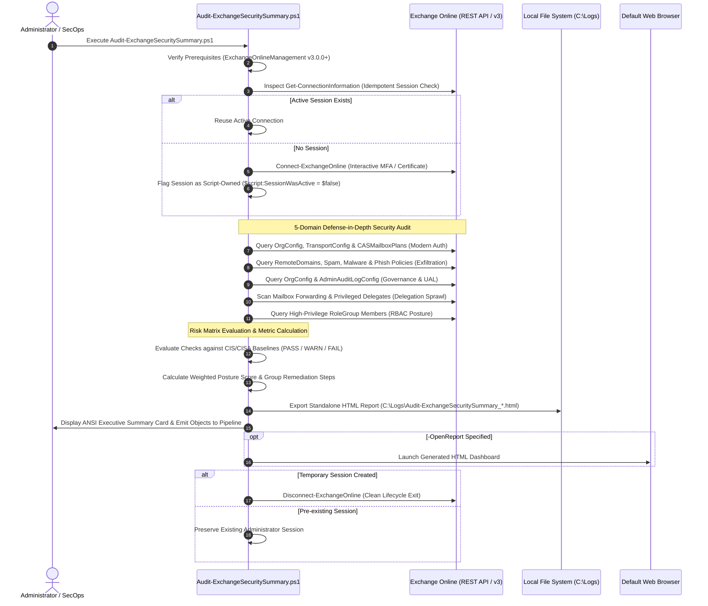

# Audit-ExchangeSecuritySummary

[](https://microsoft.com/powershell)
[](https://learn.microsoft.com/powershell/exchange/)
[](https://www.cisecurity.org/benchmark/microsoft_365)
[](https://opensource.org/licenses/MIT)

An enterprise-grade, non-intrusive (read-only) PowerShell security auditing tool engineered to evaluate Microsoft Exchange Online configurations against recognized security baselines (CIS Microsoft 365 Foundations Benchmark, CISA Microsoft 365 Baselines, and Microsoft Cloud Security Baselines). Designed, developed, and maintained by **Roman Pindela**, this utility evaluates tenant hardening posture, provides plain-English risk rationales, calculates weighted compliance posture metrics, and exports an executive-ready, standalone HTML dashboard with a prioritized remediation roadmap.

---

## 📋 Executive Overview

Securing Microsoft Exchange Online requires continuous verification across authentication mechanisms, perimeter mailflow rules, threat filtering policies, audit logging, and administrative delegation. Because configuration drift and legacy protocol exposure remain leading causes of business email compromise (BEC) and unauthorized data exfiltration, security teams need a dependable, read-only mechanism to audit tenant configurations without disrupting operational services.

`Audit-ExchangeSecuritySummary.ps1` bridges the gap between deep technical telemetry and executive visibility:
- **Strictly Read-Only (`SupportsShouldProcess = $false`)**: Zero modification commands are executed. Safe to run in production enterprise tenants, multi-tenant MSP environments, or during compliance audits.
- **5 Comprehensive Defense-in-Depth Audit Domains**:
  1. **Modern Authentication & Legacy Protocols**: Audits tenant-wide OAuth 2.0 enablement, SMTP AUTH exposure, and POP3/IMAP4/ActiveSync configurations across CAS mailbox plans.
  2. **Mail Routing & Exfiltration Protections**: Evaluates automatic external forwarding on Remote Domains, Outbound Anti-Spam auto-forwarding controls, Zero-Hour Auto Purge (ZAP) for malware and phishing, Anti-Malware file filters, and Anti-Phishing spoof intelligence.
  3. **Auditing & Governance**: Inspects organization-wide mailbox auditing (`AuditDisabled`), Unified Audit Log (UAL) ingestion, and administrative cmdlet logging.
  4. **Mailbox Delegation & Suspicious Rules**: Identifies hidden external auto-forwarding addresses on user and executive accounts, as well as high-risk delegation (`FullAccess`, `SendAs`) sprawl across administrative mailboxes.
  5. **Role-Based Access Control (RBAC)**: Audits standing memberships within high-privilege role groups (`Organization Management`, `Compliance Management`, `Security Administrator`, `Help Desk`).
- **Plain-English Threat Rationale**: Every audited control is accompanied by a business impact explanation detailing *why* the setting matters and *what threat* it mitigates.
- **Standalone Executive HTML Dashboard**: Outputs a zero-dependency, self-contained HTML5 report with embedded CSS, inline SVG graphics, interactive search and filtering, and a Priority Remediation Roadmap sorted by risk.
- **Pipeline Integration**: Emits structured `[PSCustomObject]` instances to the PowerShell pipeline for downstream SIEM ingestion, CSV export, or automated alerting.

---

## 🏗️ Technical Architecture & Workflow



---

## 🛡️ Prerequisites & Required Administrative Roles

### Minimum Software Requirements
- **PowerShell**: Windows PowerShell 5.1 or PowerShell Core 7.x (Cross-platform Windows Desktop / Server).
- **Module**: `ExchangeOnlineManagement` (v3.0.0 or later). Automatically installed for `CurrentUser` from PSGallery if missing.

### Minimum Entra ID & Exchange Online Roles
To perform this read-only audit across all five security domains, the executing identity requires one of the following Entra ID / Exchange Online administrative roles:
- **Global Reader** *(Recommended for least-privilege auditing)*
- **Security Reader**
- **Exchange Administrator**
- **Global Administrator**

---

## ⚙️ Parameter Reference

| Parameter | Type | Default Value | Description |
| :--- | :--- | :--- | :--- |
| `-ReportPath` | `string` | `"C:\Logs"` | Target directory where the standalone HTML report is saved. Automatically created if it does not exist. |
| `-OpenReport` | `switch` | `$false` | Automatically opens the generated HTML report in the default system web browser upon completion. |
| `-ShowDetailedOutput` | `switch` | `$false` | Prints in-depth plain-English risk rationales and remediation commands directly in the console stream. |
| `-AdminUserPrincipalName` | `string` | `$null` | Optional administrator UPN to pre-populate when initiating modern browser authentication. |
| `-Help` / `-h` | `switch` | `$false` | Displays interactive banner, syntax help, parameter descriptions, usage examples, and exits with code `0`. |

---

## 🚀 Usage Examples

### 1. Standard Execution (Default C:\Logs Output)
Runs the complete audit against Exchange Online, displays color-coded ANSI status updates in the console, generates the standalone HTML report in `C:\Logs`, and emits findings to the pipeline:
```powershell
.\Audit-ExchangeSecuritySummary.ps1
```

### 2. Audit and Automatically Open Executive Dashboard
Executes all defense-in-depth evaluations and immediately launches the responsive HTML dashboard in your default browser:
```powershell
.\Audit-ExchangeSecuritySummary.ps1 -OpenReport
```

### 3. Custom Output Directory with Detailed Console Rationale
Targets a custom security reports directory and prints verbose threat rationales and remediation steps in real-time:
```powershell
.\Audit-ExchangeSecuritySummary.ps1 -ReportPath "C:\SecOps\ExchangeAudits" -ShowDetailedOutput -OpenReport
```

### 4. Automated Execution with Pipeline Filtering & CSV Export
Runs non-interactively without opening a browser window, filters only failed checks, and exports them directly to CSV for ticketing or compliance evidence:
```powershell
.\Audit-ExchangeSecuritySummary.ps1 | Where-Object Status -eq 'FAIL' | Export-Csv -Path "C:\Logs\FailedExchangeControls.csv" -NoTypeInformation -Encoding UTF8
```

### 5. Display Built-In Help & Syntax Documentation
```powershell
.\Audit-ExchangeSecuritySummary.ps1 -Help
```

---

## 📊 HTML Report Structure Preview

The generated dashboard (`Audit-ExchangeSecuritySummary_<Tenant>_<Timestamp>.html`) is completely self-contained with **zero external CDN dependencies** (pure embedded CSS and inline SVG vector icons). It can be securely archived, emailed, viewed in offline or air-gapped environments, and printed to PDF for executive briefings.

```text
+---------------------------------------------------------------------------------------------------+
|  [Shield SVG] Exchange Online Security Posture Summary                                            |
|  Tenant: contoso.onmicrosoft.com | Audited: 2026-10-25 07:35:00 | Host: SEC-OPS-01 | Auditor: admin |
+---------------------------------------------------------------------------------------------------+
|  [ METRIC KPI CARDS ]                                                                             |
|  +-------------------+  +-------------------+  +-------------------+  +------------------------+  |
|  | POSTURE SCORE     |  | CHECKS EVALUATED  |  | COMPLIANT (PASS)  |  | SECURITY RISKS (FAIL)  |  |
|  |      91.2%        |  |        18         |  |        15         |  |           1            |  |
|  +-------------------+  +-------------------+  +-------------------+  +------------------------+  |
+---------------------------------------------------------------------------------------------------+
|  [ TOOLBAR ] [ Search input... ] [ Status: All | Fail | Warn | Pass ] [ Severity: Critical | High ] |
+---------------------------------------------------------------------------------------------------+
|  [ FINDING CARDS ]                                                                                |
|  +---------------------------------------------------------------------------------------------+  |
|  | [FAIL] [CRITICAL] EXO-ROUT-001  External Automatic Mail Forwarding on Remote Domains        |  |
|  | Current Setting: AutoForwardEnabled: True on domain(s): *                                   |  |
|  | Baseline Target: AutoForwardEnabled: False                                                  |  |
|  | Why This Matters: Attackers configure silent forwarding rules to exfiltrate communications. |  |
|  | Remediation: Set-RemoteDomain -Identity 'Default' -AutoForwardEnabled $false  [Copy Cmdlet] |  |
|  +---------------------------------------------------------------------------------------------+  |
+---------------------------------------------------------------------------------------------------+
|  [ PRIORITY REMEDIATION ROADMAP ]                                                                 |
|  Rank | Severity | ID           | Objective                                | Remediation Cmdlet   |
|  #1   | Critical | EXO-ROUT-001 | Disable external auto-forwarding on *    | Set-RemoteDomain ... |
|  #2   | High     | EXO-AUTH-002 | Disable tenant-wide SMTP AUTH submission | Set-TransportConfig  |
+---------------------------------------------------------------------------------------------------+
```

---

## 🔒 Security & Safe Script Execution

### Unblocking PowerShell Scripts on Windows
When downloading scripts from GitHub, Windows places an execution block on files marked with the `Zone.Identifier` alternate data stream. To unblock the script before execution, run:

```powershell
Unblock-File -Path .\Audit-ExchangeSecuritySummary.ps1
```

---

## 👨‍💻 Author & License

- **Author**: Roman Pindela
- **GitHub**: [https://github.com/romanpindela](https://github.com/romanpindela)
- **Repository**: [https://github.com/romanpindela/Microsoft-365](https://github.com/romanpindela/Microsoft-365)
- **License**: [MIT License](https://opensource.org/licenses/MIT)
