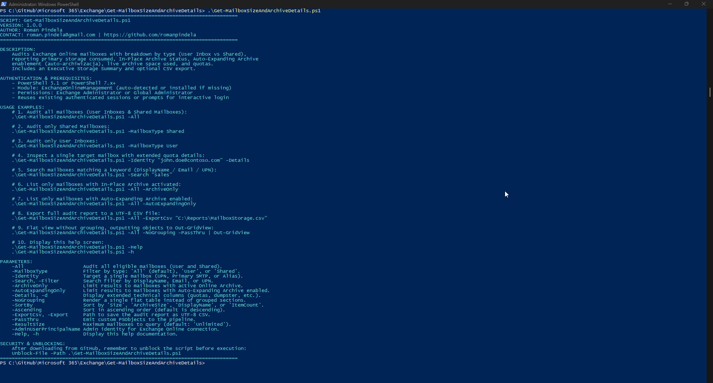
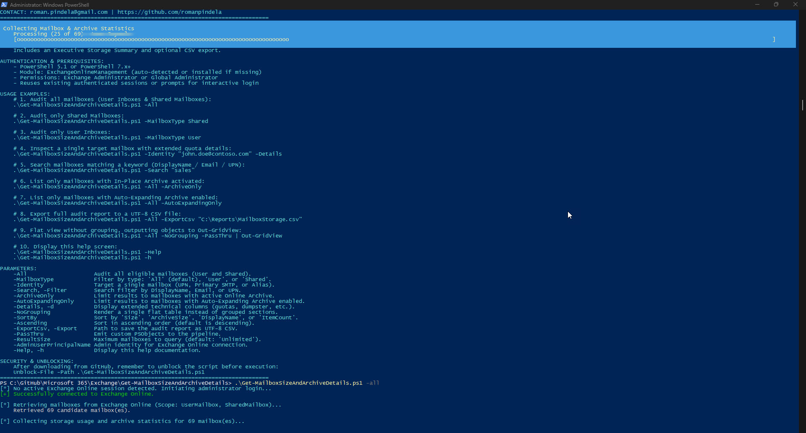
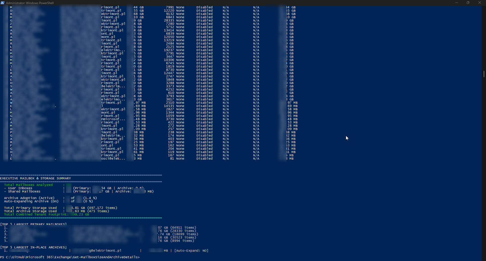

# Exchange Online Mailbox Size & Archive Telemetry Auditor

A production-grade, enterprise PowerShell automation script designed for Microsoft 365 and Exchange Online administrators. It audits tenant mailboxes, providing deep storage consumption insights with distinct categorization between **User Inboxes** and **Shared Mailboxes**, full **In-Place Archive** metrics, and **Auto-Expanding Archive** (`AutoExpandingArchiveEnabled` / auto-archiwizacja) telemetry.

---

## Key Features

- **Mailbox Type Segregation**: Organizes and presents mailboxes by category—separating **User Inboxes** (`UserMailbox`) and **Shared Mailboxes** (`SharedMailbox`) with row numbering (`Nr`).
- **Storage Consumption Telemetry**: Gathers primary mailbox volume in human-readable units (MB, GB, TB) alongside raw byte precision and total item counts.
- **In-Place Online Archive Telemetry**: Accurately reports whether Online Archive is provisioned (`Active` vs. `None`), total archived volume, and archive item counts.
- **Auto-Expanding Archive Detection**: Directly inspects the `AutoExpandingArchiveEnabled` property to verify whether Microsoft 365 auto-expanding storage (auto-archiwizacja) is active.
- **Executive Storage Summary**: Displays high-level tenant metrics including total consumed volume (Primary, Archive, and Combined), archive adoption percentages, and Top 5 storage consumers.
- **Detailed Quota & Dumpster Analysis (`-Details`, `-d`)**: Audits issue warning quotas, prohibit send/receive quotas, archive quotas, and Recoverable Items (Dumpster) size.
- **Flexible Filtering & Search**: Filter by mailbox type (`-MailboxType`), target a specific user (`-Identity`), search keywords (`-Search`), or isolate archived mailboxes (`-ArchiveOnly`, `-AutoExpandingOnly`).
- **Flexible Sorting**: Sort descending or ascending by Mailbox Size (`-SortBy Size`), Archive Size (`-SortBy ArchiveSize`), Item Count (`-SortBy ItemCount`), or Display Name (`-SortBy DisplayName`).
- **Export & Pipeline Ready**: Export complete datasets to UTF-8 CSV (`-ExportCsv`) or emit custom objects into the pipeline for `Out-GridView` or downstream automations (`-PassThru`).
- **Cross-Language Windows Elevation**: Language-independent UAC elevation using Well-Known SIDs (`BuiltInAdministratorsSid`), supporting Polish and English Windows Desktop and Server editions.
- **Security & Input Sanitization**: Defensive protection preventing command injection via regex-validated parameter handling.
- **Zero-Parameter Help Banner**: Invoking the script without arguments or with `-Help` / `-h` renders comprehensive interactive help and usage guidance.

---

## Important: Unblock File After Download

When scripts are downloaded from GitHub or external sources, Windows marks them with the `Zone.Identifier` alternate data stream. Unblock the script before executing:

```powershell
Unblock-File -Path .\Get-MailboxSizeAndArchiveDetails.ps1
```

---

## Prerequisites & Permissions

| Requirement | Details |
|---|---|
| **PowerShell Version** | Windows PowerShell 5.1 or PowerShell 7.x+ |
| **PowerShell Module** | `ExchangeOnlineManagement` (auto-detected and installed if missing) |
| **M365 Role** | Exchange Administrator, Global Reader, or Global Administrator |
| **Local Privilege** | Administrator privileges (auto-elevates via UAC SID check if needed) |

---

## Authentication Mechanism

The script leverages modern certificate and OAuth authentication via the official `ExchangeOnlineManagement` module:
- If an active Exchange Online session is already established in your PowerShell session, it is reused automatically.
- If no active session exists, an interactive Microsoft 365 login prompt is initiated.
- Use `-AdminUserPrincipalName` (`-AdminUPN`) to pre-fill your administrative tenant credentials.

---

## Parameter Reference

| Parameter | Type | Default | Description |
|---|---|---|---|
| `-All` | Switch | `False` | Audits all eligible tenant mailboxes (User and Shared). |
| `-MailboxType` | String | `'All'` | Filter mailboxes by type: `'All'`, `'User'`, or `'Shared'`. |
| `-Identity` | String | `None` | Target a specific mailbox by UPN, primary email address, or alias. |
| `-Search`, `-Filter` | String | `None` | Case-insensitive filter matching DisplayName, Email, or UPN. |
| `-ArchiveOnly` | Switch | `False` | Filters results to mailboxes with active In-Place Archive (`ArchiveStatus = Active`). |
| `-AutoExpandingOnly` | Switch | `False` | Filters results to mailboxes with Auto-Expanding Archive enabled. |
| `-Details`, `-d` | Switch | `False` | Displays extended columns: quotas, dumpster size, retention policy, and last logon. |
| `-NoGrouping` | Switch | `False` | Outputs a single flat unified table instead of grouped sections. |
| `-SortBy` | String | `'Size'` | Sort criteria: `'Size'`, `'ArchiveSize'`, `'DisplayName'`, or `'ItemCount'`. |
| `-Ascending` | Switch | `False` | Sorts in ascending order (default is descending). |
| `-ExportCsv`, `-Export`| String | `None` | Path to export the collected audit data to a UTF-8 CSV report. |
| `-PassThru` | Switch | `False` | Emits custom PowerShell objects to the pipeline. |
| `-ResultSize` | String | `'Unlimited'` | Maximum number of mailboxes to query from Exchange Online. |
| `-AdminUserPrincipalName` | String | `None` | Administrator UPN for pre-populating login credentials. |
| `-Help`, `-h` | Switch | `False` | Displays the built-in help and example usage screen. |

---

## Usage Examples

### 1. Display Built-In Help & Guidance
Running without parameters or passing `-Help` / `-h` prints the complete usage documentation:
```powershell
.\Get-MailboxSizeAndArchiveDetails.ps1 -Help
# Shorthand alias:
.\Get-MailboxSizeAndArchiveDetails.ps1 -h
```

### 2. Audit All Tenant Mailboxes (User Inboxes & Shared Mailboxes)
Scans all mailboxes in the tenant and renders grouped tables with executive telemetry:
```powershell
.\Get-MailboxSizeAndArchiveDetails.ps1 -All
```

### 3. Audit Only Shared Mailboxes
Focus specifically on Shared Mailboxes to monitor shared storage and archiving:
```powershell
.\Get-MailboxSizeAndArchiveDetails.ps1 -MailboxType Shared
```

### 4. Audit Only User Inboxes
Audit standard licensed user mailboxes:
```powershell
.\Get-MailboxSizeAndArchiveDetails.ps1 -MailboxType User
```

### 5. Inspect a Specific Mailbox with Extended Quota Details
Target a specific user or shared mailbox and display quota thresholds and dumpster details:
```powershell
.\Get-MailboxSizeAndArchiveDetails.ps1 -Identity "jan.kowalski@contoso.com" -Details
```

### 6. Filter by In-Place Archive Activation Status
Identify all mailboxes where In-Place Online Archive is actively provisioned:
```powershell
.\Get-MailboxSizeAndArchiveDetails.ps1 -All -ArchiveOnly
```

### 7. Filter by Auto-Expanding Archive Enablement
Identify mailboxes that have the auto-expanding archive (auto-archiwizacja) feature turned on:
```powershell
.\Get-MailboxSizeAndArchiveDetails.ps1 -All -AutoExpandingOnly
```

### 8. Search Mailboxes by Keyword
Search by name, email, or department prefix:
```powershell
.\Get-MailboxSizeAndArchiveDetails.ps1 -Search "finanse"
```

### 9. Export Comprehensive Report to CSV
Generate a complete management report in UTF-8 CSV format for Excel auditing:
```powershell
.\Get-MailboxSizeAndArchiveDetails.ps1 -All -ExportCsv "C:\Reports\M365_Mailbox_Archive_Report.csv"
```

### 10. Interactive GUI Inspection via Out-GridView
Display results in an interactive searchable GUI window using pipeline pass-through:
```powershell
.\Get-MailboxSizeAndArchiveDetails.ps1 -All -NoGrouping -PassThru | Out-GridView -Title "Exchange Online Mailbox & Archive Audit"
```

### 11. Sort by Archive Size Descending
Quickly identify the largest online archives in the organization:
```powershell
.\Get-MailboxSizeAndArchiveDetails.ps1 -All -SortBy ArchiveSize
```

---

## Sample Console Output

```text
================================================================================
  USER INBOXES (Skrzynki uzytkownikow) - 45 mailbox(es)
================================================================================
Nr   Display Name             Email / UPN                      Mailbox Size   Items    Archive   Auto-Expand  Archive Size   Arch. Items  Combined Size 
--   ------------             -----------                      ------------   -----    -------   -----------  ------------   -----------  ------------- 
1    Jan Kowalski             jan.kowalski@contoso.com         42.15 GB       85,420   Active    Enabled      98.40 GB       142,300      140.55 GB     
2    Anna Nowak               anna.nowak@contoso.com           31.50 GB       62,110   Active    Disabled     45.20 GB       51,800       76.70 GB      
3    Michal Wisniewski        michal.w@contoso.com             18.40 GB       29,000   None      Disabled     N/A            N/A          18.40 GB      

================================================================================
  SHARED MAILBOXES (Skrzynki wspoldzielone) - 12 mailbox(es)
================================================================================
Nr   Display Name             Email / UPN                      Mailbox Size   Items    Archive   Auto-Expand  Archive Size   Arch. Items  Combined Size 
--   ------------             -----------                      ------------   -----    -------   -----------  ------------   -----------  ------------- 
4    Faktury i Platnosci      faktury@contoso.com              48.20 GB       110,200  Active    Enabled      112.40 GB      185,000      160.60 GB     
5    Dzial Sprzedazy          sprzedaz@contoso.com             24.80 GB       45,100   None      Disabled     N/A            N/A          24.80 GB      

================================================================================
EXECUTIVE MAILBOX & STORAGE SUMMARY
================================================================================
  Total Mailboxes Analyzed     : 57
  - User Inboxes               : 45 (Primary: 312.40 GB | Archive: 620.10 GB)
  - Shared Mailboxes           : 12 (Primary: 145.80 GB | Archive: 180.50 GB)

  Archive Adoption (Active)    : 38 of 57 (66.7 %)
  Auto-Expanding Archive (On)  : 14 of 57 (24.6 %)

  Total Primary Storage Used   : 458.20 GB (1,245,100 items)
  Total Archive Storage Used   : 800.60 GB (1,920,400 items)
  Total Combined Tenant Footprint: 1.23 TB
================================================================================

[TOP 5 LARGEST PRIMARY MAILBOXES]
  1. Faktury i Platnosci          | faktury@contoso.com              |     48.20 GB (110,200 items)
  2. Jan Kowalski                 | jan.kowalski@contoso.com         |     42.15 GB (85,420 items)
  3. Anna Nowak                   | anna.nowak@contoso.com           |     31.50 GB (62,110 items)
  4. Dzial Sprzedazy              | sprzedaz@contoso.com             |     24.80 GB (45,100 items)
  5. Michal Wisniewski            | michal.w@contoso.com             |     18.40 GB (29,000 items)

[TOP 5 LARGEST IN-PLACE ARCHIVES]
  1. Faktury i Platnosci          | faktury@contoso.com              |    112.40 GB | [Auto-Expand: YES]
  2. Jan Kowalski                 | jan.kowalski@contoso.com         |     98.40 GB | [Auto-Expand: YES]
  3. Anna Nowak                   | anna.nowak@contoso.com           |     45.20 GB | [Auto-Expand: NO]
```

---

## Screenshots & Examples

### 1. Standard Run & Built-in Help


### 2. Analyzing Inboxes & Storage Telemetry


### 3. Mailbox Storage & Executive Summary Report


---

## CSV Export Fields

When exporting using `-ExportCsv`, the generated file includes full granular metrics:

| Field Name | Description |
|---|---|
| `Nr` | Sequential display index. |
| `DisplayName` | Mailbox display name. |
| `UserPrincipalName` | Mailbox User Principal Name (UPN). |
| `PrimarySmtpAddress` | Primary email address. |
| `MailboxType` | Friendly type (`User Inbox` or `Shared Mailbox`). |
| `RecipientTypeDetails` | Raw Exchange recipient type (`UserMailbox`, `SharedMailbox`). |
| `PrimaryTotalItemSize` | Formatted primary mailbox size (e.g. `24.50 GB`). |
| `PrimaryTotalItemSizeBytes` | Exact primary mailbox size in bytes (ideal for sorting). |
| `PrimaryTotalItemSizeMB` | Primary mailbox size in Megabytes (MB). |
| `PrimaryTotalItemSizeGB` | Primary mailbox size in Gigabytes (GB). |
| `PrimaryItemCount` | Number of items in primary mailbox. |
| `PrimaryDeletedItemSize` | Recoverable items (Dumpster) formatted volume. |
| `PrimaryDeletedItemSizeBytes` | Recoverable items volume in bytes. |
| `PrimaryDeletedItemCount` | Number of deleted items in Recoverable Items. |
| `PrimaryProhibitSendReceive` | Maximum mailbox send/receive quota limit. |
| `PrimaryIssueWarning` | Warning quota threshold for primary mailbox. |
| `ArchiveStatus` | In-Place Archive status (`Active` or `None`). |
| `ArchiveEnabled` | Boolean indicating whether online archive is enabled (`True`/`False`). |
| `AutoExpandingArchive` | Auto-expanding archive status (`Enabled` or `Disabled`). |
| `AutoExpandingArchiveEnabled`| Boolean indicating whether auto-expanding archive is active (`True`/`False`). |
| `ArchiveTotalItemSize` | Formatted archive size or `N/A`. |
| `ArchiveTotalItemSizeBytes` | Exact archive size in bytes. |
| `ArchiveTotalItemSizeMB` | Archive size in Megabytes (MB). |
| `ArchiveTotalItemSizeGB` | Archive size in Gigabytes (GB). |
| `ArchiveItemCount` | Number of items in the archive or `N/A`. |
| `ArchiveDeletedItemSize` | Recoverable items volume in the archive. |
| `ArchiveDeletedItemCount` | Number of deleted items in the archive. |
| `ArchiveQuota` | Maximum storage limit for the archive. |
| `ArchiveWarningQuota` | Warning quota threshold for the archive. |
| `CombinedTotalSize` | Formatted combined volume (Primary + Archive). |
| `CombinedTotalSizeBytes` | Combined volume in bytes. |
| `CombinedTotalSizeGB` | Combined volume in Gigabytes (GB). |
| `RetentionPolicy` | Name of the assigned MRM retention policy. |
| `LitigationHoldEnabled` | Boolean indicating if Litigation Hold is enabled. |
| `LastLogonTime` | Timestamp of the last recorded logon activity. |

---

## Author & Version Information

- **Author**: Roman Pindela
- **Email**: [roman.pindela@gmail.com](mailto:roman.pindela@gmail.com)
- **GitHub**: [https://github.com/romanpindela](https://github.com/romanpindela)
- **Version**: `1.0.0`
