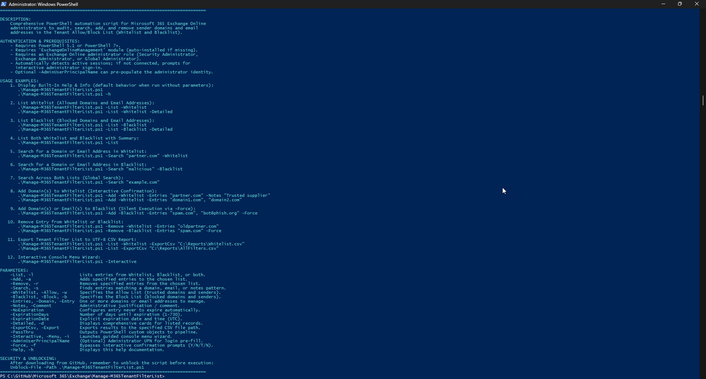

# Manage-M365TenantFilterList

A professional, enterprise-grade PowerShell automation script for Microsoft 365 and Exchange Online administrators to audit, search, add, and remove sender domains and email addresses in the **Tenant Allow/Block List (TABL)**. It enables administrators to manage organizational **Whitelists (Allow Lists)** and **Blacklists (Block Lists)** with automated conflict detection, syntax validation, flexible expiration policies, CSV reporting, and an interactive console wizard.

---

## Features

- **Tenant Whitelist Management (Allow List)**:
  - Add trusted business partner domains (e.g., `partner.com`, `*.vendor.com`) or individual sender email addresses (e.g., `alerts@partner.com`).
  - List all currently allowed domains and addresses with in-depth operational metadata (status, remaining days, expiration date, modifying admin, and notes).
  - Search specifically within allowed senders to verify whether a partner or vendor domain is permitted.
- **Tenant Blacklist Management (Block List)**:
  - Add malicious, spam, or phishing domains and email addresses tenant-wide to block incoming threats before reaching user mailboxes.
  - List all currently blocked domains and senders with administrative justification and timestamps.
  - Search specifically within blocked senders for threat investigation and security incident response.
- **Detailed Inspection & Forensic Audit**:
  - Summarizes filter lists with key operational metrics (total entries, domain count, address count, active vs. expired).
  - Detailed card view (`-Detailed`) displays full entry properties including System Identity GUIDs, UTC timestamps, and modifying administrator UPNs.
- **Fast Wildcard Search Engine**:
  - Substring and wildcard search (`-Search`) querying entry values, administrator notes, and author identities across Whitelist, Blacklist, or both simultaneously.
- **Pre-Flight Validation & Conflict Protection**:
  - Validates RFC-compliant email and domain syntax *before* connecting to cloud infrastructure.
  - Detects conflicting entries (e.g., alerts if attempting to whitelist a domain that is currently on the blacklist).
  - Automatically handles duplicate entries and trims whitespace.
- **Flexible Expiration Handling**:
  - Supports permanent rules (`-NoExpiration`), relative durations (`-ExpirationDays`), or explicit UTC deadlines (`-ExpirationDate`).
  - Respects Microsoft 365 default security guidelines (defaulting Allow entries to 30 days unless specified otherwise).
- **Interactive Console Menu Wizard**:
  - Guided console menu (`-Interactive` / `-Menu`) providing a menu-driven management experience for administrators.
- **Bilingual Confirmation & Automation Ready**:
  - Interactive confirmation prompts supporting both English (`Y`/`N`) and Polish (`T`/`N`) administrator inputs.
  - Silent, unattended automation support via `-Force`.
  - Pipeline output (`-PassThru`) and UTF-8 CSV report export (`-ExportCsv`).
- **Modern Authentication Flow**:
  - Automatically detects active Exchange Online PowerShell sessions.
  - Initiates interactive modern administrator login (MFA/MSAL) if no active session exists.
  - Supports `-AdminUserPrincipalName` to pre-populate administrative credentials.

---

## Prerequisites

- **PowerShell**: PowerShell 5.1 (Windows PowerShell) or PowerShell 7+ (cross-platform on Windows Desktop / Windows Server).
- **Exchange Online Module**: `ExchangeOnlineManagement` (v3.0.0 or later recommended).
  *If missing, the script will automatically attempt to install it for `CurrentUser` from PSGallery.*
  ```powershell
  Install-Module -Name ExchangeOnlineManagement -Scope CurrentUser -Repository PSGallery -Force
  ```
- **Administrative Permissions**: An administrative account assigned one of the following Microsoft 365 / Entra ID roles:
  - **Security Administrator**
  - **Exchange Administrator**
  - **Global Administrator**
  - Or the custom **Tenant AllowBlockList Manager** role.

---

## Security & Unblocking

When downloading PowerShell scripts from GitHub or external sources, Windows marks them with an execution restriction flag (Zone.Identifier). Unblock the script before running:

```powershell
Unblock-File -Path .\Manage-M365TenantFilterList.ps1
```

---

## Usage Examples

### 1. Display Built-In Help & Info (Default Execution)
Running the script without parameters (or using `-Help` / `-h`) displays comprehensive syntax help, parameter descriptions, usage examples, and author information:

```powershell
.\Manage-M365TenantFilterList.ps1
# or
.\Manage-M365TenantFilterList.ps1 -h
```

---

### 2. List Whitelist (Allowed Domains & Senders)
Displays all allowed sender domains and email addresses in a prioritized summary table (supports both `-List Whitelist` and `-List -Whitelist`):

```powershell
# Formatted summary table
.\Manage-M365TenantFilterList.ps1 -List Whitelist
# or
.\Manage-M365TenantFilterList.ps1 -List -Whitelist

# In-depth card view (showing GUIDs, modification dates, and notes)
.\Manage-M365TenantFilterList.ps1 -List Whitelist -Detailed
# or
.\Manage-M365TenantFilterList.ps1 -List -Whitelist -Detailed
```

---

### 3. List Blacklist (Blocked Domains & Senders)
Displays all blocked sender domains and email addresses configured in the tenant:

```powershell
# Formatted summary table
.\Manage-M365TenantFilterList.ps1 -List Blacklist
# or
.\Manage-M365TenantFilterList.ps1 -List -Blacklist

# In-depth inspection
.\Manage-M365TenantFilterList.ps1 -List Blacklist -Detailed
# or
.\Manage-M365TenantFilterList.ps1 -List -Blacklist -Detailed
```

---

### 4. Full Tenant Filter Overview (All Records)
Lists all tenant allow and block items with summary counts (Whitelist, Blacklist, Active, Expired):

```powershell
.\Manage-M365TenantFilterList.ps1 -List
```

---

### 5. Search for a Domain or Email Address in Whitelist
Checks whether a specific domain, address, or keyword exists in the Whitelist:

```powershell
.\Manage-M365TenantFilterList.ps1 -Search "partner.com" -Whitelist
```

---

### 6. Search for a Domain or Email Address in Blacklist
Searches for suspicious or blocked domains in the Blacklist:

```powershell
.\Manage-M365TenantFilterList.ps1 -Search "phishing-bank.com" -Blacklist
```

---

### 7. Global Search (Across Whitelist and Blacklist)
Finds all occurrences of a string across both lists, including administrative notes:

```powershell
.\Manage-M365TenantFilterList.ps1 -Search "contoso.com"
```

---

### 8. Add Domains to Whitelist
Adds one or more trusted domains to the tenant Whitelist with an administrative comment and confirmation:

```powershell
# Add single domain with note
.\Manage-M365TenantFilterList.ps1 -Add -Whitelist `
    -Entries "trustedpartner.com" `
    -Notes "Approved B2B vendor - Ticket #1234"

# Add multiple domains with 60-day expiration
.\Manage-M365TenantFilterList.ps1 -Add -Whitelist `
    -Entries "supplier1.com", "supplier2.com" `
    -ExpirationDays 60 `
    -Notes "Temporary project suppliers"
```

---

### 9. Add Malicious Domains / Senders to Blacklist
Adds threat domains and email addresses to the tenant Blacklist:

```powershell
# Interactive confirmation
.\Manage-M365TenantFilterList.ps1 -Add -Blacklist `
    -Entries "malicious-spammer.com", "phisher@badactor.org" `
    -Notes "Blocked due to credential phishing campaign"

# Silent execution (ideal for SOC automation and incident response)
.\Manage-M365TenantFilterList.ps1 -Add -Blacklist `
    -Entries "evil-domain.com" `
    -Notes "SOC Incident #9921" `
    -Force
```

---

### 10. Remove Entries from Whitelist or Blacklist
Removes obsolete entries from the designated list:

```powershell
# Remove from Whitelist
.\Manage-M365TenantFilterList.ps1 -Remove -Whitelist -Entries "oldpartner.com"

# Remove from Blacklist silently
.\Manage-M365TenantFilterList.ps1 -Remove -Blacklist -Entries "remediated-sender.com" -Force
```

---

### 11. Export Tenant Filter List to CSV Report
Audits all or scoped entries and exports clean UTF-8 CSV reports for compliance or backup:

```powershell
# Export Whitelist only
.\Manage-M365TenantFilterList.ps1 -List -Whitelist -ExportCsv "C:\Reports\M365_Whitelist.csv"

# Export entire Tenant Allow/Block List
.\Manage-M365TenantFilterList.ps1 -List -ExportCsv "C:\Reports\M365_TenantFilterList.csv"
```

---

### 12. Interactive Console Menu Mode
Launches a menu-driven console wizard allowing administrators to list, search, add, remove, and export filter lists interactively:

```powershell
.\Manage-M365TenantFilterList.ps1 -Interactive
# or alias
.\Manage-M365TenantFilterList.ps1 -Menu
```

---

## Parameter Reference

| Parameter | Type | Required | Description |
| :--- | :--- | :--- | :--- |
| `-List` / `-l` | `Switch` | No | Lists entries from the Tenant Allow/Block List. |
| `-Scope` / `-Type` | `String` | No | Target filter list: `All` (default), `Whitelist`, `Blacklist`, `Allow`, `Block`. Supports positional usage (e.g. `-List Whitelist`). |
| `-Add` / `-a` | `Switch` | No | Adds specified domains or email addresses to the chosen list (e.g. `-Add Whitelist domain.com`). |
| `-Remove` / `-r` | `Switch` | No | Removes specified domains or email addresses from the chosen list. |
| `-Search` / `-s` | `String` | No | Searches for domains, email addresses, or keywords in notes (e.g. `-Search "partner.com" Whitelist`). |
| `-Whitelist` / `-w` | `Switch` | No | Targets or filters the operation to the Allow List (trusted senders). |
| `-Blacklist` / `-b` | `Switch` | No | Targets or filters the operation to the Block List (blocked senders). |
| `-Entries` / `-Domain` | `String[]` | Conditional | One or more domains or email addresses to add, remove, or query. |
| `-Notes` / `-Comment` | `String` | No | Administrative comment or justification (max 500 characters). |
| `-NoExpiration` | `Switch` | No | Configures added entries never to expire automatically. |
| `-ExpirationDays` | `Int32` | No | Sets expiration to the specified number of days (1-730). |
| `-ExpirationDate` | `DateTime` | No | Sets an explicit UTC expiration date and time. |
| `-Detailed` / `-d` | `Switch` | No | Displays in-depth configuration cards with full technical details. |
| `-ExportCsv` / `-Export` | `String` | No | Exports retrieved records to a UTF-8 CSV report file. |
| `-PassThru` | `Switch` | No | Emits custom PowerShell objects to the pipeline. |
| `-Interactive` / `-Menu` | `Switch` | No | Launches the interactive console menu wizard. |
| `-AdminUserPrincipalName` | `String` | No | Administrator UPN for pre-populating Exchange Online login. |
| `-Force` / `-f` | `Switch` | No | Bypasses interactive confirmation prompts (`Y/N/T/N`). |
| `-Help` / `-h` | `Switch` | No | Displays built-in help and usage documentation. |

---

## Screenshots & Output Examples

### 1. Standard Execution (Help & Usage)


### 2. Whitelist Summary Table


### 3. Adding Entries to Whitelist & Conflict Detection


### 4. Blacklist Inspection & Search


---

## Author & Contact

- **Author**: Roman Pindela
- **Email**: [roman.pindela@gmail.com](mailto:roman.pindela@gmail.com)
- **GitHub**: [https://github.com/romanpindela](https://github.com/romanpindela)
- **Version**: 1.0.1

---

## Version History

- **v1.0.1** (2026-10-14):
  - Added positional scope argument support for `-List` (e.g. `-List Whitelist -Detailed` and `-List Blacklist`).
  - Added positional list argument resolution for `-Add` and `-Remove` (e.g. `-Add Whitelist "partner.com"`).
  - Added positional search scope support for `-Search` (e.g. `-Search "partner.com" Whitelist`).
- **v1.0.0** (2026-10-14):
  - Initial production release.
  - Support for Exchange Online Tenant Allow/Block List (TABL) for Sender domains and email addresses.
  - Whitelist (Allow) and Blacklist (Block) addition, listing, searching, and removal.
  - Comprehensive status calculation (Active/Expired, RemainingDays, UTC dates).
  - Pre-flight RFC domain/email validation and conflict detection.
  - Bilingual interactive confirmation prompts (`Y/N` and `T/N`).
  - Interactive console menu mode (`-Interactive`).
  - UTF-8 CSV export (`-ExportCsv`) and pipeline support (`-PassThru`).
  - Automatic module detection, installation, and modern administrator session handling.
