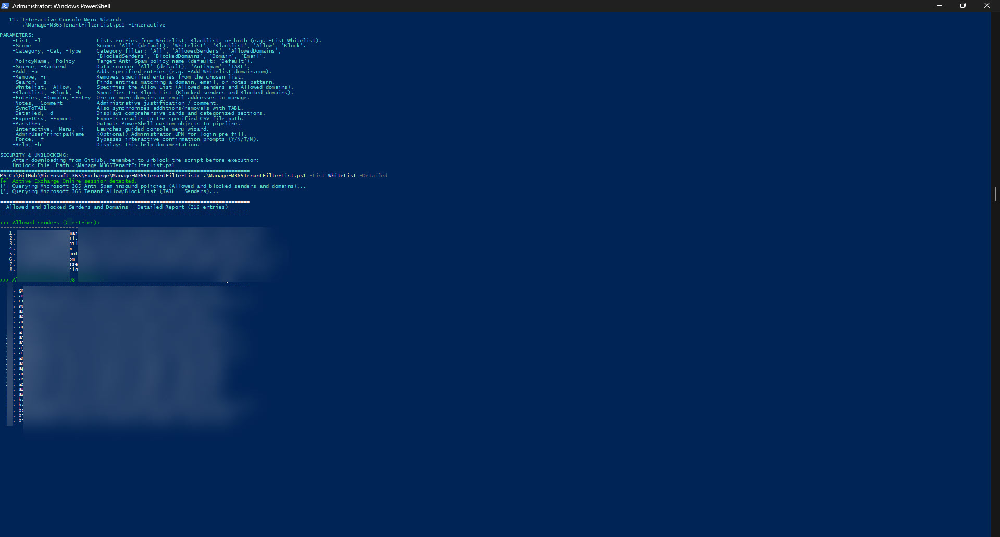
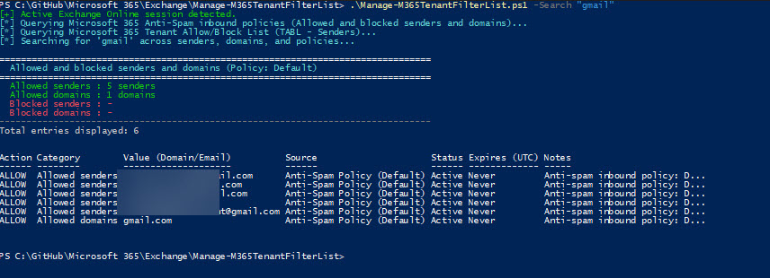

# Manage-M365TenantFilterList

A professional, enterprise-grade PowerShell automation script for Microsoft 365 and Exchange Online administrators to audit, search, add, and remove sender domains and email addresses across:
1. **Anti-Spam Inbound Policies** (`HostedContentFilterPolicy`) - specifically managing the **"Allowed and blocked senders and domains"** lists:
   - **Allowed senders** (`AllowedSenders` - trusted individual email addresses)
   - **Allowed domains** (`AllowedSenderDomains` - trusted domain names)
   - **Blocked senders** (`BlockedSenders` - blocked individual email addresses)
   - **Blocked domains** (`BlockedSenderDomains` - blocked domain names)
2. **Tenant Allow/Block List (TABL)** (`TenantAllowBlockListItems`) for organization-wide security overrides.

---

## Features

- **Allowed and Blocked Senders and Domains (Anti-Spam Inbound Policies)**:
  - **Allowed Senders**: Audits and manages individual external email addresses allowed to bypass content filtering.
  - **Allowed Domains**: Audits and manages external domains (e.g., 200+ partner and supplier domains) allowed to bypass content filtering.
  - **Blocked Senders**: Audits and manages specific external email addresses blocked from sending mail into the tenant.
  - **Blocked Domains**: Audits and manages domains blocked from sending mail into the tenant.
- **Tenant Allow/Block List (TABL) Integration**:
  - Automatically queries and displays entries from the Microsoft Defender Tenant Allow/Block List alongside policy-level rules.
  - Optional `-SyncToTABL` switch to synchronize allow/block actions across both Anti-Spam policies and TABL simultaneously.
- **Exact Microsoft Defender Portal Alignment**:
  - Displays summary statistics matching the security portal view:
    ```text
    Allowed senders : 8 senders
    Allowed domains : 208 domains
    Blocked senders : - (0 senders)
    Blocked domains : 1 domains
    ```
- **Category & Type Filtering**:
  - Filter listings by category (`-Category AllowedDomains`, `-Category AllowedSenders`, `-Category BlockedDomains`, `-Category BlockedSenders`).
  - Or filter by type (`-Type Domain` vs `-Type Email`).
- **Detailed Forensic Card View**:
  - Detailed inspection view (`-Detailed`) groups entries by category with item numbers, sources, and active statuses.
- **Fast Wildcard Search Engine**:
  - Searches across all 200+ domains, senders, notes, and policies with `-Search "keyword"`.
- **Pre-Flight Validation & Conflict Protection**:
  - Validates RFC-compliant domain and email syntax before initiating cloud transactions.
  - Detects if an entry already exists in the opposing list (e.g., warns if attempting to allow an already blocked domain).
- **Interactive Console Menu Wizard**:
  - Full-featured console menu (`-Interactive` / `-Menu`) with 10 guided options for quick day-to-day administration.
- **Bilingual Confirmation & Automation Ready**:
  - Supports English (`Y`/`N`) and Polish (`T`/`N`) administrator inputs.
  - Silent unattended automation via `-Force`.
  - UTF-8 CSV report export via `-ExportCsv`.
- **Modern Authentication Flow**:
  - Auto-detects active Exchange Online sessions; prompts for interactive modern administrator login if needed.

---

## Prerequisites

- **PowerShell**: PowerShell 5.1 (Windows PowerShell) or PowerShell 7+ (cross-platform on Windows Desktop / Windows Server).
- **Exchange Online Module**: `ExchangeOnlineManagement` (v3.0.0 or later recommended).
  *If missing, the script will automatically attempt to install it for `CurrentUser` from PSGallery.*
  ```powershell
  Install-Module -Name ExchangeOnlineManagement -Scope CurrentUser -Repository PSGallery -Force
  ```
- **Administrative Permissions**: An administrative account assigned one of the following Microsoft 365 / Entra ID roles:
  - **Security Administrator**
  - **Exchange Administrator**
  - **Global Administrator**

---

## Security & Unblocking

When downloading PowerShell scripts from GitHub or external sources, Windows marks them with an execution restriction flag (Zone.Identifier). Unblock the script before executing:

```powershell
Unblock-File -Path .\Manage-M365TenantFilterList.ps1
```

---

## Usage Examples

### 1. Display Built-In Help & Info (Default Execution)
Running without parameters (or with `-Help` / `-h`) displays detailed help, syntax, author, and usage examples:

```powershell
.\Manage-M365TenantFilterList.ps1
# or
.\Manage-M365TenantFilterList.ps1 -h
```

---

### 2. List Allowed Senders and Allowed Domains (Whitelist)
Displays summary counts and all allowed senders and domains (e.g. 208 domains, 8 senders):

```powershell
# Formatted summary table
.\Manage-M365TenantFilterList.ps1 -List Whitelist
# or
.\Manage-M365TenantFilterList.ps1 -List -Whitelist

# In-depth categorized view (grouped into Allowed senders and Allowed domains)
.\Manage-M365TenantFilterList.ps1 -List Whitelist -Detailed
```

---

### 3. Filter Whitelist by Specific Category or Type
Display only allowed domains or only allowed senders:

```powershell
# List only Allowed Domains (e.g. 208 domains)
.\Manage-M365TenantFilterList.ps1 -List Whitelist -Category AllowedDomains

# List only Allowed Senders (e.g. 8 senders)
.\Manage-M365TenantFilterList.ps1 -List Whitelist -Category AllowedSenders
```

---

### 4. List Blocked Senders and Blocked Domains (Blacklist)
Displays all blocked senders and domains configured in the tenant:

```powershell
# Formatted summary table
.\Manage-M365TenantFilterList.ps1 -List Blacklist
# or
.\Manage-M365TenantFilterList.ps1 -List -Blacklist

# Detailed card view
.\Manage-M365TenantFilterList.ps1 -List Blacklist -Detailed
```

---

### 5. Full Tenant Overview (All Senders & Domains)
Displays the complete breakdown of Allowed senders, Allowed domains, Blocked senders, and Blocked domains:

```powershell
.\Manage-M365TenantFilterList.ps1 -List All
# or
.\Manage-M365TenantFilterList.ps1 -List
```

---

### 6. Search for a Domain or Email Address
Searches across all lists, senders, domains, and policy names:

```powershell
# Search everywhere
.\Manage-M365TenantFilterList.ps1 -Search "partner.com"

# Search specifically within Whitelist
.\Manage-M365TenantFilterList.ps1 -Search "partner.com" Whitelist

# Search specifically within Blacklist
.\Manage-M365TenantFilterList.ps1 -Search "malicious" Blacklist
```

---

### 7. Add Domain or Email Address to Whitelist
Adds a domain to `AllowedSenderDomains` or an email address to `AllowedSenders` in the Anti-Spam policy:

```powershell
# Add trusted domain to Allowed Domains
.\Manage-M365TenantFilterList.ps1 -Add Whitelist "trustedpartner.com"

# Add sender email to Allowed Senders with note
.\Manage-M365TenantFilterList.ps1 -Add Whitelist "alerts@supplier.com" -Notes "Supplier notifications"

# Add multiple domains with explicit parameters
.\Manage-M365TenantFilterList.ps1 -Add -Whitelist `
    -Entries "supplier1.com", "supplier2.com" `
    -Notes "B2B integration project"
```

---

### 8. Add Domain or Email Address to Blacklist
Adds a domain to `BlockedSenderDomains` or an email address to `BlockedSenders`:

```powershell
# Add blocked domain silently (-Force)
.\Manage-M365TenantFilterList.ps1 -Add Blacklist "spammer.com" -Force

# Add blocked sender address
.\Manage-M365TenantFilterList.ps1 -Add Blacklist "badactor@evil.org" -Force
```

---

### 9. Remove Entry from Whitelist or Blacklist
Removes obsolete entries from the appropriate list in the Anti-Spam policy:

```powershell
# Remove domain from Allowed Domains
.\Manage-M365TenantFilterList.ps1 -Remove Whitelist "oldpartner.com"

# Remove sender email from Allowed Senders
.\Manage-M365TenantFilterList.ps1 -Remove Whitelist "inactive@supplier.com"

# Remove blocked domain from Blacklist silently
.\Manage-M365TenantFilterList.ps1 -Remove Blacklist "unblocked-vendor.com" -Force
```

---

### 10. Export Filter Entries to CSV Report
Exports the entire configuration or scoped lists to a UTF-8 CSV report:

```powershell
# Export Whitelist (Allowed senders and domains)
.\Manage-M365TenantFilterList.ps1 -List Whitelist -ExportCsv "C:\Reports\M365_AllowedSendersAndDomains.csv"

# Export complete tenant filter configuration
.\Manage-M365TenantFilterList.ps1 -List All -ExportCsv "C:\Reports\M365_AllFilterLists.csv"
```

---

### 11. Interactive Console Menu Mode
Launches a menu-driven console wizard allowing administrators to list, inspect, search, add, and remove entries interactively:

```powershell
.\Manage-M365TenantFilterList.ps1 -Interactive
# or alias
.\Manage-M365TenantFilterList.ps1 -Menu
```

---

## Parameter Reference

| Parameter | Type | Required | Description |
| :--- | :--- | :--- | :--- |
| `-List` / `-l` | `Switch` | No | Lists entries from the specified scope. |
| `-Scope` | `String` | No | List scope: `All` (default), `Whitelist`, `Blacklist`, `Allow`, `Block`. Supports positional usage (e.g. `-List Whitelist`). |
| `-Category` / `-Cat` / `-Type` | `String` | No | Category filter: `All` (default), `AllowedSenders`, `AllowedDomains`, `BlockedSenders`, `BlockedDomains`, `Domain`, `Email`. |
| `-PolicyName` / `-Policy` | `String` | No | Name of the Anti-Spam inbound policy (default: `'Default'`). |
| `-Source` / `-Backend` | `String` | No | Target repository: `All` (default), `AntiSpam`, `TABL`. |
| `-Add` / `-a` | `Switch` | No | Adds specified domains or email addresses (e.g. `-Add Whitelist domain.com`). |
| `-Remove` / `-r` | `Switch` | No | Removes specified domains or email addresses. |
| `-Search` / `-s` | `String` | No | Searches across all senders, domains, and policies. |
| `-SearchScope` | `String` | No | Scope for search: `All` (default), `Whitelist`, `Blacklist`, `Allow`, `Block`. |
| `-Whitelist` / `-w` | `Switch` | No | Targets or filters to Allowed senders and Allowed domains. |
| `-Blacklist` / `-b` | `Switch` | No | Targets or filters to Blocked senders and Blocked domains. |
| `-Entries` / `-Domain` | `String[]` | Conditional | One or more domains or email addresses to add or remove. |
| `-Notes` / `-Comment` | `String` | No | Administrative comment or justification (max 500 characters). |
| `-SyncToTABL` | `Switch` | No | Also synchronizes additions/removals with the Tenant Allow/Block List (TABL). |
| `-Detailed` / `-d` | `Switch` | No | Displays in-depth categorized cards with item numbers. |
| `-ExportCsv` / `-Export` | `String` | No | Exports retrieved records to a UTF-8 CSV report file. |
| `-PassThru` | `Switch` | No | Emits custom PowerShell objects to the pipeline. |
| `-Interactive` / `-Menu` | `Switch` | No | Launches the interactive console menu wizard. |
| `-AdminUserPrincipalName` | `String` | No | Administrator UPN for pre-populating Exchange Online login. |
| `-Force` / `-f` | `Switch` | No | Bypasses interactive confirmation prompts (`Y/N/T/N`). |
| `-Help` / `-h` | `Switch` | No | Displays built-in help and usage documentation. |

---

## Screenshots & Output Examples

### 1. Standard Execution (Help & Usage)


### 2. Whitelist Summary Table (Allowed Senders and Domains)


### 3. Searching Across Senders and Domains


---

## Author & Contact

- **Author**: Roman Pindela
- **Email**: [roman.pindela@gmail.com](mailto:roman.pindela@gmail.com)
- **GitHub**: [https://github.com/romanpindela](https://github.com/romanpindela)
- **Version**: 1.1.1

---

## Version History

- **v1.1.1** (2026-10-14):
  - Fixed `PropertyNotFoundException` on `.Count` under PowerShell `Set-StrictMode -Version Latest`.
  - Wrapped filtered query collections, summary counters, and search results in `@()` array subexpressions to guarantee robust `.Count` evaluation on empty or single-item results.
- **v1.1.0** (2026-10-14):
  - Added native integration for Anti-Spam Inbound Policies (`HostedContentFilterPolicy`):
    * **Allowed senders** (`AllowedSenders`)
    * **Allowed domains** (`AllowedSenderDomains`)
    * **Blocked senders** (`BlockedSenders`)
    * **Blocked domains** (`BlockedSenderDomains`)
  - Integrated summary counts matching Microsoft Defender portal view (e.g. 208 domains, 8 senders).
  - Added `-Category` and `-Type` filters (`AllowedDomains`, `AllowedSenders`, `BlockedDomains`, `BlockedSenders`).
  - Added `-PolicyName` parameter (default: `Default`) and `-Source` selection (`AntiSpam`, `TABL`, `All`).
  - Updated Add/Remove operations to manage policy-level `AllowedSenders`, `AllowedSenderDomains`, `BlockedSenders`, and `BlockedSenderDomains` with optional `-SyncToTABL`.
- **v1.0.1** (2026-10-14):
  - Added positional scope argument support for `-List` (e.g. `-List Whitelist -Detailed` and `-List Blacklist`).
  - Added positional list argument resolution for `-Add` and `-Remove` (e.g. `-Add Whitelist "partner.com"`).
  - Added positional search scope support for `-Search` (e.g. `-Search "partner.com" Whitelist`).
- **v1.0.0** (2026-10-14):
  - Initial release with Tenant Allow/Block List (TABL) support.
