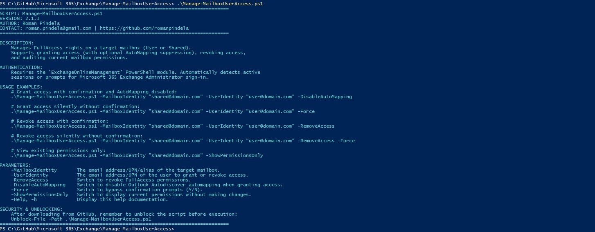
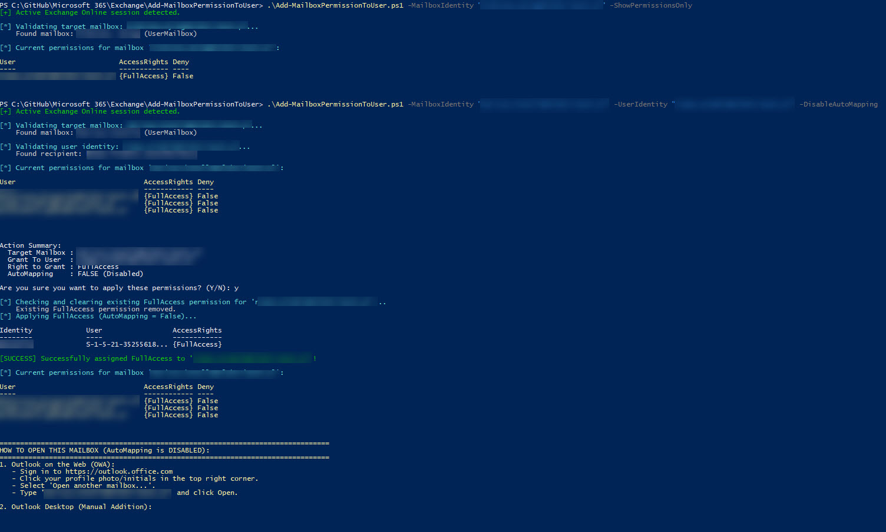
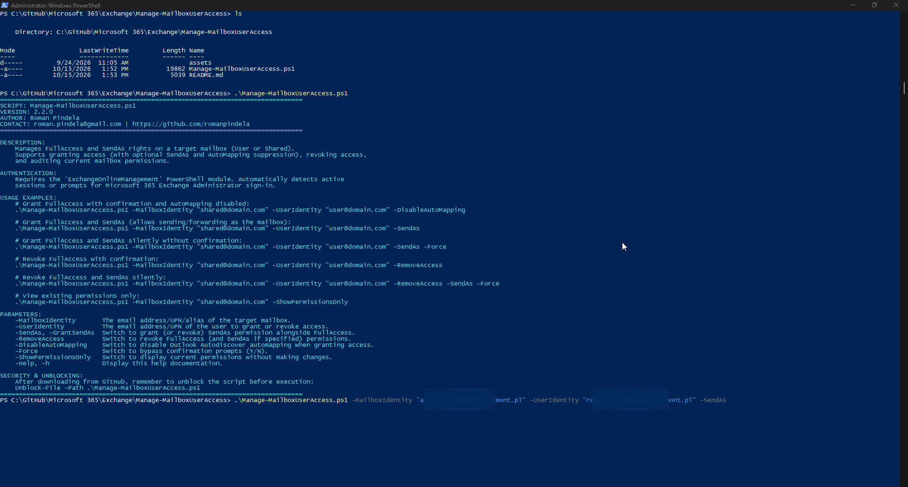
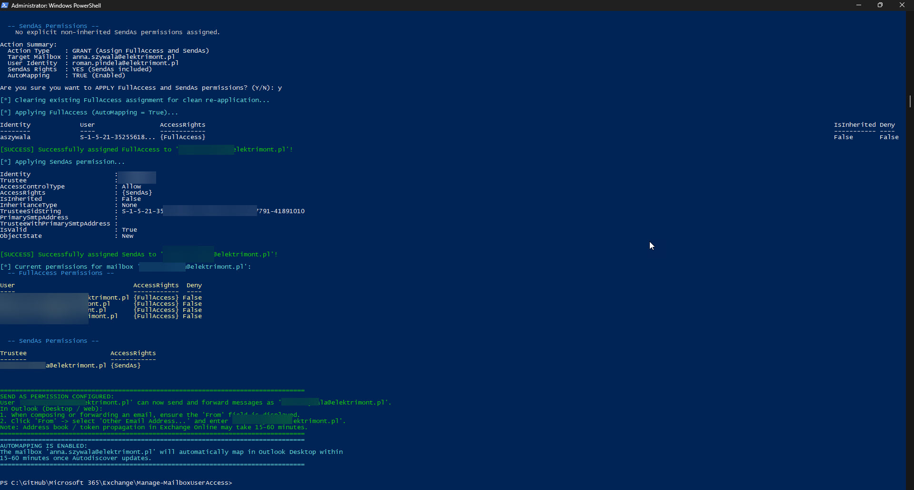

# Manage-MailboxUserAccess

A comprehensive PowerShell automation script for Microsoft 365 Exchange Online administrators to manage mailbox access permissions. It allows administrators to **grant** `FullAccess` and `SendAs` rights (with optional **AutoMapping** control), **revoke** existing permissions, run silent automated tasks via **Force**, and audit existing permissions.

## Features

- **Grant & Revoke Permissions**: Assign or remove `FullAccess` rights on both `UserMailbox` and `SharedMailbox` objects.
- **Send As Delegation**: Support for granting or revoking `SendAs` recipient permissions via `-SendAs` (alias `-GrantSendAs`), enabling delegated users to send and forward messages directly as the target mailbox.
- **AutoMapping Suppression**: Optional `-DisableAutoMapping` switch prevents Outlook Desktop from auto-mounting delegated mailboxes.
- **Confirmation & Automation**: Includes interactive `(Y/N)` confirmation prompts by default, with a `-Force` switch to bypass prompts for CI/CD or scripting.
- **Audit Mode**: Use `-ShowPermissionsOnly` to inspect explicit mailbox permissions (both `FullAccess` and `SendAs`) without modifying any settings.
- **Identity Pre-Validation**: Validates that both the target mailbox and the specified user exist in the Microsoft 365 tenant before taking action.
- **Session Auto-Detection**: Checks for active Exchange Online sessions and initiates modern administrator login if not connected.

## Prerequisites

- PowerShell 5.1 or PowerShell 7+
- `ExchangeOnlineManagement` module:
  ```powershell
  Install-Module -Name ExchangeOnlineManagement -Scope CurrentUser
  ```
- Exchange Online administrative role (e.g., Exchange Administrator or Global Administrator).

## Security & Unblocking

When downloading scripts from GitHub, unblock the file before running:

```powershell
Unblock-File -Path .\Manage-MailboxUserAccess.ps1
```

## Parameters

| Parameter | Type | Description |
| :--- | :--- | :--- |
| `-MailboxIdentity` | String | Email address, UPN, or alias of the target mailbox (User or Shared). |
| `-UserIdentity` | String | Email address or UPN of the user receiving or losing access permissions. |
| `-SendAs` | Switch | Grants `SendAs` permission alongside `FullAccess` (allowing sending/forwarding as the mailbox). When used with `-RemoveAccess`, revokes `SendAs`. Alias: `-GrantSendAs`. |
| `-DisableAutoMapping` | Switch | Disables Outlook Autodiscover automapping when granting access, avoiding automatic mailbox mounting. |
| `-RemoveAccess` | Switch | Revokes `FullAccess` (and `SendAs` if specified) permissions from the user. |
| `-Force` | Switch | Bypasses interactive `(Y/N)` confirmation prompts for automated scripts or pipelines. |
| `-ShowPermissionsOnly`| Switch | Displays explicit `FullAccess` and `SendAs` permissions on the mailbox and exits. |
| `-Help` / `-h` | Switch | Displays script syntax, parameter details, and usage examples. |

## Usage Examples

### 1. View Mailbox Permissions Only (Audit Mode)

```powershell
.\Manage-MailboxUserAccess.ps1 -MailboxIdentity "sales@domain.com" -ShowPermissionsOnly
```

### 2. Grant FullAccess with AutoMapping Disabled (Interactive)

```powershell
.\Manage-MailboxUserAccess.ps1 -MailboxIdentity "sales@domain.com" -UserIdentity "admin@domain.com" -DisableAutoMapping
```

### 3. Grant FullAccess and SendAs Permissions

```powershell
# Grants FullAccess and SendAs (user can open mailbox and send/forward emails as sales@domain.com)
.\Manage-MailboxUserAccess.ps1 -MailboxIdentity "sales@domain.com" -UserIdentity "admin@domain.com" -SendAs
```

### 4. Grant FullAccess and SendAs with AutoMapping Disabled

```powershell
.\Manage-MailboxUserAccess.ps1 -MailboxIdentity "sales@domain.com" -UserIdentity "admin@domain.com" -DisableAutoMapping -SendAs
```

### 5. Grant Access Silently (Automated / Non-Interactive)

```powershell
.\Manage-MailboxUserAccess.ps1 -MailboxIdentity "sales@domain.com" -UserIdentity "admin@domain.com" -SendAs -Force
```

### 6. Revoke Access with Interactive Confirmation

```powershell
.\Manage-MailboxUserAccess.ps1 -MailboxIdentity "sales@domain.com" -UserIdentity "admin@domain.com" -RemoveAccess
```

### 7. Revoke FullAccess and SendAs Permissions

```powershell
.\Manage-MailboxUserAccess.ps1 -MailboxIdentity "sales@domain.com" -UserIdentity "admin@domain.com" -RemoveAccess -SendAs
```

### 8. Revoke Access Silently

```powershell
.\Manage-MailboxUserAccess.ps1 -MailboxIdentity "sales@domain.com" -UserIdentity "admin@domain.com" -RemoveAccess -SendAs -Force
```

### 9. Display Built-In Help

```powershell
.\Manage-MailboxUserAccess.ps1 -h
```

## Screenshots & Examples

### Info run


### Changing permission


### Granting Send As permissions


### Applying FullAccess and SendAs with summary


---

## Author & Contact

* **Author**: Roman Pindela
* **Email**: [roman.pindela@gmail.com](mailto:roman.pindela@gmail.com)
* **GitHub**: [https://github.com/romanpindela](https://github.com/romanpindela)
* **Version**: 2.2.0
