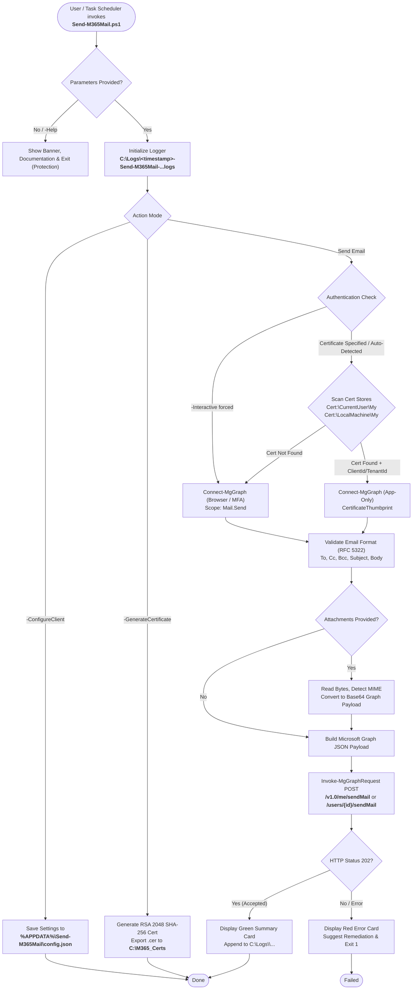
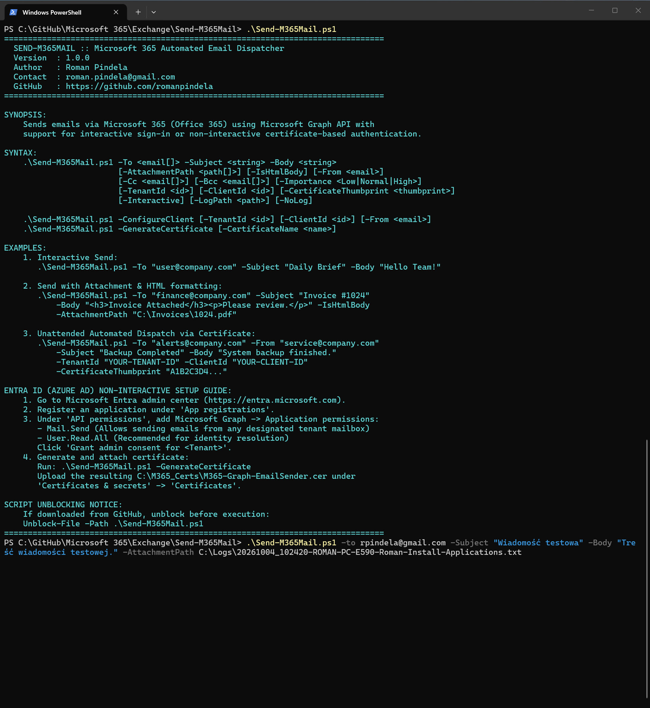
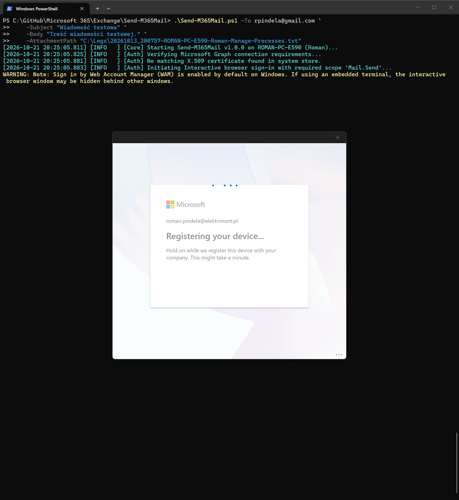
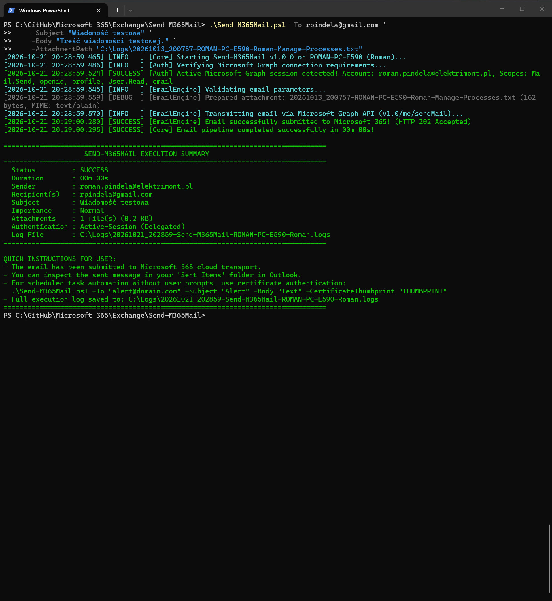

# Send-M365Mail

[](https://microsoft.com/powershell)
[](https://learn.microsoft.com/graph/)
[](https://admin.microsoft.com/)
[](https://opensource.org/licenses/MIT)

An enterprise-grade PowerShell automation script for sending emails via **Microsoft 365 (Office 365)** using the **Microsoft Graph API**. Developed and maintained by **Roman Pindela**, this utility supports dual authentication modes: **interactive delegated sign-in (with MFA)** and **unattended non-interactive certificate-based daemon authentication (X.509)**, complete with MIME attachment encoding, client configuration deployment, color-coded execution tracking, and persistent enterprise logging.

---

## 📋 Overview

`Send-M365Mail.ps1` modernizes email dispatching in Microsoft 365 environments. Because Microsoft has permanently disabled Basic Authentication and legacy SMTP AUTH in many modern tenants, automation workflows require **OAuth 2.0 / Modern Authentication** via Microsoft Graph.

This tool solves these automation challenges by providing a seamless, robust, and clean PowerShell interface that automatically determines the best authentication method, validates recipient addresses, encodes attachments into RFC-compliant Graph payloads, logs every operation, and displays an informative execution summary.

### Key Capabilities:
1. **Intelligent Dual Authentication**:
   - **Certificate Auto-Discovery**: Automatically inspects the local Windows Certificate Store (`Cert:\CurrentUser\My` and `Cert:\LocalMachine\My`) for installed M365/Graph certificates, or accepts an explicit `-CertificateThumbprint`.
   - **Interactive Browser Fallback**: If no certificate is found or specified, it seamlessly initiates an interactive delegated session (`Connect-MgGraph -Scopes "Mail.Send", "User.Read"`).
2. **Client Configuration & Deployment**:
   - Allows one-time client setup (`-ConfigureClient`) that caches `TenantId`, `ClientId`, and default sender settings in `%APPDATA%\Send-M365Mail\config.json`.
   - Built-in certificate generation (`-GenerateCertificate`) creating a 2048-bit RSA SHA-256 certificate ready for Entra ID app registration.
3. **MIME & Attachment Processing**:
   - Accepts multiple file paths via `-AttachmentPath`.
   - Dynamically resolves MIME types and converts files into Base64-encoded Graph file attachments.
4. **Rich Content & Priority Controls**:
   - Supports plain text and rich HTML bodies (`-IsHtmlBody`).
   - Supports `-Importance` (`Low`, `Normal`, `High`), `-Cc`, and `-Bcc` recipients.
   - Option to automatically save outgoing messages to the sender's *Sent Items* folder (`-SaveToSentItems`).
5. **Detailed Enterprise Logging**:
   - Mandatory logging writing to `C:\Logs\<timestamp>-Send-M365Mail-<computer>-<user>.logs`.
   - Color-coded console feedback for every step (`[INFO]`, `[SUCCESS]`, `[WARNING]`, `[ERROR]`, `[DEBUG]`).
6. **Defensive Input Validation & Cross-Language Support**:
   - Validates email formats using RFC 5322 regex.
   - Fully compatible with Polish and English versions of Windows Desktop and Windows Server.
   - Safe execution: running the script without arguments displays full syntax help instead of throwing cryptic errors.

---

## 🏗️ Technical Architecture & How It Works



---

## 🔐 How to Configure Microsoft Entra ID for Non-Interactive Authentication

To execute this script unattended (e.g. via **Windows Task Scheduler**, DevOps pipelines, or monitoring alerts) without interactive MFA prompts, configure an application in Microsoft Entra ID:

### Step 1: Register an Application in Microsoft Entra ID
1. Sign in to the [Microsoft Entra Admin Center](https://entra.microsoft.com).
2. Go to: **Identity** > **Applications** > **App registrations** > **New registration**.
3. Name the application (e.g., `M365-Automated-Mailer`).
4. Select **Accounts in this organizational directory only (Single tenant)**.
5. Leave the Redirect URI blank and click **Register**.
6. Copy the **Application (client) ID** and **Directory (tenant) ID** from the application's overview page.

### Step 2: Configure Microsoft Graph API Permissions
1. Under **Manage**, select **API permissions**.
2. Click **Add a permission** > Select **Microsoft Graph**.
3. Select **Application permissions** *(essential for unattended daemon execution)*.
4. Search for and select:
   - `Mail.Send` — Grants permission to send emails as any user or shared mailbox in the organization.
   - `User.Read.All` *(Optional but recommended)* — For mailbox verification.
5. Click **Add permissions**.
6. Click **Grant admin consent for [Your Organization]** and confirm. Ensure the status turns to a green checkmark.

### Step 3: Generate and Upload Certificate
You can generate a compliant self-signed certificate directly using this script:

```powershell
.\Send-M365Mail.ps1 -GenerateCertificate
```

This generates a 2048-bit RSA certificate in `Cert:\CurrentUser\My` and exports the public key to:
`C:\M365_Certs\M365-Graph-EmailSender.cer`

1. In the Entra Admin Center, navigate to **Manage** > **Certificates & secrets** > **Certificates** tab.
2. Click **Upload certificate** and select `C:\M365_Certs\M365-Graph-EmailSender.cer`.
3. Note the Thumbprint generated in the console.

### Step 4: (Optional) Save Client Configuration Locally
Run the configuration command once on the machine so you don't have to specify Tenant and Client IDs every time:

```powershell
.\Send-M365Mail.ps1 -ConfigureClient `
    -TenantId "YOUR-TENANT-ID" `
    -ClientId "YOUR-CLIENT-ID" `
    -From "notifications@yourdomain.com"
```

---

## 🛠️ Prerequisites

- **Operating System**: Windows 10, Windows 11, Windows Server 2016 / 2019 / 2022 / 2025 (Polish or English language editions).
- **PowerShell**: Windows PowerShell 5.1 or PowerShell 7.x (Core).
- **PowerShell Module**: `Microsoft.Graph.Authentication`
  ```powershell
  Install-Module -Name Microsoft.Graph.Authentication -Scope CurrentUser -Repository PSGallery -Force
  ```
  *(The script will automatically detect if the module is missing and offer to install it interactively).*

---

## 🛡️ Security & Script Unblocking

When cloning or downloading PowerShell scripts from GitHub, Windows attaches an execution security zone identifier. Before first use, unblock the script:

```powershell
Unblock-File -Path .\Send-M365Mail.ps1
```

---

## 🚀 Usage Examples

### 1. View Built-in Help & Syntax Reference
Running without parameters or using `-Help` / `-h` displays custom help, usage instructions, author information, and security guidance:

```powershell
.\Send-M365Mail.ps1
# Or explicitly:
.\Send-M365Mail.ps1 -Help
```

### 2. Interactive Sign-In (Delegated User Session)
Sends an email as the currently signed-in user. If not logged in, opens a browser for modern authentication with MFA:

```powershell
.\Send-M365Mail.ps1 -To "colleague@company.com" `
    -Subject "Project Update - Milestone 2" `
    -Body "Hello, please find the latest updates on our project milestone."
```

### 3. Send HTML Email with File Attachment
```powershell
.\Send-M365Mail.ps1 -To "accounting@company.com" `
    -Subject "Invoice #2026-10-88" `
    -Body "<h3>Invoice for Services</h3><p>Attached is the invoice for October 2026.</p>" `
    -IsHtmlBody `
    -AttachmentPath "C:\Billing\Invoice_20261088.pdf"
```

### 4. Send with Multiple Attachments, CC, and High Importance
```powershell
.\Send-M365Mail.ps1 -To "manager@company.com" `
    -Cc "lead@company.com" `
    -Subject "Critical: Server Incident Report" `
    -Body "Incident resolved. Detailed logs and post-mortem report attached." `
    -AttachmentPath "C:\Reports\Incident_Logs.zip", "C:\Reports\PostMortem.pdf" `
    -Importance High
```

### 5. Automated / Unattended Background Sending via Certificate
Ideal for scheduled tasks, batch scripts, and server notifications:

```powershell
.\Send-M365Mail.ps1 -To "admin-alerts@company.com" `
    -From "svc-backup@company.com" `
    -Subject "Daily Backup Report: Success" `
    -Body "All database backups completed successfully at $(Get-Date)." `
    -TenantId "11111111-2222-3333-4444-555555555555" `
    -ClientId "aaaaaaaa-bbbb-cccc-dddd-eeeeeeeeeeee" `
    -CertificateThumbprint "A1B2C3D4E5F60718293A4B5C6D7E8F9012345678"
```

### 6. Automated Certificate Generation
```powershell
.\Send-M365Mail.ps1 -GenerateCertificate
```


---

## 📸 Visual Walkthrough & Screenshots

### 1. Standard Run & Interactive Help (`.\Send-M365Mail.ps1`)
Running without parameters or using `-Help` / `-h` immediately displays the syntax, options, and Entra ID configuration guide:



### 2. Interactive Microsoft 365 Authorization & Consent
When running interactively, the browser prompts modern authentication and requests the necessary `Mail.Send` permission:



### 3. Successful Email Transmission & Execution Confirmation
The email with attachment is submitted to Microsoft 365 cloud transport (HTTP 202 Accepted) with full execution summary and persistent log file:



---

## ⚙️ Parameters Reference

| Parameter | Type | Required | Description | Aliases |
| :--- | :--- | :---: | :--- | :--- |
| `-To` | `String[]` | **Yes\*** | One or more recipient email addresses. | `Recipient`, `RecipientEmail`, `User` |
| `-Subject` | `String` | **Yes\*** | Subject line of the email. | `Title` |
| `-Body` | `String` | **Yes\*** | Body text or HTML content. | `Content`, `Message` |
| `-AttachmentPath` | `String[]` | No | File paths to attach. Encoded automatically into Base64. | `Attachment`, `Attachments`, `FilePath` |
| `-IsHtmlBody` | `Switch` | No | Specifies that `-Body` contains HTML formatting. | `Html`, `HtmlBody` |
| `-From` | `String` | No\*\* | Sender mailbox address (required in App-Only / Certificate mode). | `Sender`, `SenderEmail` |
| `-Cc` | `String[]` | No | Carbon copy recipient email addresses. | - |
| `-Bcc` | `String[]` | No | Blind carbon copy recipient email addresses. | - |
| `-Importance` | `String` | No | Message importance: `Low`, `Normal`, or `High`. Default: `Normal`. | - |
| `-SaveToSentItems` | `Boolean` | No | Save copy in Sent Items folder. Default: `$true`. | - |
| `-TenantId` | `String` | No | Entra ID Directory (Tenant) ID. | `Tenant`, `DirectoryId` |
| `-ClientId` | `String` | No | Entra ID Application (Client) ID. | `AppId`, `ApplicationId` |
| `-CertificateThumbprint` | `String` | No | Thumbprint of installed X.509 certificate. | `Thumbprint` |
| `-Interactive` | `Switch` | No | Forces interactive browser sign-in. | - |
| `-ConfigureClient` | `Switch` | No | Saves default settings to local `%APPDATA%` profile. | - |
| `-GenerateCertificate` | `Switch` | No | Generates self-signed certificate and exports `.cer`. | - |
| `-LogPath` | `String` | No | Custom log file path (default: `C:\Logs\...`). | - |
| `-NoLog` | `Switch` | No | Disables disk logging. | - |
| `-Help` | `Switch` | No | Displays documentation and usage instructions. | `h` |

*\* Required when executing the default email dispatch operation.*  
*\*\* If running non-interactively with application permissions, `-From` specifies the sending mailbox.*

---

## 📜 Logging & Diagnostics

By default, every execution generates a comprehensive, timestamped UTF-8 log file in the standard location:

```text
C:\Logs\<yyyyMMdd_HHmmss>-Send-M365Mail-<COMPUTERNAME>-<USERNAME>.logs
```

### Sample Log Output:
```text
================================================================================
Send-M365Mail Execution Log Session
Started     : 2026-10-21 19:47:38 UTC+02:00
Script Ver  : 1.0.0
Author      : Roman Pindela (roman.pindela@gmail.com)
GitHub      : https://github.com/romanpindela
Machine     : SERVER-01
User        : Administrator
Log Path    : C:\Logs\20261021_194738-Send-M365Mail-SERVER-01-Administrator.logs
================================================================================
[2026-10-21 19:47:38.942] [INFO   ] [Core] Starting Send-M365Mail v1.0.0...
[2026-10-21 19:47:39.120] [INFO   ] [Auth] Auto-discovered valid M365 certificate in Cert:\CurrentUser\My
[2026-10-21 19:47:39.450] [SUCCESS] [Auth] Successfully connected via Entra ID App Certificate!
[2026-10-21 19:47:39.510] [INFO   ] [EmailEngine] Validating email parameters...
[2026-10-21 19:47:39.620] [DEBUG  ] [EmailEngine] Prepared attachment: Report.pdf (124850 bytes)
[2026-10-21 19:47:39.980] [SUCCESS] [EmailEngine] Email successfully submitted to Microsoft 365! (HTTP 202 Accepted)
```

---

## 👤 Author & Support

- **Author**: Roman Pindela
- **Email**: [roman.pindela@gmail.com](mailto:roman.pindela@gmail.com)
- **GitHub**: [https://github.com/romanpindela](https://github.com/romanpindela)
- **Version**: 1.0.0
- **License**: MIT
