# Audit-SharePoint-Site

[](https://microsoft.com/powershell)
[](https://www.microsoft.com/sharepoint)
[](https://github.com/romanpindela)
[](LICENSE)

An enterprise-grade, CleanCode PowerShell automation utility engineered for **Microsoft 365** and **SharePoint Online** administrators, security analysts, and compliance officers. It performs comprehensive security inspection across site collections, identifying permission inheritance breaks, expanding nested SharePoint and Entra ID security groups, highlighting high-risk direct user assignments, cataloging Site Collection Administrators, and exporting structured audit data to CSV or JSON formats.

---

## 🏛️ Author & Project Metadata

* **Author**: Roman Pindela
* **Email**: [roman.pindela@gmail.com](mailto:roman.pindela@gmail.com)
* **GitHub**: [https://github.com/romanpindela](https://github.com/romanpindela)
* **Script Version**: `1.0.0`
* **Release Date**: 2026-10-23
* **Target Platforms**: Windows 10, Windows 11, Windows Server (2016/2019/2022/2025)
* **Target Environment**: SharePoint Online / Microsoft 365
* **Standards Compliance**: Adheres to CleanCode, PSScriptAnalyzer Zero-Warning standard, and repository standards (`PowerShell Script Standards.txt`)

---

## 🌟 Key Capabilities & Overview

1. **Multi-Tiered Permission Discovery**
   - **Site-Level Role Assignments**: Discovers all explicit role assignments across built-in groups (Owners, Members, Visitors), custom SharePoint security groups, and Microsoft Entra ID (Azure AD) security groups.
   - **Site Collection Administrators**: Discovers all users and identities possessing unconditional, tenant-wide administrative authority over the site collection.
   - **Deep Group Membership Resolution**: Automatically expands nested SharePoint groups down to individual user principals, identifying exact identities behind generic group assignments.
   - **Direct vs. Group Distinction**: Discovers whether a user has access via direct assignment (`Direct Assignment`), SharePoint group membership (`Group Membership`), or security group assignment (`Security Group Assignment`).

2. **Broken Inheritance Detection (`HasUniqueRoleAssignments`)**
   - Scans all Document Libraries and SharePoint Lists.
   - Recursively inspects folders and list items with broken permission inheritance.
   - Highlights high-risk permission divergence and unauthorized security grants.

3. **Versatile Authentication Methods**
   - **Interactive Modern Authentication**: Interactive browser authentication with full Multi-Factor Authentication (MFA) and Conditional Access compatibility.
   - **Microsoft Entra ID App-Only Daemon Authentication**: Secure certificate-based (X.509) authentication for automated, non-interactive execution in scheduled pipelines, Azure Automation, or CI/CD jobs.

4. **Structured Output & Data Export**
   - Emits rich `[PSCustomObject]` pipeline items for direct consumption in downstream PowerShell commands (`Out-GridView`, `Export-Csv`, etc.).
   - Built-in multi-format export engine supporting UTF-8 encoded **CSV** and indented **JSON** files (`-ExportPath`, `-ExportFormat`).

5. **Enterprise-Grade Logging & Observability**
   - Real-time step-by-step progress tracking via dynamic PowerShell progress bars (`Write-Progress`).
   - Standardized dual-stream logging (color-coded console stream and persistent file logs in `C:\Logs\`).
   - Automated naming convention: `<yyyyMMdd-HHmmss>-Audit-SharePoint-Site-<COMPUTERNAME>-<USERNAME>.logs`.

---

## 📐 Architecture & Scan Workflow

### Process Architecture Diagram (Mermaid)

```mermaid
flowchart TD
    Start(["Start Audit Script"]) --> Init["Initialize Logging in C:\\Logs\\"]
    Init --> CheckAuth{"Authentication Mode"}
    
    CheckAuth -->|"Interactive"| AuthBrowser["Interactive Modern Sign-in (Browser + MFA)"]
    CheckAuth -->|"App-Only"| AuthCert["Entra ID App-Only (X.509 Certificate)"]
    
    AuthBrowser --> Connect["Establish PnP.PowerShell Session"]
    AuthCert --> Connect
    
    Connect --> ScanSite["Scan Site Collection Web"]
    ScanSite --> EnumerateAdmins["Enumerate Site Collection Administrators"]
    ScanSite --> EnumerateWebRoles["Enumerate Web Role Assignments"]
    
    EnumerateWebRoles --> CheckGroup{"Principal Type"}
    CheckGroup -->|"SharePoint Group"| ExpandGroup["Expand Nested Group Members"]
    CheckGroup -->|"Direct User"| ClassifyDirect["Tag as Direct Assignment (High Risk)"]
    CheckGroup -->|"Security Group"| ClassifySecGroup["Tag as Security Group"]
    
    ExpandGroup --> ScanLists["Query Document Libraries & Lists"]
    ClassifyDirect --> ScanLists
    ClassifySecGroup --> ScanLists
    
    ScanLists --> CheckListUnique{"Has Unique Permissions?"}
    CheckListUnique -->|"Yes"| AuditListRoles["Extract Unique List Role Assignments"]
    CheckListUnique -->|"No / Inherited"| CheckInclude{"-IncludeInherited Set?"}
    CheckInclude -->|"Yes"| AuditListRoles
    CheckInclude -->|"No"| ScanItems["Scan Folders & List Items"]
    AuditListRoles --> ScanItems
    
    ScanItems --> CheckItemUnique{"Item Has Unique Permissions?"}
    CheckItemUnique -->|"Yes"| AuditItemRoles["Extract Unique Item / Folder Roles"]
    CheckItemUnique -->|"No / Inherited"| CheckItemInclude{"-IncludeInherited Set?"}
    CheckItemInclude -->|"Yes"| AuditItemRoles
    CheckItemInclude -->|"No"| NextItem["Next Item / Finish Scan"]
    AuditItemRoles --> NextItem
    
    NextItem --> Summarize["Render Console Audit Summary"]
    Summarize --> ExportCheck{"-ExportPath Specified?"}
    ExportCheck -->|"Yes"| ExportData["Write Export File (CSV / JSON)"]
    ExportCheck -->|"No"| Pipeline["Emit PSCustomObject to Pipeline"]
    ExportData --> Pipeline
    
    Pipeline --> Disconnect["Terminate PnP Session (finally)"]
    Disconnect --> End(["Audit Completed"])
```



### Scan Hierarchy (ASCII)

```text
[Site Collection] https://contoso.sharepoint.com/sites/finance
 │
 ├── [Site Collection Administrators]
 │    ├── admin1@contoso.com (Full Control)
 │    └── secadmin@contoso.com (Full Control)
 │
 ├── [Site-Level Role Assignments]
 │    ├── Finance Owners (SharePointGroup) ──> Full Control
 │    │    └── manager@contoso.com (Member)
 │    ├── Finance Members (SharePointGroup) ──> Edit
 │    │    ├── analyst1@contoso.com (Member)
 │    │    └── analyst2@contoso.com (Member)
 │    ├── SG-Finance-Department (SecurityGroup) ──> Read
 │    └── external.consultant@partner.com (User) ──> Edit [Direct Assignment]
 │
 └── [Lists & Document Libraries]
      ├── Shared Documents (HasUniqueRoleAssignments = False) [Inherited]
      │    ├── Folder: 2026-Budgets (HasUniqueRoleAssignments = True) [Broken Inheritance]
      │    │    └── CFO@contoso.com (Direct Assignment: Full Control)
      │    └── File: Q3_Projections.xlsx (HasUniqueRoleAssignments = True) [Broken Inheritance]
      │         └── auditor@consulting.com (Direct Assignment: Read)
      │
      └── Confidential Contracts (HasUniqueRoleAssignments = True) [Broken Inheritance]
           └── Legal Counsel Group (SharePointGroup: Full Control)
```

---

## 🛠️ Prerequisites & Installation

### 1. PowerShell Environment
- Windows PowerShell 5.1 or PowerShell 7.x (Core) on Windows 10/11 or Windows Server.

### 2. Required PowerShell Modules
This script leverages the official **PnP.PowerShell** module:

```powershell
Install-Module -Name PnP.PowerShell -Scope CurrentUser -Repository PSGallery -Force
```

### 3. Script Unblocking (After GitHub Download)
Downloaded scripts are marked with the Zone.Identifier alternate data stream by Windows. Unblock the script before execution:

```powershell
Unblock-File -Path .\Audit-SharePoint-Site.ps1
```

---

## 📋 Parameters Reference

| Parameter | Type | Required | Default | Description |
| :--- | :--- | :---: | :---: | :--- |
| `-SiteUrl` | `string` | **Yes** | *None* | The absolute URL of the SharePoint Online site collection to audit. Supports pipeline input by value. |
| `-ClientId` | `string` | No | *None* | Application (Client) ID of the Microsoft Entra ID App Registration for daemon authentication. |
| `-Tenant` | `string` | No | *None* | Tenant domain (e.g. `contoso.onmicrosoft.com`) or Tenant ID GUID for App-Only authentication. |
| `-CertificateThumbprint`| `string` | No | *None* | Thumbprint of an X.509 certificate in the local store used for daemon authentication. |
| `-Interactive` | `switch` | No | `False` | Forces interactive browser sign-in with MFA prompt. |
| `-IncludeInherited` | `switch` | No | `False` | Audits inherited lists, libraries, and items in addition to broken inheritance resources. |
| `-ExportPath` | `string` | No | *None* | Local filesystem destination file path for exported audit findings (e.g. `C:\Reports\Audit.csv`). |
| `-ExportFormat` | `string` | No | `'CSV'` | Export format: `CSV` or `JSON`. |
| `-Help`, `-h` | `switch` | No | `False` | Displays the built-in help and practical examples, then terminates execution. |

---

## 💡 Usage Examples

### Example 1: Interactive Authentication & Pipeline Inspection
Perform an interactive scan of the Human Resources site collection, displaying findings in the console and piping them directly to `Out-GridView`:

```powershell
.\Audit-SharePoint-Site.ps1 -SiteUrl "https://contoso.sharepoint.com/sites/human-resources" -Interactive | Out-GridView
```

### Example 2: Non-Interactive App-Only Audit with CSV Export
Execute an unattended security audit using an Entra ID App Registration with certificate authentication, capturing all broken permissions and exporting to a CSV report:

```powershell
.\Audit-SharePoint-Site.ps1 -SiteUrl "https://contoso.sharepoint.com/sites/finance" `
    -ClientId "11111111-2222-3333-4444-555555555555" `
    -Tenant "contoso.onmicrosoft.com" `
    -CertificateThumbprint "A1B2C3D4E5F67890123456789ABCDEF012345678" `
    -ExportPath "C:\Reports\FinancePermissionsAudit.csv" `
    -ExportFormat CSV
```

### Example 3: Comprehensive Audit Including Inherited Resources (JSON Export)
Audit all lists, folders, and items across the Marketing site (both inherited and unique) and export the full dataset to structured JSON:

```powershell
.\Audit-SharePoint-Site.ps1 -SiteUrl "https://contoso.sharepoint.com/sites/marketing" `
    -IncludeInherited `
    -ExportPath "C:\Reports\MarketingFullAudit.json" `
    -ExportFormat JSON
```

### Example 4: Filter Direct User Assignments (High-Risk Governance)
Identify high-risk direct user assignments (bypassing centralized groups) directly in PowerShell:

```powershell
$audit = .\Audit-SharePoint-Site.ps1 -SiteUrl "https://contoso.sharepoint.com/sites/legal" -Interactive
$directPermissions = $audit | Where-Object { $_.AssignmentType -eq "Direct Assignment" }
$directPermissions | Format-Table Scope, ResourceName, UserPrincipalName, PermissionLevels -AutoSize
```

---

## 📊 Extracted Audit Object Properties

Each audit record produced by the script contains the following properties:

| Property | Type | Description |
| :--- | :--- | :--- |
| `Timestamp` | `string` | Timestamp when the scan was executed (`yyyy-MM-dd HH:mm:ss`). |
| `SiteUrl` | `string` | Target SharePoint Online site collection URL. |
| `Scope` | `string` | Entitlement scope: `Site`, `List`, or `Item`. |
| `ResourceType` | `string` | Resource classification: `Web`, `DocumentLibrary`, `List`, `Folder`, or `Item/File`. |
| `ResourceName` | `string` | Display title of the list/web or relative path (`FileRef`). |
| `ResourceUrl` | `string` | Direct web URL or relative path to the resource. |
| `HasUniquePermissions` | `bool` | `$true` if permission inheritance is broken; `$false` if inherited. |
| `InheritanceStatus` | `string` | `Broken (Unique)`, `Inherited`, or `Unique (Site Collection)`. |
| `PrincipalTitle` | `string` | Name of the user, security group, or SharePoint group. |
| `PrincipalType` | `string` | Entity type: `User`, `SharePointGroup`, `SecurityGroup`, or `SiteCollectionAdmin`. |
| `PrincipalLoginName` | `string` | UPN, claims identity string, or internal login identifier. |
| `AssignmentType` | `string` | Access mechanism: `Direct Assignment`, `Group Assignment`, `Group Membership`, or `Site Collection Administrator`. |
| `GroupName` | `string` | Name of the parent SharePoint group if expanded; otherwise `N/A`. |
| `UserDisplayName` | `string` | Real display name of the user or group. |
| `UserPrincipalName` | `string` | Email or UPN of the individual user account. |
| `PermissionLevels` | `string` | Assigned SharePoint permission levels (e.g. `Full Control`, `Edit`, `Read`). |

---

## 📝 Logging & Diagnostics

Execution logs are automatically generated for every run in `C:\Logs\` (with automatic fallback to `$env:LOCALAPPDATA\Logs` if privileges are restricted).

* **Log File Format**: `<yyyyMMdd-HHmmss>-Audit-SharePoint-Site-<COMPUTERNAME>-<USERNAME>.logs`
* **Log Entry Structure**:
  ```text
  [2026-10-23 20:12:18] [INFO   ] Starting Audit-SharePoint-Site.ps1 v1.0.0
  [2026-10-23 20:12:18] [INFO   ] Log initialized at: C:\Logs\20261023-201218-Audit-SharePoint-Site-RPINDELA-PC-rpindela.logs
  [2026-10-23 20:12:18] [INFO   ] Validating prerequisites and required module: PnP.PowerShell
  [2026-10-23 20:12:18] [SUCCESS] Module 'PnP.PowerShell' (v2.12.0) verified successfully.
  [2026-10-23 20:12:19] [INFO   ] Connecting to SharePoint Online site: https://contoso.sharepoint.com/sites/finance
  [2026-10-23 20:12:21] [SUCCESS] Connected successfully to https://contoso.sharepoint.com/sites/finance.
  [2026-10-23 20:12:22] [WARN   ] Unique permissions detected on DocumentLibrary - 'Confidential Invoices'
  [2026-10-23 20:12:25] [SUCCESS] Permission audit completed. Discovered 48 permission record(s).
  [2026-10-23 20:12:25] [SUCCESS] Export completed successfully. File size: 8412 bytes (C:\Reports\Audit.csv)
  ```

---

## 📦 Changelog

### Version 1.0.0 (2026-10-23)
* Initial release of `Audit-SharePoint-Site.ps1`.
* Comprehensive multi-tier permission audit (Web, Library, List, Folder, and Item).
* Detection and categorization of broken permission inheritance (`HasUniqueRoleAssignments`).
* Full expansion of SharePoint group members down to individual user accounts.
* Distinction between Direct Assignments, Group Assignments, and Security Groups.
* Support for Interactive and Microsoft Entra ID App-Only (X.509 Certificate) authentication.
* Export to UTF-8 CSV and indented JSON formats.
* PSScriptAnalyzer clean implementation with zero warnings and StrictMode enabled.
* Centralized logging system in `C:\Logs\`.

---

## 👨‍💻 Author & Contact

- **Author**: Roman Pindela
- **Email**: [roman.pindela@gmail.com](mailto:roman.pindela@gmail.com)
- **GitHub**: [https://github.com/romanpindela](https://github.com/romanpindela)
- **License**: MIT
