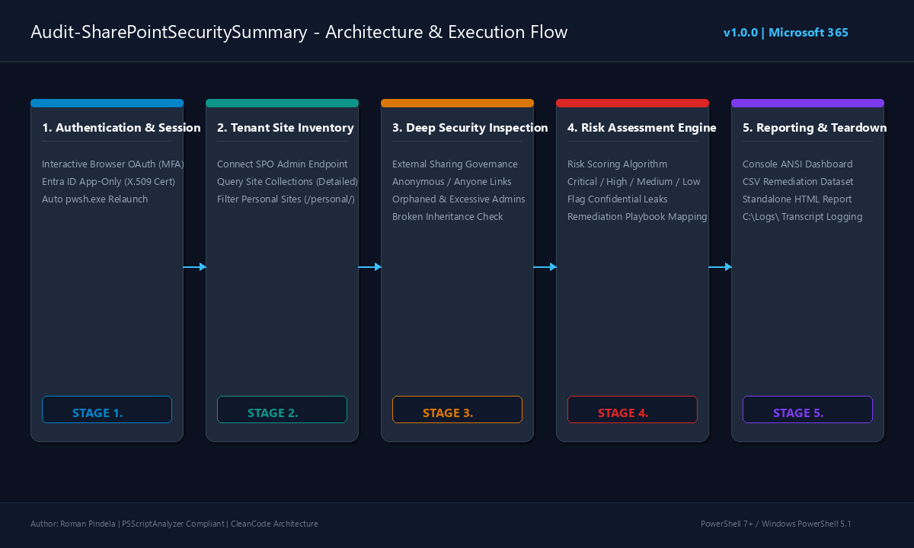

# Audit-SharePointSecuritySummary

[](https://microsoft.com/powershell)
[](https://www.microsoft.com/sharepoint)
[-brightgreen.svg)](https://github.com/PowerShell/PSScriptAnalyzer)
[](https://github.com/romanpindela)
[](https://opensource.org/licenses/MIT)

An enterprise-grade, production-hardened PowerShell automation utility engineered for **Microsoft 365 Administrators**, **Cloud Security Engineers**, and **Compliance Auditors**. It performs tenant-wide security posture auditing across SharePoint Online site collections—evaluating external sharing governance, orphaned site collections, excessive administrative privileges, anonymous sharing links without expiration policies, and broken permission inheritance.

The tool provides operational and executive reporting through an interactive color-coded console dashboard, a comprehensive raw CSV remediation dataset, a modern standalone HTML dashboard, and structured `[PSCustomObject]` pipeline binding.

---

## 🏛️ Author & Project Metadata

* **Author**: Roman Pindela
* **Email**: [roman.pindela@gmail.com](mailto:roman.pindela@gmail.com)
* **GitHub**: [https://github.com/romanpindela](https://github.com/romanpindela)
* **Script Version**: `1.0.0`
* **Release Date**: 2026-10-24
* **Target Platforms**: Windows 10, Windows 11, Windows Server (2016/2019/2022/2025)
* **Target Environment**: Microsoft 365 / SharePoint Online
* **Standards Compliance**: CleanCode Architecture, PSScriptAnalyzer Zero-Warning Standard, Strict Mode Latest

---

## 🌟 Executive Overview & Why This Audit Matters

In modern Microsoft 365 environments, SharePoint Online serves as the primary collaboration backbone. Over time, sprawl, decentralized site creation, and ad-hoc sharing lead to critical security risks:

1. **Unrestricted Anonymous / Anyone Links**: Sites configured with `ExternalUserAndGuestSharing` allow anyone on the internet with a link to access corporate files without authenticating. Missing link expiration policies turn temporary shares into permanent data exfiltration hazards.
2. **Orphaned Site Collections**: When employees leave an organization without transferring site ownership, site collections become orphaned (0 active administrators), creating blind spots where access is neither monitored nor revoked.
3. **Excessive Administrator Footprint**: Sites with more than 5 Site Collection Administrators violate the Principle of Least Privilege (PoLP) and dramatically expand the blast radius of credential compromise.
4. **Permission Inheritance Drift**: Broken inheritance across site webs, document libraries, and lists complicates access reviews and often hides inadvertent access grants to third parties or former contractors.
5. **Sensitivity & Privacy Mismatch**: Confidential and Secret-labeled content residing within public Microsoft 365 Groups or sites permitting anonymous sharing creates immediate compliance breaches (e.g., GDPR, HIPAA, SOC 2, ISO 27001).

`Audit-SharePointSecuritySummary.ps1` consolidates these multi-vector risk metrics into a single, automated, repeatable audit process with mathematical risk scoring and actionable remediation steps.

---

## 📐 Architecture & Execution Flow

### Architecture Flow Diagram



### Process Workflow (Mermaid Diagram)

```mermaid
flowchart TD
    Start(["Start Audit Script"]) --> Preflight["Preflight Checks: PWSH 7+ & PSScriptAnalyzer Standards"]
    Preflight --> InitLog["Initialize Transcript Logging in C:\\Logs\\"]
    InitLog --> ZeroCheck{"Parameters Provided?"}
    
    ZeroCheck -->|"No (-Help / No Args)"| HelpScreen["Display Show-ScriptHelp & Exit 0"]
    ZeroCheck -->|"Yes"| AuthBranch{"Authentication Method"}
    
    AuthBranch -->|"Interactive (-Interactive)"| OAuth["Modern Browser OAuth Sign-in (MFA)"]
    AuthBranch -->|"App-Only (-Thumbprint / -CertPath)"| CertAuth["Entra ID App-Only Daemon (X.509 Certificate)"]
    
    OAuth --> ConnectPnP["Connect-PnPOnline to SharePoint Admin Endpoint"]
    CertAuth --> ConnectPnP
    
    ConnectPnP --> Inventory["Query Tenant Site Collections (Get-PnPTenantSite -Detailed)"]
    Inventory --> FilterStep["Filter Out Personal Sites (/personal/) & Apply -SiteFilter"]
    
    FilterStep --> SiteLoop["Iterate Discovered Site Collections"]
    SiteLoop --> CheckSharing["Audit External Sharing Capabilities & Anyone Links"]
    CheckSharing --> CheckAdmins["Enumerate Site Collection Administrators & Primary Owner"]
    CheckAdmins --> CheckInheritance["Inspect Permission Inheritance on Web & Document Libraries"]
    CheckInheritance --> CheckLabels["Inspect Sensitivity Labels & M365 Group Privacy"]
    CheckLabels --> ScoreEngine["Execute Measure-SiteSecurityRisk Engine (Critical/High/Med/Low)"]
    
    ScoreEngine --> NextSite{"More Sites to Audit?"}
    NextSite -->|"Yes"| SiteLoop
    NextSite -->|"No"| RenderDash["Render Colorized Console ANSI Dashboard"]
    
    RenderDash --> ExportCSV["Export Comprehensive CSV Dataset to -OutputPath"]
    ExportCSV --> CheckHTML{"-GenerateHtmlReport Set?"}
    CheckHTML -->|"Yes"| ExportHTML["Generate Standalone Responsive HTML Executive Report"]
    CheckHTML -->|"No"| PipeCheck{"-PassThru or Piped?"}
    ExportHTML --> PipeCheck
    
    PipeCheck -->|"Yes"| EmitObjects["Emit [PSCustomObject] Collection to Pipeline"]
    PipeCheck -->|"No"| Teardown["Disconnect-PnPOnline Session in Finally Block"]
    EmitObjects --> Teardown
    
    Teardown --> Complete(["Audit Execution Completed Successfully"])
```



### ASCII Schematic Representation

```text
+-----------------------------------------------------------------------------------------+
|                       AUDIT-SHAREPOINTSECURITYSUMMARY LIFECYCLE                         |
+-----------------------------------------------------------------------------------------+
|                                                                                         |
|  [ 1. AUTHENTICATION ]                                                                  |
|    - Interactive OAuth (Browser + MFA)                                                  |
|    - App-Only Daemon (X.509 Certificate Thumbprint / File + Entra App ID)                |
|                                                                                         |
|                                     │                                                   |
|                                     ▼                                                   |
|  [ 2. TENANT INVENTORY & DISCOVERY ]                                                    |
|    - Query SharePoint Online Admin endpoint (https://<tenant>-admin.sharepoint.com)     |
|    - Filter out OneDrive Personal Sites (/personal/) by default                         |
|    - Target specific site collections using -SiteFilter pattern matching                |
|                                                                                         |
|                                     │                                                   |
|                                     ▼                                                   |
|  [ 3. MULTI-VECTOR SECURITY INSPECTION ]                                                |
|    ┌──────────────────────────┬──────────────────────────┬──────────────────────────┐   |
|    │ External Sharing Status  │ Admins & Ownership       │ Inheritance & Exposure   │   |
|    │ - Disabled / Guests Only │ - Orphaned (0 Admins)    │ - Broken Web Inheritance │   |
|    │ - Anonymous Anyone Links │ - Excessive Admins (>5)  │ - Document Library Perms │   |
|    │ - Link Expiration Days   │ - Single Point of Failure│ - Group Privacy & Labels │   |
|    └──────────────────────────┴──────────────────────────┴──────────────────────────┘   |
|                                                                                         |
|                                     │                                                   |
|                                     ▼                                                   |
|  [ 4. MATHEMATICAL RISK ENGINE (Measure-SiteSecurityRisk) ]                             |
|    - Critical : Orphaned sites, unauthenticated access on confidential data             |
|    - High     : Anyone links without expiration, excessive admins (>5)                  |
|    - Medium   : Guest sharing enabled, broken permission inheritance                    |
|    - Low      : Compliant governance, controlled access                                 |
|                                                                                         |
|                                     │                                                   |
|                                     ▼                                                   |
|  [ 5. MULTI-FORMAT REPORTING & ARTIFACT GENERATION ]                                    |
|    - Console Table  : Color-coded ANSI status dashboard                                 |
|    - CSV Dataset    : Raw records for SOC / remediation engineering                     |
|    - HTML Dashboard : Standalone responsive dashboard with search & interactive filters |
|    - Pipeline Stream: Strongly-typed PSCustomObjects for Out-GridView or orchestration  |
|                                                                                         |
|                                     │                                                   |
|                                     ▼                                                   |
|  [ 6. TEARDOWN & LOGGING ]                                                              |
|    - Persistent transcript log: C:\Logs\<timestamp>-Audit-SharePointSecuritySummary.log |
|    - Clean session teardown in finally {} block                                         |
+-----------------------------------------------------------------------------------------+
```

---

## ⚙️ Prerequisites & Environment Setup

### Required PowerShell Environment

* **PowerShell 7.4+ (Core)** is strongly recommended for peak performance and full cross-platform compatibility.
* **Windows PowerShell 5.1** is supported via built-in auto-elevation: if invoked in 5.1, the script automatically locates `pwsh.exe` and seamlessly relaunches in PowerShell 7+.

### Required PowerShell Modules

The script depends on the official community-standard **PnP.PowerShell** module:

```powershell
# Install PnP.PowerShell for the current user
Install-Module -Name PnP.PowerShell -Scope CurrentUser -Repository PSGallery -Force -AllowClobber
```

### Unblocking the Script

If the script was downloaded from the internet or GitHub, unblock the file prior to execution:

```powershell
Unblock-File -Path ".\Audit-SharePointSecuritySummary.ps1"
```

### Required Microsoft 365 Permissions

| Audit Mode | Required Identity / Role | Scope / Entra ID Permissions |
| :--- | :--- | :--- |
| **Interactive Mode** | SharePoint Administrator or Global Administrator | Delegated permissions via browser sign-in |
| **App-Only Mode** | Microsoft Entra ID App Registration | Application permission: `SharePoint: Sites.FullControl.All` or `Sites.Read.All` |

---

## 📋 Parameter Reference

| Parameter | Type | Default | Mandatory | Description |
| :--- | :---: | :---: | :---: | :--- |
| `-AdminUrl` | `[string]` | *None* | No* | The SharePoint Online Admin URL (e.g. `https://contoso-admin.sharepoint.com`). Auto-normalizes if root URL is passed. Prompted interactively if omitted. |
| `-Interactive` | `[switch]` | `$false` | No | Initiates interactive modern browser OAuth authentication with Multi-Factor Authentication (MFA). |
| `-ClientId` | `[string]` | *None* | No | Microsoft Entra ID Application (Client) ID for unattended App-Only daemon authentication. |
| `-TenantId` | `[string]` | *None* | No | Microsoft Entra ID Directory (Tenant) ID or domain name (e.g. `contoso.onmicrosoft.com`). |
| `-CertificateThumbprint` | `[string]` | *None* | No | Thumbprint of an X.509 certificate installed in `Cert:\CurrentUser\My` or `Cert:\LocalMachine\My`. |
| `-CertificatePath` | `[string]` | *None* | No | File system path to an X.509 certificate file (`.pfx` or `.cer`). |
| `-CertificatePassword` | `[SecureString]` | `$null` | No | Optional password for encrypted certificate files. |
| `-OutputPath` | `[string]` | `'C:\Logs'` | No | Target folder where raw CSV and HTML executive reports will be saved. |
| `-GenerateHtmlReport` | `[switch]` | `$false` | No | Generates a standalone, responsive HTML executive summary dashboard. |
| `-LogPath` | `[string]` | `'C:\Logs'` | No | Directory for execution transcript logs. Falls back to `$env:LOCALAPPDATA\Logs` if `C:\Logs` is inaccessible. |
| `-SiteFilter` | `[string]` | *None* | No | Wildcard pattern or exact string to filter target sites by URL or Title (e.g. `'*finance*'`). |
| `-IncludePersonalSites`| `[switch]` | `$false` | No | Includes OneDrive for Business personal sites (`/personal/`). Excluded by default. |
| `-DetailedScan` | `[switch]` | `$false` | No | Connects to each site to inspect Site Collection Admins and document library inheritance. |
| `-PassThru` | `[switch]` | `$false` | No | Emits strongly-typed `[PSCustomObject]` records to the PowerShell pipeline. |
| `-Force` | `[switch]` | `$false` | No | Bypasses interactive prompts and confirmations for non-interactive automation. |
| `-Help` (`-h`) | `[switch]` | `$false` | No | Displays the help documentation and usage examples, then terminates execution. |

*\*Note: If executed without any arguments or with `-Help`, the script displays the help screen and safely exits with return code 0.*

---

## 🚀 Execution Examples

### Scenario 1: Interactive Audit with Standalone HTML Dashboard

Executes a full interactive audit of all tenant site collections, displaying the colorized console summary and generating an executive HTML report:

```powershell
.\Audit-SharePointSecuritySummary.ps1 `
    -AdminUrl "https://contoso-admin.sharepoint.com" `
    -Interactive `
    -GenerateHtmlReport `
    -OutputPath "C:\Reports\SharePointAudit"
```

### Scenario 2: Unattended Automated Audit via Entra ID App-Only Certificate

Runs non-interactively in scheduled CI/CD pipelines, Azure Automation, or Windows Task Scheduler using certificate authentication:

```powershell
.\Audit-SharePointSecuritySummary.ps1 `
    -AdminUrl "https://contoso-admin.sharepoint.com" `
    -ClientId "00000000-1111-2222-3333-444444444444" `
    -TenantId "contoso.onmicrosoft.com" `
    -CertificateThumbprint "A1B2C3D4E5F67890123456789ABCDEF012345678" `
    -OutputPath "C:\Reports\AutomatedAudits" `
    -GenerateHtmlReport `
    -Force
```

### Scenario 3: Targeted Audit with Pipeline Filtering for High-Risk Sites

Filters sites matching the keyword `*teams*` and uses `-PassThru` to isolate sites flagged as `Critical` or `High` risk:

```powershell
$highRiskSites = .\Audit-SharePointSecuritySummary.ps1 `
    -AdminUrl "https://contoso-admin.sharepoint.com" `
    -Interactive `
    -SiteFilter "*teams*" `
    -PassThru |
    Where-Object { $_.RiskLevel -in @('Critical', 'High') }

# Export filtered high-risk sites to remediation list
$highRiskSites | Export-Csv -Path "C:\Reports\ImmediateRemediation.csv" -NoTypeInformation
```

### Scenario 4: Deep Inspection with Pipeline Output to Out-GridView

Performs deep document library and site administrator inspection, outputting results directly to an interactive grid view:

```powershell
.\Audit-SharePointSecuritySummary.ps1 `
    -AdminUrl "https://contoso-admin.sharepoint.com" `
    -Interactive `
    -DetailedScan `
    -PassThru | Out-GridView -Title "SharePoint Online Security Posture Assessment"
```

---

## 📊 Sample Executive HTML Dashboard Preview

The generated HTML report is self-contained with embedded CSS and vanilla JavaScript. It requires zero external CDNs, making it completely compliant with air-gapped enterprise environments:

* **Executive Summary Metric Cards**: Real-time counts of Total Sites, Critical Risk, High Risk, Medium Risk, Compliant Sites, Anonymous Sharing, Orphaned Sites, and Excessive Admins.
* **Instant Client-Side Search**: Filter through hundreds of site collections in real time by site name, URL, owner, or risk driver.
* **One-Click Risk Filters**: Isolate Critical, High, Medium, Low, External Sharing, or Orphaned sites with a single click.
* **Actionable Remediation Playbook**: Direct PowerShell command snippets embedded into the dashboard for immediate remediation.

---

## 📝 Logging & Remediation Playbook

### Logging Infrastructure

Every audit execution maintains a dual-stream logging record:
1. **Interactive Console Stream**: Colorized ANSI log entries (`[INFO]`, `[WARN]`, `[ERROR]`, `[SUCCESS]`).
2. **Persistent Audit File**: Written to `C:\Logs\<yyyyMMdd-HHmmss>-Audit-SharePointSecuritySummary-<COMPUTERNAME>-<USERNAME>.log`.
   *Automatic Fallback*: If `C:\Logs\` lacks write permissions, the script automatically writes to `$env:LOCALAPPDATA\Logs\`.

### Remediation Guidance

| Finding Tag | Risk Severity | Cause | Recommended Remediation Command |
| :--- | :---: | :--- | :--- |
| `ORPHANED_SITE` | **Critical** | 0 active Site Collection Admins or missing owner. | `Set-PnPTenantSite -Url "<SiteUrl>" -Owners "sec-admin@contoso.com"` |
| `CONFIDENTIAL_LEAK_RISK` | **Critical** | Confidential-labeled site allows anyone links. | `Set-PnPTenantSite -Url "<SiteUrl>" -SharingCapability ExternalUserSharingDisabled` |
| `ANYONE_LINKS` | **High** | Unrestricted anonymous access allowed. | `Set-PnPTenantSite -Url "<SiteUrl>" -SharingCapability ExistingExternalUserSharingOnly` |
| `NO_EXPIRATION` | **High** | Anonymous links do not expire. | `Set-PnPTenantSite -Url "<SiteUrl>" -AnonymousLinkExpirationInDays 14` |
| `EXCESSIVE_ADMINS` | **High** | More than 5 Site Collection Administrators. | `Remove-PnPSiteCollectionAdmin -Owners "user@contoso.com"` |
| `BROKEN_INHERITANCE` | **Medium** | Unique permissions on document libraries/lists. | Restore role inheritance on stale libraries via SharePoint Admin Center or PnP. |
| `UNLABELED_SHARING` | **Medium** | External sharing on unlabeled site collection. | Assign appropriate Microsoft Purview Sensitivity Label. |

---

## 📦 Changelog

### `v1.0.0` (2026-10-24)

* Initial production release of `Audit-SharePointSecuritySummary.ps1`.
* Implemented multi-vector security evaluation:
  * External sharing & guest governance auditing (`Disabled`, `ExistingGuests`, `Anyone`).
  * Anonymous link expiration policy enforcement check.
  * Orphaned site collection detection (0 active administrators).
  * Excessive administrator footprint detection (>5 administrators).
  * Document library and site web permission inheritance breaks.
  * Microsoft 365 Group privacy status and sensitivity label mapping.
* Implemented dual authentication architecture:
  * Interactive modern browser sign-in with Multi-Factor Authentication (MFA).
  * Entra ID App-Only non-interactive authentication via X.509 certificate thumbprint or file.
* Built multi-format reporting engine:
  * Color-coded ANSI executive console dashboard.
  * Comprehensive UTF-8 CSV raw remediation dataset.
  * Standalone, responsive HTML executive report with interactive filters and search.
  * Strongly-typed `[PSCustomObject]` pipeline binding.
* Integrated enterprise transcript logging in `C:\Logs\` with automatic `$env:LOCALAPPDATA\Logs` fallback.
* Achieved 100% compliance with PSScriptAnalyzer zero-warning standard and StrictMode Latest.

---

## 👨‍💻 Author & Contact

* **Author**: Roman Pindela
* **Email**: [roman.pindela@gmail.com](mailto:roman.pindela@gmail.com)
* **GitHub**: [https://github.com/romanpindela](https://github.com/romanpindela)
* **License**: MIT
