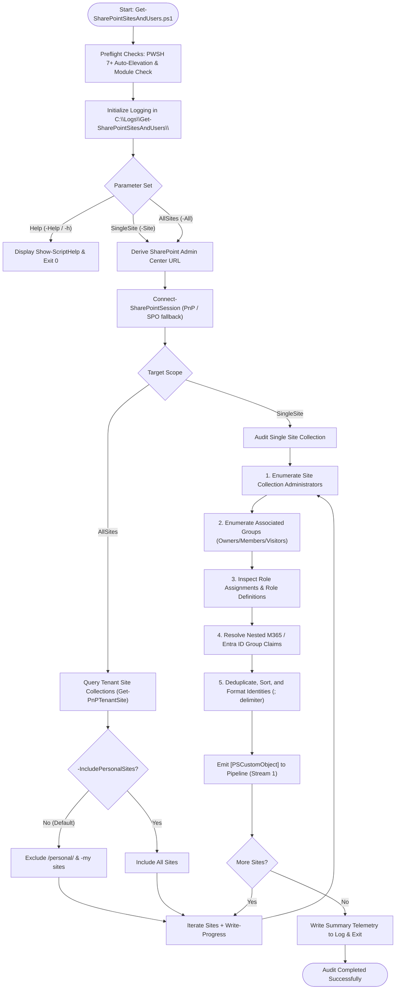

# Get-SharePointSitesAndUsers

[](https://microsoft.com/powershell)
[](https://www.microsoft.com/sharepoint)
[-brightgreen.svg)](https://github.com/PowerShell/PSScriptAnalyzer)
[](https://github.com/romanpindela)
[](https://opensource.org/licenses/MIT)

An enterprise-grade PowerShell automation utility engineered for **Microsoft 365 Administrators**, **Information Security Officers**, and **Compliance Auditors**. It performs automated inventory auditing across SharePoint Online site collections and aggregates entitled user accounts and permissions into four standardized administrative and governance tiers.

The tool emits strongly-typed `[PSCustomObject]` records directly to the PowerShell pipeline, enabling seamless integration with native utilities such as `Export-Csv`, `Out-GridView`, and `Format-Table`.

---

## 🏛️ Author & Project Metadata

* **Author**: Roman Pindela
* **Email**: [roman.pindela@gmail.com](mailto:roman.pindela@gmail.com)
* **GitHub**: [https://github.com/romanpindela](https://github.com/romanpindela)
* **Script Version**: `1.0.0`
* **Release Date**: 2026-10-25
* **Target Platforms**: Windows 10, Windows 11, Windows Server (2016/2019/2022/2025)
* **Target Environment**: Microsoft 365 / SharePoint Online
* **Standards Compliance**: CleanCode Architecture, PSScriptAnalyzer Zero-Warning Standard, Strict Mode Latest

---

## 🌟 Executive Overview & Business Value

Managing permissions across dozens or thousands of SharePoint Online site collections presents significant visibility and governance challenges. Over time, decentralized administration, Microsoft 365 Group membership expansion, direct role assignments, and permission inheritance drift can lead to over-privileged accounts and compliance risks.

`Get-SharePointSitesAndUsers.ps1` addresses these challenges by:
1. **Single-Pane-of-Glass Auditing**: Aggregating all entitled identities into 4 distinct logical tiers:
   - **Site Collection Administrators** (Full unconditional control)
   - **Owners / Full Control** (Site Owners and full control assignments)
   - **Members / Write** (Contribute, Edit, and modification rights)
   - **Visitors / Read** (Read-only viewers and guests)
2. **Dual Execution Modes**: Seamlessly switching between targeted inspection of an individual site collection (`-Site <Url>`) and tenant-wide comprehensive discovery (`-All`).
3. **Pipeline-First Architecture**: Streaming structured objects directly to the output pipeline for instant filtering, sorting, or CSV export.
4. **Fault-Tolerant Resilience**: Safely isolating access denied errors (HTTP 401/403) on individual private sites without terminating bulk audit execution.
5. **Rate-Limiting Protection**: Exponential backoff retry engine handling Microsoft Graph and SharePoint Online HTTP 429/503 throttling.
6. **Enterprise Audit Logging**: Synchronous timestamped logging in `C:\Logs\Get-SharePointSitesAndUsers\` with automatic fallback to user profile storage.

---

## 📐 Architecture & Execution Flow

### Process Workflow (Mermaid Diagram)



### ASCII Architecture Schematic

```text
+-----------------------------------------------------------------------------------------+
|                        GET-SHAREPOINTSITESANDUSERS WORKFLOW                             |
+-----------------------------------------------------------------------------------------+
|                                                                                         |
|  [ 1. INITIALIZATION & LOGGING ]                                                        |
|    - Auto-relaunch in pwsh.exe if executed from Windows PowerShell 5.1                  |
|    - Synchronous audit log: C:\Logs\Get-SharePointSitesAndUsers\Get-SharePoint...log    |
|    - Module assertion: PnP.PowerShell (primary) with SPO PowerShell fallback            |
|                                                                                         |
|                                     │                                                   |
|                                     ▼                                                   |
|  [ 2. AUTHENTICATION & SESSION BINDING ]                                                |
|    - Interactive OAuth (Browser + MFA)                                                  |
|    - App-Only Daemon (X.509 Certificate Thumbprint or File + Client ID)                 |
|    - Local cached Client ID retrieval (AppData\Local\SharePoint-Audit)                  |
|                                                                                         |
|                                     │                                                   |
|                                     ▼                                                   |
|  [ 3. PARAMETER SET DISPATCH ]                                                          |
|    ┌────────────────────────────────────────┬────────────────────────────────────────┐  |
|    │ [SingleSite] Parameter Set             │ [AllSites] Parameter Set               │  |
|    │ - Parameter: -Site <Url>               │ - Parameter: -All                      │  |
|    │ - Targeted single-site audit           │ - Discover all tenant site collections │  |
|    │ - Accepts pipeline input               │ - Filter out OneDrive (/personal/)     │  |
|    └────────────────────────────────────────┴────────────────────────────────────────┘  |
|                                                                                         |
|                                     │                                                   |
|                                     ▼                                                   |
|  [ 4. PERMISSIONS AGGREGATION ENGINE ]                                                  |
|    - SiteCollectionAdmins : Direct Site Collection Admins (IsSiteAdmin = $true)         |
|    - FullControl          : Owners group + Full Control role definitions + M365 Owners  |
|    - Write                : Members group + Edit/Contribute definitions + M365 Members  |
|    - Read                 : Visitors group + Read/View Only role definitions            |
|    - Nested Claims        : Graph expansion of M365 Group owners and members            |
|                                                                                         |
|                                     │                                                   |
|                                     ▼                                                   |
|  [ 5. PIPELINE STREAMING & REPORTING ]                                                  |
|    - Emits strongly-typed [PSCustomObject] to Stream 1 (Standard Output)                |
|    - Clean pipeline: Write-Host and progress bars do NOT contaminate CSV / Grid exports |
|    - Fully compatible with: Export-Csv, Out-GridView, Format-Table                      |
+-----------------------------------------------------------------------------------------+
```

---

## 📊 Role & Permission Mapping Specification

For every inspected site collection, entitled accounts are mapped to four standardized tiers:

| Field Name | Logical Level | Source Group / Role Definitions |
| :--- | :--- | :--- |
| `SiteCollectionAdmins` | Administrator / SCA | Site Collection Administrators (`IsSiteAdmin = $true`, `Get-PnPSiteCollectionAdmin`). |
| `FullControl` | Full Control / Owner | Default `<Site> Owners` group, role assignments with `Full Control` / `Pełna kontrola`, and connected M365 Group owners. |
| `Write` | Modification / Contributor | Default `<Site> Members` group, role assignments with `Edit`, `Contribute`, `Edycja`, `Współtworzenie`, `Design`, and connected M365 Group members. |
| `Read` | Read / Visitor | Default `<Site> Visitors` group, role assignments with `Read`, `View Only`, `Odczyt`, `Tylko wyświetlanie`, `Restricted View`. |

> **Note on Microsoft 365 Groups**: For modern group-connected team sites, connected Microsoft 365 Group owners and members are automatically resolved and mapped to `FullControl` and `Write` respectively.

---

## 📦 Output Object Structure (`PSCustomObject`)

Every audited record emitted to the pipeline has the following schema:

```powershell
[PSCustomObject]@{
    SiteTitle             = $siteTitle           # Human-readable site title
    SiteUrl               = $siteUrl             # Absolute SharePoint Online URL
    StorageUsedMB         = $storageMB           # Current storage usage in Megabytes
    Template              = $template            # Site template code (e.g. GROUP#0, STS#3)
    SiteCollectionAdmins  = ($admins -join '; ') # Semicolon-delimited administrator list
    FullControl           = ($full -join '; ')   # Semicolon-delimited owners list
    Write                 = ($write -join '; ')  # Semicolon-delimited members/contributors
    Read                  = ($read -join '; ')   # Semicolon-delimited readers/visitors
    AuditDate             = (Get-Date)           # Exact inspection timestamp
}
```

---

## 📋 Parameter Reference

| Parameter | Type | Default | ParameterSet | Description |
| :--- | :---: | :---: | :---: | :--- |
| `-All` | `[switch]` | `$false` | `AllSites` | Triggers tenant-wide bulk auditing across all site collections. |
| `-Site` | `[string]` | *None* | `SingleSite` | URL of a specific site collection to audit. Aliases: `-Url`, `-SiteUrl`. Supports pipeline input. |
| `-AdminCenterUrl` | `[string]` | *Auto-derived* | Both | SharePoint Admin Center URL (e.g. `https://contoso-admin.sharepoint.com`). Derived automatically if omitted. |
| `-LogPath` | `[string]` | `'C:\Logs\Get-SharePointSitesAndUsers'` | Both | Directory for audit transcript logs. Automatically falls back to user AppData if inaccessible. |
| `-IncludePersonalSites` | `[switch]` | `$false` | Both | Includes OneDrive for Business personal sites (`/personal/`). Excluded by default. |
| `-ClientId` | `[string]` | *Auto-discovered* | Both | Microsoft Entra ID Application (Client) ID. Aliases: `-AppId`. |
| `-TenantId` | `[string]` | *Auto-discovered* | Both | Microsoft Entra ID Tenant ID or domain name (e.g. `contoso.onmicrosoft.com`). Aliases: `-Tenant`. |
| `-CertificateThumbprint`| `[string]` | *None* | Both | X.509 certificate thumbprint for unattended App-Only daemon execution. Aliases: `-Thumbprint`. |
| `-CertificatePath` | `[string]` | *None* | Both | Path to an X.509 certificate file (`.pfx` or `.cer`). |
| `-CertificatePassword` | `[SecureString]` | `$null` | Both | Password for password-protected certificate files. |
| `-Interactive` | `[switch]` | `$false` | Both | Forces modern interactive web browser OAuth authentication with MFA support. |
| `-Force` | `[switch]` | `$false` | Both | Bypasses confirmation prompts. |
| `-Help` (`-h`) | `[switch]` | `$false` | `Help` | Displays the help documentation and usage examples, then terminates execution. |

---

## 🚀 Practical Usage Scenarios

### Scenario 1: Audit a Specific Site Collection

Audits permissions for a single department site and displays the output formatted in the console:

```powershell
.\Get-SharePointSitesAndUsers.ps1 -Site "https://contoso.sharepoint.com/sites/Marketing"
```

### Scenario 2: Pipeline Binding from URL String

Accepts target URLs directly from the pipeline and renders an interactive GUI table:

```powershell
"https://contoso.sharepoint.com/sites/Finance" | .\Get-SharePointSitesAndUsers.ps1 | Out-GridView
```

### Scenario 3: Tenant-Wide Bulk Audit Exported to CSV

Discovers all organizational site collections across the tenant and exports the permission report into a clean, UTF-8 CSV:

```powershell
.\Get-SharePointSitesAndUsers.ps1 -All | Export-Csv -Path "C:\Reports\SharePointUsersAudit.csv" -NoTypeInformation -Encoding UTF8
```

### Scenario 4: Bulk Audit Including OneDrive Personal Sites

Audits all site collections including personal OneDrive repositories (`/personal/`):

```powershell
.\Get-SharePointSitesAndUsers.ps1 -All -IncludePersonalSites | Format-Table -AutoSize
```

### Scenario 5: Unattended Scheduled Daemon via Certificate Authentication

Executes non-interactively in scheduled CI/CD pipelines or Windows Task Scheduler:

```powershell
.\Get-SharePointSitesAndUsers.ps1 -All `
    -AdminCenterUrl "https://contoso-admin.sharepoint.com" `
    -ClientId "11111111-2222-3333-4444-555555555555" `
    -TenantId "contoso.onmicrosoft.com" `
    -CertificateThumbprint "A1B2C3D4E5F67890123456789ABCDEF012345678" |
    Export-Csv -Path "C:\Reports\TenantAudit.csv" -NoTypeInformation
```

---

## 🛡️ Error Handling, Resilience & Throttling

1. **Site-Level Isolation**: If a specific site throws an access denied error (`401 Unauthorized` or `403 Forbidden`), the audit logs a `[WARN]` entry, marks the permissions as `"Access Denied / Insufficient Permissions"`, and smoothly continues processing the remaining sites.
2. **Exponential Backoff Retries**: Transient HTTP `429 Too Many Requests` or `503 Server Busy` conditions are caught by `Invoke-WithRetry` and automatically retried with increasing backoff delays (4s, 8s, 16s).
3. **Write-Progress Feedback**: In `-All` mode, a real-time progress bar shows the current site index, total count, percentage completed, and current site title.
4. **Clean Stream Separation**: Log output and status banners write strictly to Host or Information streams (`Write-Host`, `Write-Progress`), ensuring that pipeline exports (`Export-Csv`) remain 100% clean and uncorrupted.

---

## 📝 Audit Log Specifications

- **Location**: `C:\Logs\Get-SharePointSitesAndUsers\` (falls back to `$env:LOCALAPPDATA\Logs\Get-SharePointSitesAndUsers` if access is denied).
- **File Name Format**: `Get-SharePointSitesAndUsers_yyyyMMdd_HHmmss.log`
- **Line Format**: `[yyyy-MM-dd HH:mm:ss] [INFO/WARN/ERROR/DEBUG/SUCCESS] <Message>`
- **Directory Creation**: Automatically validated and provisioned using `New-Item -ItemType Directory -Force`.

---

## 📄 License & Contributing

Distributed under the **MIT License**. Contributions, bug reports, and enhancements are welcome via pull requests to the [GitHub Repository](https://github.com/romanpindela).
