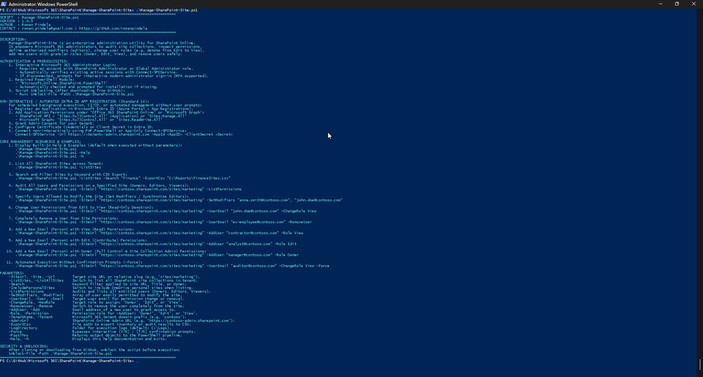
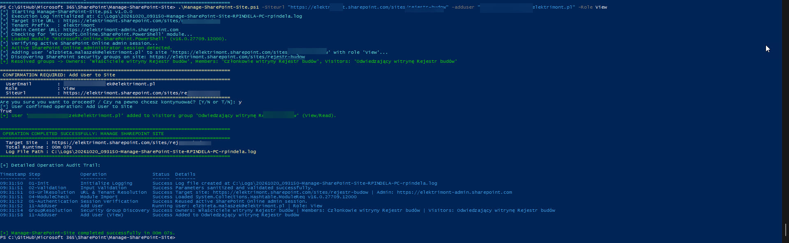
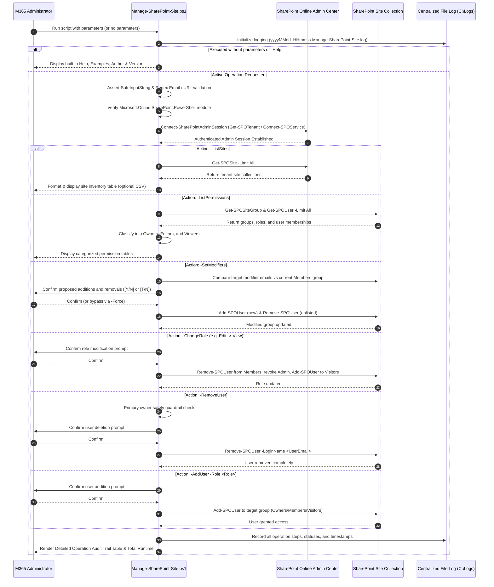

# Manage-SharePoint-Site

[](https://microsoft.com/powershell)
[](https://www.microsoft.com/windows)
[](https://github.com/romanpindela)
[](LICENSE)

An enterprise-grade, clean-code PowerShell automation utility designed for Microsoft 365 and SharePoint Online administrators. It streamlines SharePoint Online site governance: auditing site collections across the tenant, cataloging and auditing permissions (**Owners**, **Editors/Modifiers**, and **Viewers/Readers**), defining and synchronizing authorized site content modifiers, modifying user roles (such as demoting from **Edit** to **View**), adding new users with specific permission tiers, and safely revoking user access, accompanied by **real-time operation audit tracking** and **centralized file logging**.

---

## Author & Project Metadata

* **Author**: Roman Pindela
* **Email**: [roman.pindela@gmail.com](mailto:roman.pindela@gmail.com)
* **GitHub**: [https://github.com/romanpindela](https://github.com/romanpindela)
* **Script Version**: `1.0.0`
* **Release Date**: 2026-10-19
* **Target Platforms**: Windows 10, Windows 11, Windows Server (2016/2019/2022/2025 with Desktop Experience)
* **Supported Locales**: English & Polish environments (language-independent bilingual security group resolution: `Owners` / `Właściciele`, `Members` / `Członkowie`, `Visitors` / `Goście` / `Czytelnicy`)
* **Standards Compliance**: Adheres to CleanCode and PowerShell Script Standards (`PowerShell Script Standards.txt`)

---

## Key Features

1. **Interactive Office 365 Administrator Authentication**
   - Automatically detects active administrative sessions (`Get-SPOTenant`).
   - If not connected, prompts for interactive modern sign-in with Multi-Factor Authentication (MFA) to the SharePoint Online Admin Center (`https://<tenant>-admin.sharepoint.com`).
   - Automatically derives the tenant prefix and SharePoint Admin URL from the target site URL or `-TenantName`.

2. **Tenant-Wide SharePoint Site Inventory (`-ListSites`)**
   - Discovers and lists all SharePoint Online site collections across the entire Microsoft 365 tenant.
   - Provides keyword filtering (`-Search`) across site URLs, titles, and owners.
   - Summarizes storage consumption (Used GB, Quota GB), status, lock state, template, and sharing capabilities.
   - Supports export to UTF-8 CSV (`-ExportCsv`).

3. **Categorized Site Permissions Auditing (`-ListPermissions`)**
   - Audits and classifies all entitled principals on a target site collection into three distinct tiers:
     - **Owners / Full Control**: Primary Site Collection Administrator, explicit Site Collection Admins, and members of the site's Owners group (`Full Control` / `Pełna kontrola`).
     - **Edit / Modifiers**: Users and groups assigned to the Members group (`Contribute` / `Edit` / `Edycja` / `Współtworzenie`).
     - **View / Readers**: Users and groups assigned to the Visitors group (`Read` / `Odczyt`).
     - **Other / Custom**: Highlights any additional custom permission levels or external claims.

4. **Defining & Synchronizing Site Modifiers (`-SetModifiers`)**
   - Directly defines the exact list of users authorized to modify site content.
   - Reconciles the site's Members group: newly specified users are added, while unauthorized or unlisted users are removed.
   - Features pre-synchronization diff inspection and bilingual confirmation prompt.

5. **Modifying User Roles & Demoting/Promoting Permissions (`-ChangeRole`)**
   - Seamlessly transitions user permissions between tiers:
     - **Demotion from Edit to View (`-ChangeRole View`)**: Removes the user from the Members group, revokes Site Collection Admin rights if assigned, and places them into the Visitors group (Read-only).
     - **Promotion from View to Edit (`-ChangeRole Edit`)**: Moves user from Visitors to Members.
     - **Promotion to Owner (`-ChangeRole Owner`)**: Moves user into the Owners group and elevates them to Site Collection Administrator.

6. **Completely Removing User Access (`-RemoveUser`)**
   - Completely revokes a user's access across all security groups and administrative assignments on the site collection (`Remove-SPOUser`).
   - Includes safety checks warning against removing the primary site collection administrator.

7. **Adding New Users with Granular Roles (`-AddUser` & `-Role`)**
   - Invites and grants permissions to new email addresses:
     - `-Role View`: Grants Read permissions via the site's Visitors group.
     - `-Role Edit`: Grants Contribute/Edit permissions via the site's Members group.
     - `-Role Owner`: Grants Full Control via the site's Owners group and Site Collection Administrator rights.

8. **Real-Time Step-by-Step Operation Auditing**
   - Real-time color-coded console indicators (`[*] INFO`, `[+] SUCCESS`, `[!] WARN`, `[-] ERROR`, `[.] DEBUG`).
   - Operation audit ledger tracking every execution phase with timestamps, step codes, operations, statuses, and details.
   - Structured audit summary table rendered upon completion.

9. **Centralized File Logging**
   - Automatic execution logs written to `C:\Logs` (with fallback to `$env:LOCALAPPDATA\Logs`).
   - Standardized naming convention: `yyyyMMdd_HHmmss-Manage-SharePoint-Site-<ComputerName>-<UserName>.log`.

10. **Pre-Execution Input Defense & Bilingual Support**
    - Protects against command injection and dangerous shell meta-characters (`` `$<>|;&\0 ``).
    - Email address format verification via strict regex.
    - URL structure validation preventing malformed or unauthorized requests.
    - Bilingual prompts (`Y/N` and `T/N`) with unattended automation override via `-Force`.
    - Auto-help invocation on empty parameter execution.

---

## Screenshots

### 1. Built-in Help & Guidance (`.\Manage-SharePoint-Site.ps1`)
Running the script without parameters or with `-Help` / `-h` displays comprehensive usage instructions, scenario descriptions, Entra ID non-interactive configuration guide, parameter options, and practical examples:



---

### 2. User Permission Assignment & Interactive Audit Trail (`-AddUser -Role View`)
Adding a user to the site with automatic security group resolution (e.g., resolving bilingual Polish groups such as `Właściciele witryny`, `Członkowie witryny`, `Odwiedzający witrynę`), interactive confirmation prompt, and detailed real-time operation audit logging:



---

## Prerequisites

- **Operating System**: Windows 10, Windows 11, or Windows Server 2016/2019/2022/2025.
- **PowerShell**: Windows PowerShell 5.1 or PowerShell 7+.
- **SharePoint Online PowerShell Module**: `Microsoft.Online.SharePoint.PowerShell`.
  *If missing, the script offers automatic installation for `CurrentUser`:*
  ```powershell
  Install-Module -Name Microsoft.Online.SharePoint.PowerShell -Scope CurrentUser -Repository PSGallery -Force
  ```
- **Administrative Privileges**: Microsoft 365 account assigned **SharePoint Administrator** or **Global Administrator**.

---

## Security & GitHub Unblocking

When downloading scripts from GitHub, Windows PowerShell applies the execution restriction flag (`Zone.Identifier`). Unblock the script before execution:

```powershell
Unblock-File -Path .\Manage-SharePoint-Site.ps1
```

---

## Non-Interactive & Automated Execution via Microsoft Entra ID (Standard 14)

For scheduled tasks, CI/CD pipelines, or headless server execution without interactive browser prompts:

1. **Register an App in Microsoft Entra ID**:
   - Go to [Microsoft Entra admin center](https://entra.microsoft.com/) > **Identity** > **Applications** > **App registrations** > **New registration**.
   - Name: `SharePoint-Site-Manager-Automation`.
   - Supported account types: *Accounts in this organizational directory only (Single tenant)*.

2. **Configure API Permissions**:
   - Navigate to **API permissions** > **Add a permission**.
   - Select **SharePoint** > **Application permissions**:
     - `Sites.FullControl.All` (for full site and permission management) or `Sites.Manage.All`.
   - Alternatively, under **Microsoft Graph** > **Application permissions**:
     - `Sites.FullControl.All`.
   - Click **Grant admin consent for <Your Tenant>** and confirm the status displays green checkmarks.

3. **Configure Authentication Credentials**:
   - **Certificate (Recommended)**: Go to **Certificates & secrets** > **Certificates** > upload your X.509 certificate.
   - **Client Secret**: Go to **Certificates & secrets** > **Client secrets** > **New client secret** > copy the secret value.

4. **Automated Connection Syntax**:
   ```powershell
   # App-Only connection with client credentials
   Connect-SPOService -Url "https://<tenant>-admin.sharepoint.com" -AppId "<Application-ID>" -ClientSecret "<Client-Secret>"
   ```

---

## Technical Architecture & How It Works



---

## Parameter Reference

| Parameter | Type | Required | Default | Description |
| :--- | :--- | :---: | :--- | :--- |
| `-SiteUrl` / `-Site` / `-Url` | `String` | Dependent | *None* | Target SharePoint site URL (e.g. `https://contoso.sharepoint.com/sites/marketing`) or relative slug (`sites/marketing`). |
| `-ListSites` / `-ListAllSites` | `Switch` | No | `False` | Lists all SharePoint Online site collections across the tenant. |
| `-Search` | `String` | No | *None* | Keyword filter applied to site URL, Title, or Owner when using `-ListSites`. |
| `-IncludePersonalSites` | `Switch` | No | `False` | Includes OneDrive for Business personal sites in inventory listing. |
| `-Detailed` | `Switch` | No | `False` | Retrieves detailed site collection properties when querying sites. |
| `-ListPermissions` / `-AuditPermissions` | `Switch` | No | `False` | Audits and categorizes all entitled entities on a site into Owners, Editors, and Viewers. |
| `-SetModifiers` / `-Modifiers` | `String[]` | No | *None* | Array of user emails permitted to modify the site (synchronizes the Members group). |
| `-UserEmail` / `-User` / `-Email` | `String` | Dependent | *None* | Email/UPN of user targeted for role change or removal. |
| `-ChangeRole` / `-NewRole` | `String` | No | *None* | New permission role for `-UserEmail`: `'Owner'`, `'Edit'`, or `'View'`. |
| `-RemoveUser` / `-Remove` | `Switch` | No | `False` | Completely removes the targeted user from the site collection. |
| `-AddUser` / `-Add` | `String` | No | *None* | Email/UPN of a new or existing user to grant access to. |
| `-Role` / `-Permission` | `String` | Dependent | *None* | Permission tier for `-AddUser`: `'Owner'`, `'Edit'`, or `'View'`. |
| `-TenantName` / `-Tenant` | `String` | No | *Auto-detected* | Microsoft 365 tenant domain prefix (e.g. `contoso`). |
| `-AdminUrl` | `String` | No | *Auto-derived* | SharePoint Online Admin Center URL (`https://<tenant>-admin.sharepoint.com`). |
| `-ExportCsv` | `String` | No | *None* | Destination file path to export inventory or permission audit to CSV. |
| `-LogDirectory` | `String` | No | `C:\Logs` | Destination folder for execution logs (falls back to `$env:LOCALAPPDATA\Logs`). |
| `-Force` | `Switch` | No | `False` | Bypasses interactive confirmation prompts (`[Y/N]` or `[T/N]`). |
| `-PassThru` | `Switch` | No | `False` | Returns output objects to the PowerShell pipeline. |
| `-Help` / `-h` | `Switch` | No | `False` | Displays comprehensive built-in help and exits. |

---

## Usage Examples

### 1. Display Built-In Help & Info (Default Execution)
Running the script without parameters or with `-Help` / `-h` displays syntax, author info, and practical examples without modifying any resources:

```powershell
.\Manage-SharePoint-Site.ps1
# or
.\Manage-SharePoint-Site.ps1 -h
```

---

### 2. List All SharePoint Sites Across Tenant
Queries all site collections, displaying titles, URLs, storage usage, quotas, owners, and status:

```powershell
.\Manage-SharePoint-Site.ps1 -ListSites
```

---

### 3. Search Sites by Keyword with CSV Export
Filters site collections matching `"Finance"` and exports the inventory to a CSV report:

```powershell
.\Manage-SharePoint-Site.ps1 -ListSites -Search "Finance" -ExportCsv "C:\Reports\FinanceSites.csv"
```

---

### 4. Audit All Users and Permissions on a Specified Site
Discovers and displays all entitled users grouped by **Owners**, **Editors/Modifiers**, and **Viewers/Readers**:

```powershell
.\Manage-SharePoint-Site.ps1 -SiteUrl "https://contoso.sharepoint.com/sites/marketing" -ListPermissions
```

---

### 5. Specify Users Allowed to Modify the Site (Set Modifiers)
Synchronizes the site's Members group so that only the specified users possess Edit permissions:

```powershell
.\Manage-SharePoint-Site.ps1 `
    -SiteUrl "https://contoso.sharepoint.com/sites/marketing" `
    -SetModifiers "anna.smith@contoso.com", "john.doe@contoso.com"
```

*The script presents a diff of current vs target modifiers and prompts for confirmation:*
```text
================================================================================
 PROPOSED SITE MODIFIERS SYNCHRONIZATION
================================================================================
 Site URL       : https://contoso.sharepoint.com/sites/marketing
 Members Group  : Marketing Members
 Current Count  : 3
 Target Count   : 2
 Users to ADD   : anna.smith@contoso.com
 Users to REMOVE: old.editor@contoso.com
================================================================================
Are you sure you want to proceed? / Czy na pewno chcesz kontynuować? [Y/N or T/N]:
```

---

### 6. Change User Permissions from Edit to View (Read-Only Demotion)
Demotes a user from Edit permissions to View permissions (removes them from Members and adds them to Visitors):

```powershell
.\Manage-SharePoint-Site.ps1 `
    -SiteUrl "https://contoso.sharepoint.com/sites/marketing" `
    -UserEmail "john.doe@contoso.com" `
    -ChangeRole View
```

---

### 7. Completely Remove a User from Site Permissions
Removes a former employee or vendor completely from all site groups and administrative roles:

```powershell
.\Manage-SharePoint-Site.ps1 `
    -SiteUrl "https://contoso.sharepoint.com/sites/marketing" `
    -UserEmail "ex-employee@contoso.com" `
    -RemoveUser
```

---

### 8. Add a New User with View (Read) Permissions
Invites a user and assigns them to the site's Visitors group:

```powershell
.\Manage-SharePoint-Site.ps1 `
    -SiteUrl "https://contoso.sharepoint.com/sites/marketing" `
    -AddUser "contractor@contoso.com" `
    -Role View
```

---

### 9. Add a New User with Edit (Contribute) Permissions
Invites a user and assigns them to the site's Members group:

```powershell
.\Manage-SharePoint-Site.ps1 `
    -SiteUrl "https://contoso.sharepoint.com/sites/marketing" `
    -AddUser "analyst@contoso.com" `
    -Role Edit
```

---

### 10. Add a New User with Owner Permissions
Assigns a user to the site's Owners group and grants them Site Collection Administrator rights:

```powershell
.\Manage-SharePoint-Site.ps1 `
    -SiteUrl "https://contoso.sharepoint.com/sites/marketing" `
    -AddUser "manager@contoso.com" `
    -Role Owner
```

---

### 11. Automated Execution Without Confirmation Prompts (`-Force`)
Bypasses interactive confirmation prompts for automated administration or CI/CD pipelines:

```powershell
.\Manage-SharePoint-Site.ps1 `
    -SiteUrl "https://contoso.sharepoint.com/sites/marketing" `
    -UserEmail "auditor@contoso.com" `
    -ChangeRole View `
    -Force
```

---

## Detailed Operation Tracking & Audit Trail

The script records real-time progress in the console and displays a structured audit ledger upon completion:

```text
================================================================================
 OPERATION COMPLETED SUCCESSFULLY: MANAGE SHAREPOINT SITE
================================================================================
  Target Site   : https://contoso.sharepoint.com/sites/marketing
  Total Runtime : 00m 18s
  Log File Path : C:\Logs\20261019_123512-Manage-SharePoint-Site-RPINDELA-PC-rpindela.log
================================================================================

[+] Detailed Operation Audit Trail:
Timestamp  Step               Operation                     Status   Details
---------  ----               ---------                     ------   -------
12:35:12   01-Init            Initialize Logging            Success  Log file created at C:\Logs\...
12:35:12   02-Validation      Input Validation              Success  Parameters sanitized and validated successfully.
12:35:12   03-UrlResolution   URL & Tenant Resolution       Success  Target site: https://contoso.sharepoint.com/sites/marketing
12:35:13   04-ModuleCheck     Module Import                 Success  Loaded Microsoft.Online.SharePoint.PowerShell v16.0.24510.12000
12:35:14   05-Authentication  Session Verification          Success  Reused active SharePoint Online admin session.
12:35:15   GroupResolution    Security Group Discovery      Success  Owners: Marketing Owners | Members: Marketing Members | Visitors: Marketing Visitors
12:35:16   09-ChangeRole      Change Role to View           Success  Demoted 'john.doe@contoso.com' to 'Marketing Visitors'
```

---

## Log File Format

Execution logs are automatically written to `C:\Logs` (with `$env:LOCALAPPDATA\Logs` as fallback) using the naming pattern:
`yyyyMMdd_HHmmss-Manage-SharePoint-Site-<ComputerName>-<UserName>.log`

### Sample Log Output:
```text
================================================================================
Log File Created : 2026-10-19 12:35:12
Script           : Manage-SharePoint-Site.ps1 v1.0.0
Author           : Roman Pindela (roman.pindela@gmail.com)
GitHub           : https://github.com/romanpindela
Host / User      : RPINDELA-PC / rpindela
Target Dir       : C:\Logs
================================================================================
[2026-10-19 12:35:12] [INFO   ] Starting Manage-SharePoint-Site.ps1 v1.0.0
[2026-10-19 12:35:12] [INFO   ] Execution Log initialized at: C:\Logs\20261019_123512-Manage-SharePoint-Site-RPINDELA-PC-rpindela.log
[2026-10-19 12:35:12] [INFO   ] Target Site URL : https://contoso.sharepoint.com/sites/marketing
[2026-10-19 12:35:13] [SUCCESS] Loaded module 'Microsoft.Online.SharePoint.PowerShell' (v16.0.24510.12000).
[2026-10-19 12:35:14] [SUCCESS] Active SharePoint Online administrator session detected.
[2026-10-19 12:35:15] [SUCCESS] Resolved groups -> Owners: 'Marketing Owners', Members: 'Marketing Members', Visitors: 'Marketing Visitors'
[2026-10-19 12:35:16] [INFO   ] Removing 'john.doe@contoso.com' from Members group 'Marketing Members'...
[2026-10-19 12:35:16] [INFO   ] Adding 'john.doe@contoso.com' to Visitors group 'Marketing Visitors'...
[2026-10-19 12:35:17] [SUCCESS] User 'john.doe@contoso.com' successfully assigned View (Read) permissions in 'Marketing Visitors'.
[2026-10-19 12:35:18] [SUCCESS] Manage-SharePoint-Site completed successfully in 00m 06s.
```

---

```
