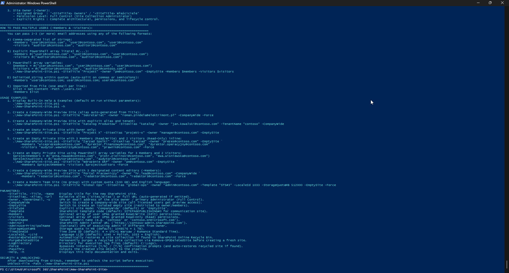
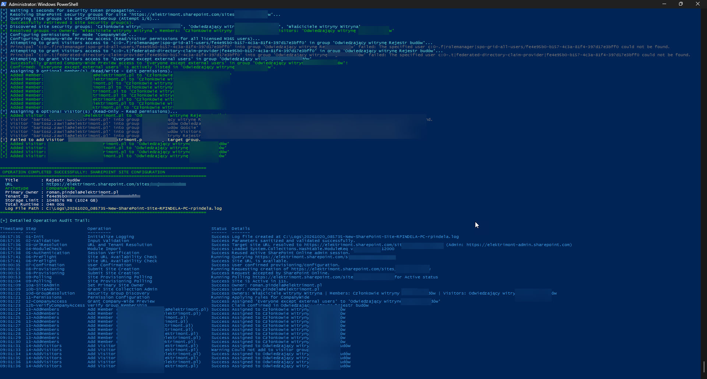
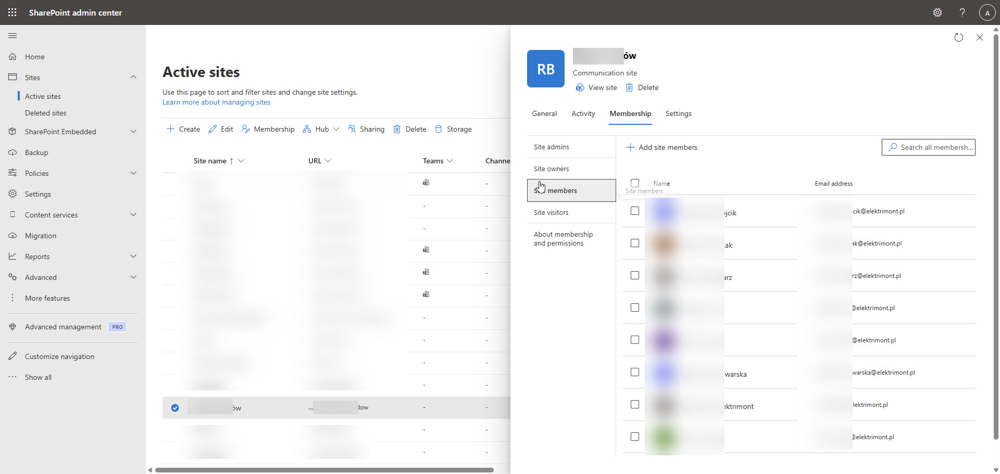

# New-SharePoint-Site

A professional, enterprise-grade PowerShell automation script for Microsoft 365 and SharePoint Online administrators to provision, configure, and secure modern SharePoint Online site collections. It supports provisioning **Company-Wide Preview Sites** (granting preview/read access to all licensed Microsoft 365 company users) or **Isolated Empty Sites** with a designated Owner and optional explicit users, accompanied by **real-time step-by-step operation tracking** and **centralized file logging**.

---

## Key Features

- **Interactive Office 365 Administrator Authentication**:
  - Automatically detects existing active sessions with the SharePoint Online Admin Center (`Connect-SPOService`).
  - Initiates secure interactive modern authentication (browser / MFA prompt) if no active session is present.
  - Automatically resolves the SharePoint Admin Center URL (`https://<tenant>-admin.sharepoint.com`) based on the Owner's UPN domain, site URL, or custom `-TenantName`.

- **Company-Wide Preview Site Provisioning (`-CompanyWide`)**:
  - Automatically provisions a modern communication site (`SITEPAGEPUBLISHING#0`).
  - Designates the specified user as the **Primary Site Collection Administrator** and Site Owner with Full Control.
  - Automatically queries Microsoft Entra ID OpenID endpoints to resolve the tenant Directory GUID.
  - Grants **Preview (Read/Visitor)** permissions to all licensed Microsoft 365 users in the tenant using the canonical SharePoint Online claim:
    ```text
    c:0-.f|rolemanager|spo-grid-all-users/<TenantId>
    ```
    alongside bilingual claims (`Everyone except external users` / `Wszyscy oprócz użytkowników zewnętrznych`) to the site's default Visitors (`Odwiedzający` / `Goście` / `Visitors`) group.
  - Ideal for company-wide portals, corporate announcements, handbooks, and knowledge bases.

- **Existing & Recycled Site Remediation (Recycle Bin Auto-Restore)**:
  - **Active Sites**: If the target site collection already exists, the script safely detects it during pre-flight checks, skips re-creation, and applies or fixes the security groups and permissions directly on the existing site.
  - **Recycled Sites**: If the site URL is held in the SharePoint Online Recycle Bin (`Get-SPODeletedSite`), standard provisioning (`New-SPOSite`) fails. The script automatically identifies recycled sites, restores them (`Restore-SPODeletedSite` - default or with `-Force` / `-RestoreDeletedSite`), waits for active status, and applies all permissions and owners. Alternatively, `-PurgeDeletedSite` allows permanent removal via `Remove-SPODeletedSite`.

- **Auto-Generated Site Alias**:
  - If `-SiteAlias` is omitted, the script automatically derives a clean, normalized URL slug from `-SiteTitle` (converting Polish diacritics, lowercase, removing special characters).

- **Isolated Empty Site Provisioning (`-EmptySite`)**:
  - Provisions a clean, private modern site collection without company-wide exposure.
  - Grants Full Control strictly to the designated **Owner**.
  - Supports optional assignment of additional **Members** (Edit / Read-Write permissions via `-Members`) and **Visitors** (Read / Read-Only permissions via `-Visitors`).
  - Ideal for confidential projects, executive management, legal, HR, or isolated departmental workgroups.

- **Step-by-Step Operation Auditing & Hydration Retry Loop**:
  - Implements progressive polling retries for SharePoint Online back-end hydration to eliminate `Access is denied (0x80070005)` errors caused by site group propagation latency.
  - Provides detailed real-time console and log tracking for every provisioning stage:
    - Input sanitization and regex validation.
    - Tenant, OpenID Tenant GUID, and URL resolution.
    - Module availability verification.
    - Office 365 Administrator session verification.
    - Pre-flight availability check (detects new vs existing site).
    - Provisioning request submission (`New-SPOSite`).
    - Asynchronous polling until site collection status reaches `Active`.
    - Primary Site Collection Administrator assignment.
    - Security group resolution (handling bilingual English and Polish site groups).
    - Company-wide preview permission grant or site isolation enforcement.
    - Optional member and visitor assignment.
    - Formatted operation audit summary table upon completion.

- **Enterprise File Logging**:
  - Automatically records all execution details, timestamps, and severity levels (`INFO`, `SUCCESS`, `WARN`, `ERROR`, `DEBUG`) to `C:\Logs`.
  - Automatically falls back to `$env:LOCALAPPDATA\Logs` if `C:\Logs` is inaccessible or restricted.
  - Standardized log naming format: `yyyyMMdd_HHmmss-New-SharePoint-Site-<ComputerName>-<UserName>.log`.

- **Pre-Execution Input Defense & CleanCode Standards**:
  - Safe input validation guarding against command injection, dangerous shell meta-characters (`` `$<>|;&\0 ``), and malformed email addresses.
  - Validates site URL slugs to ensure compliance with SharePoint URL naming rules.
  - Bilingual interactive confirmation prompt supporting English (`Y/N`) and Polish (`T/N`), with unattended automation support via `-Force`.
  - Built-in help display when invoked without parameters or with `-Help` / `-h`.

---

## Screenshots

### 1. Built-in Help & Guidance (`.\New-SharePoint-Site.ps1`)
Running the script without parameters or with `-Help` / `-h` displays comprehensive usage instructions, archetype descriptions, parameter options, explicit permission level explanations, and multi-user syntax examples:

#### Part 1: Archetypes, Architecture, and Permission Levels


#### Part 2: Multi-User Passing Syntax, Examples & Parameter Reference


---

### 2. Company-Wide SharePoint Site Provisioning (`-CompanyWide`)
End-to-end execution of modern SharePoint Online site collection provisioning with automatic alias normalization, Site Collection Administrator configuration, security group resolution, multi-member/visitor assignment, and operation auditing:

#### Pre-Flight Checks & Interactive Confirmation Prompt
Displays tenant resolution, claim discovery, and parameter confirmation highlighting `Members (Read/Write - Edit)` and `Visitors (Read-Only - Read)`:


#### Group Discovery, Permission Assignment & Audit Trail
Displays group propagation, adding multiple members and visitors to their respective security groups, and the formatted real-time audit summary table:


---

### 3. Verification in SharePoint Online Admin Center
Verification of the newly provisioned modern site collection in the SharePoint Online Admin Center (`Active sites`), confirming site properties and assigned user memberships under the Membership panel:



---

## Prerequisites

- **Operating System**: Windows 10, Windows 11, or Windows Server (Desktop Experience) with English or Polish locale.
- **PowerShell Version**: Windows PowerShell 5.1 or PowerShell 7+.
- **PowerShell Module**: `Microsoft.Online.SharePoint.PowerShell`.
  *If missing, the script will prompt and offer automatic installation for `CurrentUser`:*
  ```powershell
  Install-Module -Name Microsoft.Online.SharePoint.PowerShell -Scope CurrentUser -Repository PSGallery -Force
  ```
- **Administrative Privileges**: An account assigned **SharePoint Administrator** or **Global Administrator** in Microsoft 365.

---

## Security & GitHub Unblocking

When downloading scripts from GitHub, Windows PowerShell applies an execution restriction flag (Zone.Identifier). You must unblock the script before running:

```powershell
Unblock-File -Path .\New-SharePoint-Site.ps1
```

---

## Office 365 Administrator Authentication Flow

The script connects to the SharePoint Online Admin Center (`https://<tenant>-admin.sharepoint.com`):

1. **Active Session Detection**:
   The script invokes `Get-SPOTenant` to test if an active administrative session already exists in the current PowerShell process.
2. **Interactive Modern Sign-In**:
   If not connected, it executes:
   ```powershell
   Connect-SPOService -Url "https://<tenant>-admin.sharepoint.com"
   ```
   A standard Microsoft 365 interactive sign-in window will appear, prompting for administrator credentials and Multi-Factor Authentication (MFA).
3. **Session Reusability**:
   Once connected, subsequent invocations within the same PowerShell session will reuse the established connection without re-prompting.

---

## Site Archetypes Matrix

| Feature / Setting | Company-Wide Preview Site (`-CompanyWide`) | Isolated Empty Site (`-EmptySite`) |
| :--- | :--- | :--- |
| **Intended Use** | Company portal, internal news, policy preview | Confidential project, department, board |
| **Default Template** | `SITEPAGEPUBLISHING#0` (Modern Communication) | `SITEPAGEPUBLISHING#0` or `STS#3` |
| **Owner Access** | Full Control (Site Collection Administrator) | Full Control (Site Collection Administrator) |
| **All Company Users** | **Read / Preview Access** (Visitors group) | **None** (Access denied) |
| **Claim Assigned** | `c:0-.f\|rolemanager\|spo-grid-all-users/<TenantId>` | None |
| **Optional Members** | Supported (`-Members` -> **Edit / Read-Write**) | Supported (`-Members` -> **Edit / Read-Write**) |
| **Optional Visitors** | Supported (`-Visitors` -> **Read / Read-Only**) | Supported (`-Visitors` -> **Read / Read-Only**) |

---

## Permission Levels & Access Rights: Members vs. Visitors

A critical security and governance question when provisioning SharePoint Online sites is understanding the exact access permissions granted to each parameter.

### Does adding a user to `-Members` grant Read/Write permissions?
> **YES, unequivocally.**
> In SharePoint Online modern sites, adding a user to `-Members` assigns that account directly to the site's default **Members** group (`<SiteTitle> Members` / `<SiteTitle> Członkowie`), which is bound to the standard SharePoint **Edit** permission level.
> 
> - **What Members CAN do (Read/Write Access)**:
>   - **Create & Upload**: Upload documents, create new files, create folders, author new site pages, and create lists.
>   - **Modify & Edit**: Edit Microsoft Office documents (Word, Excel, PowerPoint) in the browser or desktop apps, update list items, rename files, and publish page updates.
>   - **Delete**: Delete documents, folders, list items, and pages.
>   - **Read & View**: Browse all libraries, view all lists, view site assets, and download files.
> - **What Members CANNOT do (Administrative Boundary)**:
>   - Cannot change site permissions or grant access to other users outside approved sharing links.
>   - Cannot modify site collection administrators or add other owners.
>   - Cannot alter site architecture (navigation, regional settings, hub association, or delete the site collection).

### Does adding a user to `-Visitors` grant Read-Only permissions?
> **YES, unequivocally.**
> Adding a user to `-Visitors` assigns that account directly to the site's default **Visitors** group (`<SiteTitle> Visitors` / `<SiteTitle> Odwiedzający` / `Goście`), which is bound to the standard SharePoint **Read** permission level.
> 
> - **What Visitors CAN do (Read-Only Access)**:
>   - **Browse & View**: Browse site pages, read published news and announcements, navigate document libraries, and view list items.
>   - **Read & Download**: Open and read documents in Office Online, download copies of documents, and view version history.
> - **What Visitors CANNOT do (Zero Write/Edit Privileges)**:
>   - Cannot upload files, create folders, or add documents.
>   - Cannot edit, update, rename, or overwrite existing documents.
>   - Cannot create, modify, or delete list items.
>   - Cannot delete any content from the site.

### Permission Comparison Matrix

| Role / Parameter | SharePoint Group | Permission Level | Effective Rights | Content Creation & Editing | Content Deletion | Permissions Management | Site Deletion |
| :--- | :--- | :--- | :---: | :---: | :---: | :---: | :---: |
| **Site Owner** (`-Owner`) | `<Title> Owners` / `Właściciele` | **Full Control** | **Full Admin** | :white_check_mark: Yes | :white_check_mark: Yes | :white_check_mark: Yes | :white_check_mark: Yes |
| **Site Member** (`-Members`) | `<Title> Members` / `Członkowie` | **Edit** | **Read / Write** | :white_check_mark: Yes | :white_check_mark: Yes | :x: No | :x: No |
| **Site Visitor** (`-Visitors`) | `<Title> Visitors` / `Odwiedzający` | **Read** | **Read-Only** | :x: No | :x: No | :x: No | :x: No |

---

## How to Supply Multiple Users for `-Members` and `-Visitors`

The script accepts an array of strings (`[string[]]`) for both `-Members` and `-Visitors`. You can supply **2, 3, or more email addresses / UPNs** using any of the following standard PowerShell techniques:

### 1. Comma-Separated Inline Syntax (Recommended for Manual CLI Execution)
Pass multiple quoted email strings separated by commas directly on the command line:

```powershell
.\New-SharePoint-Site.ps1 `
    -SiteTitle "Marketing Campaign" `
    -SiteAlias "marketing-campaign" `
    -Owner "lead@contoso.com" `
    -EmptySite `
    -Members "anna.nowak@contoso.com", "piotr.zielinski@contoso.com", "ewa.wisniewska@contoso.com" `
    -Visitors "audytor.wewnetrzny@contoso.com", "prawnik@contoso.com" `
    -Force
```

### 2. Explicit PowerShell Array Literal (`@(...)`)
Use explicit PowerShell array syntax `@(...)` for structured readability:

```powershell
.\New-SharePoint-Site.ps1 `
    -SiteTitle "Engineering Specs" `
    -SiteAlias "engineering-specs" `
    -Owner "techlead@contoso.com" `
    -EmptySite `
    -Members @("dev1@contoso.com", "dev2@contoso.com", "dev3@contoso.com") `
    -Visitors @("tester1@contoso.com", "security.auditor@contoso.com") `
    -Force
```

### 3. Pre-Defined PowerShell Array Variables (Best for Automation & Reusable Scripts)
Define your user lists in variables before invoking the script. This keeps production scripts clean and maintainable:

```powershell
# Define Read/Write content editors (Members)
$projectMembers = @(
    "anna.nowak@contoso.com",
    "piotr.zielinski@contoso.com",
    "ewa.wisniewska@contoso.com"
)

# Define Read-Only stakeholders (Visitors)
$projectAuditors = @(
    "klient.sponsor@contoso.com",
    "audytor.jakosci@contoso.com"
)

# Provision site collection
.\New-SharePoint-Site.ps1 `
    -SiteTitle "Wdrozenie ERP" `
    -SiteAlias "wdrozenie-erp" `
    -Owner "pm@contoso.com" `
    -EmptySite `
    -Members $projectMembers `
    -Visitors $projectAuditors `
    -Force
```

### 4. Semicolon or Comma Delimited String within Quotes (Auto-Sanitized)
If copying a list of addresses from Microsoft Outlook, Microsoft Teams, or an email client, the script automatically parses, splits, trims, and deduplicates semicolon- or comma-delimited strings:

```powershell
.\New-SharePoint-Site.ps1 `
    -SiteTitle "Operacje Finansowe" `
    -Owner "dyrektor@contoso.com" `
    -EmptySite `
    -Members "anna.nowak@contoso.com; piotr.zielinski@contoso.com; ewa.wisniewska@contoso.com" `
    -Visitors "audytor1@contoso.com; audytor2@contoso.com" `
    -Force
```

### 5. Importing User Lists from a Plain Text File or CSV
For automated batch onboarding, load user lists directly from external files:

```powershell
# Read from a plain text file (one UPN / email per line)
$membersList = Get-Content -Path "C:\Data\finance-members.txt" | Where-Object { -not [string]::IsNullOrWhiteSpace($_) }
$visitorsList = Get-Content -Path "C:\Data\finance-auditors.txt" | Where-Object { -not [string]::IsNullOrWhiteSpace($_) }

.\New-SharePoint-Site.ps1 `
    -SiteTitle "Archiwum Finansowe" `
    -Owner "finance.admin@contoso.com" `
    -EmptySite `
    -Members $membersList `
    -Visitors $visitorsList `
    -Force
```

---

## Usage Examples

### 1. Display Built-In Help & Info (Default Execution)
Executing the script without parameters or with `-Help` / `-h` displays syntax, author info, and practical examples without modifying any resources:

```powershell
.\New-SharePoint-Site.ps1
# or
.\New-SharePoint-Site.ps1 -h
```

---

### 2. Create a Company-Wide Preview Site (Alias Auto-Generated)
Provisions a new modern communication site titled **Sekretariat** accessible to all licensed company employees in read-only preview mode (the URL slug `/sites/sekretariat` is automatically derived):

```powershell
.\New-SharePoint-Site.ps1 -SiteTitle "Sekretariat" -Owner "roman.pindela@elektrimont.pl" -CompanyWide -Force
```

---

### 3. Create a Company-Wide Preview Site with Explicit Alias and Tenant
Provisions a site with explicit parameters and interactive confirmation:

```powershell
.\New-SharePoint-Site.ps1 -SiteTitle "Katalog Produktow" -SiteAlias "katalog" -Owner "jan.kowalski@contoso.com" -TenantName "contoso" -CompanyWide
```

---

### 4. Create an Isolated Empty Site (Owner Only)
Provisions a private, empty site collection where access is strictly confined to the designated site owner:

```powershell
.\New-SharePoint-Site.ps1 -SiteTitle "Projekt Poufny" -SiteAlias "projekt-poufny" -Owner "kierownik@contoso.com" -EmptySite
```

---

### 5. Create an Empty Private Site with 3 Members (Read/Write) and 2 Visitors (Read-Only)
Provisions a private site with explicit member and visitor assignments using inline comma-separated lists:

```powershell
.\New-SharePoint-Site.ps1 `
    -SiteTitle "Zarzad Spolki" `
    -SiteAlias "zarzad" `
    -Owner "prezes@contoso.com" `
    -EmptySite `
    -Members "wiceprezes@contoso.com", "dyrektor.finansowy@contoso.com", "dyrektor.operacyjny@contoso.com" `
    -Visitors "audytor.wewnetrzny@contoso.com", "prawnik@contoso.com" `
    -Force
```

---

### 6. Create an Empty Private Site with Variables for User Lists
Provisions an isolated team site using pre-defined array variables for 3 editors and 2 reviewers:

```powershell
$editors = @("anna.nowak@contoso.com", "piotr.zielinski@contoso.com", "ewa.wisniewska@contoso.com")
$auditors = @("audytor1@contoso.com", "audytor2@contoso.com")

.\New-SharePoint-Site.ps1 `
    -SiteTitle "Wdrozenie ERP" `
    -SiteAlias "wdrozenie-erp" `
    -Owner "pm@contoso.com" `
    -EmptySite `
    -Members $editors `
    -Visitors $auditors `
    -Force
```

---

### 7. Create a Company-Wide Preview Site with Designated Content Editors
Provisions a company-wide site where all employees get read-only preview access, while 3 designated users get Read/Write edit rights to create documents and publish articles:

```powershell
.\New-SharePoint-Site.ps1 `
    -SiteTitle "Baza Wiedzy HR" `
    -Owner "hr.lead@contoso.com" `
    -CompanyWide `
    -Members "redaktor1@contoso.com", "redaktor2@contoso.com", "redaktor3@contoso.com" `
    -Force
```

---

### 8. Create a Modern Team Site (No M365 Group) with Custom Quota & English Locale
Provisions a site collection using modern Team Site template (`STS#3`) with a 500 GB storage limit, English language (`1033`), and explicit tenant specification:

```powershell
.\New-SharePoint-Site.ps1 `
    -SiteTitle "Global Finance" `
    -SiteAlias "global-finance" `
    -Owner "admin@contoso.com" `
    -TenantName "contoso" `
    -Template "STS#3" `
    -LocaleId 1033 `
    -StorageQuotaMB 512000 `
    -EmptySite `
    -Force
```

---

### 9. Pipeline Integration (`-PassThru`)
Outputs the created site object into the PowerShell pipeline for downstream scripts:

```powershell
$siteInfo = .\New-SharePoint-Site.ps1 -SiteTitle "Strefa HR" -Owner "admin@contoso.com" -CompanyWide -Force -PassThru
$siteInfo | Format-List
```

---

## Parameter Reference

| Parameter | Type | Required | Default | Description |
| :--- | :--- | :---: | :--- | :--- |
| `-SiteTitle` / `-Title` / `-Name` | `String` | Yes | *None* | Display title of the new SharePoint Online site. |
| `-SiteAlias` / `-Alias` / `-Url` | `String` | No | *Derived from Title* | Relative path (e.g. `sites/intranet`) or full URL (`https://tenant.sharepoint.com/sites/intranet`). Auto-derived if omitted. |
| `-Owner` / `-OwnerEmail` / `-u` | `String` | Yes | *None* | Primary Site Collection Administrator and Site Owner email/UPN. |
| `-CompanyWide` | `Switch` | No | `False` | Switch to provision a Company-Wide site with preview access for all licensed users. |
| `-EmptySite` | `Switch` | No | `False` | Switch to provision an isolated Empty Site restricted to designated users. |
| `-SiteType` | `String` | No | `CompanyWide` | Explicit archetype selection: `CompanyWide` or `EmptySite`. |
| `-Template` | `String` | No | `SITEPAGEPUBLISHING#0` | SharePoint Online template code (e.g. `SITEPAGEPUBLISHING#0` for Communication, `STS#3` for Team Site). |
| `-Members` / `-MemberList` | `String[]` | No | `@()` | Optional user email(s)/UPN(s) assigned **Edit permissions (Read/Write)**. Supports arrays, comma/semicolon delimited strings, and files. |
| `-Visitors` / `-VisitorList` | `String[]` | No | `@()` | Optional user email(s)/UPN(s) assigned **Read permissions (Read-Only)**. Supports arrays, comma/semicolon delimited strings, and files. |
| `-TenantName` / `-Tenant` | `String` | No | *Auto-detected* | Microsoft 365 tenant domain prefix (e.g. `contoso`). |
| `-AdminUrl` | `String` | No | *Auto-derived* | SharePoint Online Admin Center URL (`https://<tenant>-admin.sharepoint.com`). |
| `-AdminUserPrincipalName` / `-AdminUPN` | `String` | No | *Auto-discovered* | UPN/Email of the administrator running the script, if different from `-Owner`. Ensures executing admin receives Site Collection Admin rights on the site. |
| `-StorageQuotaMB` | `Int64` | No | `1048576` (1 TB) | Maximum storage limit in megabytes (range: 1,024 to 26,214,400 MB). |
| `-TimeZoneId` | `Int32` | No | `4` | SharePoint Time Zone ID (default: 4 = UTC+1 Romance Standard Time - Warsaw/Brussels). |
| `-LocaleId` / `-Lcid` | `Int32` | No | `1045` (Polish) | SharePoint Language ID (e.g. `1045` for Polish, `1033` for English). |
| `-RestoreDeletedSite` | `Switch` | No | `False` | Automatically restores a site collection if found in the SharePoint Online Recycle Bin (default when `-Force` is supplied). |
| `-PurgeDeletedSite` | `Switch` | No | `False` | Permanently purges a recycled site collection from the SharePoint Recycle Bin via `Remove-SPODeletedSite` before creating a fresh site. |
| `-LogDirectory` | `String` | No | `C:\Logs` | Destination folder for execution log files (falls back to `$env:LOCALAPPDATA\Logs`). |
| `-Force` | `Switch` | No | `False` | Bypasses interactive confirmation prompts (`[Y/N]` or `[T/N]`) and auto-restores recycled site if found. |
| `-PassThru` | `Switch` | No | `False` | Returns custom PSObject with provisioning details to the pipeline. |
| `-Help` / `-h` | `Switch` | No | `False` | Displays comprehensive built-in help and exits. |

---

## Detailed Operation Tracking & Audit Trail

The script tracks and reports the status of each discrete operation in real time:

```text
Timestamp  Step               Operation                     Status   Details
---------  ----               ---------                     ------   -------
12:48:00   01-Init            Initialize Logging            Success  Log file created at C:\Logs\...
12:48:00   02-Validation      Input Validation              Success  Parameters sanitized and validated successfully.
12:48:00   03-UrlResolution   URL and Tenant Resolution     Success  Target site URL resolved to https://elektrimont.sharepoint.com/sites/sekretariat
12:48:01   04-ModuleCheck     Module Import                 Success  Loaded Microsoft.Online.SharePoint.PowerShell v16.0.27709.12000
12:48:02   05-Authentication  Session Authentication        Success  Connected to https://elektrimont-admin.sharepoint.com
12:48:03   06-PreFlight       Site URL Availability Check   Success  Site URL is available (or Warning if existing).
12:48:04   07-Confirmation    User Confirmation             Success  User confirmed provisioning.
12:48:05   08-Provisioning    Submit Site Creation          Success  Request accepted by SharePoint Online.
12:48:35   09-Polling         Site Provisioning Polling     Success  Site is Active in 29.4s.
12:48:45   10-GroupResolution Security Group Discovery      Success  Owners: Sekretariat Właściciele | Members: Sekretariat Członkowie | Visitors: Sekretariat Odwiedzający
12:48:46   11-Permissions     Permission Configuration      Running  Applying rules for CompanyWide
12:48:47   12-CompanyAccess   Grant Company-Wide Preview    Success  Assigned 'c:0-.f|rolemanager|spo-grid-all-users/<TenantId>' to 'Sekretariat Odwiedzający'
12:48:48   13-AddMembers      Add Member (user@domain.com)  Success  Assigned to Sekretariat Członkowie
12:48:49   14-AddVisitors     Add Visitor (user@domain.com) Success  Assigned to Sekretariat Odwiedzający
```

---

## Log File Format

Logs are stored in `C:\Logs` (or `$env:LOCALAPPDATA\Logs` as fallback) using the naming pattern:
`yyyyMMdd_HHmmss-New-SharePoint-Site-<ComputerName>-<UserName>.log`

---

## Author & Contact

- **Author**: Roman Pindela
- **Email**: [roman.pindela@gmail.com](mailto:roman.pindela@gmail.com)
- **GitHub**: [https://github.com/romanpindela](https://github.com/romanpindela)
- **Version**: 1.6.0
- **Created**: 2026-10-19
- **Updated**: 2026-10-20
