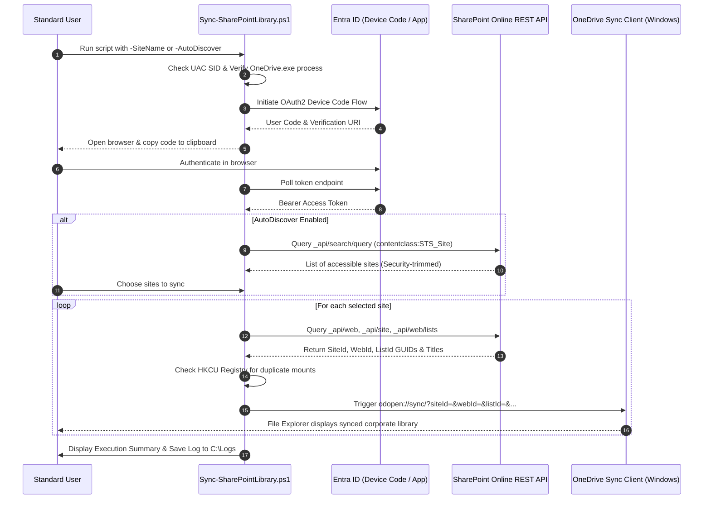

# Sync-SharePointLibrary

[](https://microsoft.com/powershell)
[](https://www.microsoft.com/windows)
[](https://github.com/romanpindela)
[](LICENSE)

An enterprise-grade, clean-code PowerShell automation utility designed to seamlessly map, register, and synchronize Microsoft 365 SharePoint Online document libraries directly to the Windows 10/11 File Explorer using the native **OneDrive for Business** synchronization engine (`odopen://sync?` protocol).

Developed for **Elektrimont Sp. z o.o.** and engineered to be reusable across any Microsoft 365 corporate tenant.

---

## Author & Project Metadata

* **Author**: Roman Pindela
* **Email**: [roman.pindela@gmail.com](mailto:roman.pindela@gmail.com)
* **GitHub**: [https://github.com/romanpindela](https://github.com/romanpindela)
* **Organization**: Elektrimont Sp. z o.o.
* **Script Version**: `2.0.0`
* **Release Date**: 2026-10-19
* **Target Platforms**: Windows 10, Windows 11, Windows Server (with Desktop Experience)
* **Supported Languages**: English & Polish environments (fully language-independent SID and library title resolution)

---

## Key Features

1. **Interactive Microsoft 365 Authentication (OAuth2 Device Code Flow)**
   - No heavy dependencies or cumbersome PowerShell module installations (`PnP.PowerShell`, `Microsoft.Graph`) required.
   - Automatically generates a device code, copies it directly to the system clipboard, and opens the official Microsoft sign-in portal (`https://microsoft.com/devicelogin`).
2. **Automatic Tenant-Wide Site Discovery (`-AutoDiscover`)**
   - Automatically interrogates the SharePoint Online Search REST API for all site collections and subsites the user has permission to access.
   - Security-trimmed: Only sites with authorized access are discovered and displayed.
   - Provides an interactive numbered selector (or automatic bulk synchronization via `-All`).
3. **Explicit Multi-Site & Multi-Library Synchronization**
   - Supports site slugs (e.g., `'automatyka'`), relative paths (`'/sites/automatyka'`), or full tenant URLs.
   - Accepts arrays of sites for batch provisioning.
   - Option to synchronize all document libraries in a site (`-AllLibraries`) or target specific custom library titles (`-DocumentLibraryTitle`).
4. **Bilingual & Language-Independent Architecture**
   - Automatically resolves default document libraries regardless of UI locale (handles Polish `"Dokumenty"` / `"Dokumenty udostępnione"` and English `"Documents"` / `"Shared Documents"`).
   - Privilege validation implemented via Well-Known SIDs (`BuiltInAdministratorsSid`), ensuring consistency across localized OS builds.
5. **Duplicate Sync & Existing Mount Point Detection**
   - Inspects the local Windows Registry (`HKCU:\Software\SyncEngines\Providers\OneDrive`) and OneDrive account scope caches to detect already synchronized libraries and avoid redundant mounts.
6. **Enterprise Logging Subsystem & Execution Summary**
   - Detailed, colorized real-time console feedback.
   - Automatic execution logs saved to `C:\Logs\<Timestamp>-Sync-SharePointLibrary-<ComputerName>-<UserName>.log` (with fallback to `%LOCALAPPDATA%\Logs`).
   - Comprehensive execution summary report highlighting newly initiated, existing, and failed sync jobs.
7. **Non-Interactive Entra ID App-Only Support**
   - Supports automated service execution via Microsoft Entra ID App Registrations with client credentials.

---

## Prerequisites & Requirements

### 1. Active OneDrive for Business Sign-In
* The user must be signed in to the local **OneDrive for Business** client.
* **Credentials**: Corporate Microsoft 365 work email address and password (e.g., `user@elektrimont.pl`).
* The script automatically verifies that `OneDrive.exe` is running, checking both per-machine (`C:\Program Files\Microsoft OneDrive\`) and per-user (`%LOCALAPPDATA%\Microsoft\OneDrive\`) installations.

### 2. Standard User Execution (NO Administrator Elevation)
> [!IMPORTANT]
> **DO NOT run this script as Administrator (UAC elevated).**
> Microsoft OneDrive operates strictly within the interactive standard user's desktop session. Running under an elevated Administrator token prevents the `odopen://` URI protocol from mounting to the user's Explorer profile. The script automatically detects and prevents elevated execution.

### 3. Unblock Script After Download
When downloading the script from GitHub or an email attachment, Windows marks it with the `Zone.Identifier` alternative data stream. Unblock the file prior to execution:

```powershell
Unblock-File -Path .\Sync-SharePointLibrary.ps1
```

---

## Parameter Reference

| Parameter | Type | Required | Default | Description |
| :--- | :--- | :---: | :--- | :--- |
| `-SiteName` | `String[]` | No | *None* | Name, slug, or full URL of the SharePoint site(s) to sync. Aliases: `Sites`, `SiteUrl`. |
| `-TenantHost` | `String` | No | `elektrimont.sharepoint.com` | Target SharePoint Online root domain or hostname. |
| `-AutoDiscover` | `Switch` | No | `False` | Automatically searches and lists all SharePoint sites accessible to the authenticated user. |
| `-All` | `Switch` | No | `False` | When used with `-AutoDiscover`, automatically syncs all discovered sites without interactive prompts. |
| `-DocumentLibraryTitle` | `String` | No | *Auto-detected* | Specific document library display name. If omitted, the default library is resolved automatically. |
| `-AllLibraries` | `Switch` | No | `False` | Synchronizes all visible document libraries in the specified site(s). |
| `-Force` | `Switch` | No | `False` | Forces synchronization re-triggering even if already registered locally. |
| `-LogDirectory` | `String` | No | `C:\Logs` | Destination directory for detailed execution logs. |
| `-ClientId` | `String` | No* | *Azure CLI* | Microsoft Entra ID Application ID (*Required for non-interactive mode). |
| `-TenantId` | `String` | No* | `common` | Microsoft Entra ID Directory (Tenant) ID (*Required for non-interactive mode). |
| `-ClientSecret` | `String` | No* | *None* | Microsoft Entra ID Client Secret (*Required for non-interactive mode). |
| `-Help`, `-h` | `Switch` | No | `False` | Displays console help and usage reference. |

---

## Usage Examples

### 1. Show Help & Quick Reference
Running without arguments or with `-Help` / `-h` renders comprehensive help:
```powershell
.\Sync-SharePointLibrary.ps1 -Help
```

### 2. Synchronize a Single Site (Interactive)
Prompts for user authentication, resolves site GUIDs, and initiates sync for site `automatyka`:
```powershell
.\Sync-SharePointLibrary.ps1 -SiteName "automatyka"
```

### 3. Synchronize Multiple Sites in One Command
Accepts an array of site names or slugs:
```powershell
.\Sync-SharePointLibrary.ps1 -SiteName "automatyka", "projekty", "zarzad"
```

### 4. Automatic Discovery with Interactive Selection
Discovers all sites the user can access and presents a numbered menu:
```powershell
.\Sync-SharePointLibrary.ps1 -AutoDiscover
```
*Console output:*
```text
--------------------------------------------------------------------------------
 DISCOVERED ACCESSIBLE SHAREPOINT SITES (3 found):
--------------------------------------------------------------------------------
 [ 1] Automatyka                     - https://elektrimont.sharepoint.com/sites/automatyka
 [ 2] Projekty                       - https://elektrimont.sharepoint.com/sites/projekty
 [ 3] Zarzad                         - https://elektrimont.sharepoint.com/sites/zarzad
--------------------------------------------------------------------------------

Select sites to sync:
  - Enter comma-separated numbers (e.g. 1, 3, 5)
  - Type 'ALL' to synchronize all discovered sites
  - Type 'Q' to quit

Your selection: 1, 2
```

### 5. Automatic Discovery with Unattended Full Sync
Discovers all accessible sites and immediately synchronizes all of them:
```powershell
.\Sync-SharePointLibrary.ps1 -AutoDiscover -All
```

### 6. Synchronize All Libraries from a Custom Full URL
```powershell
.\Sync-SharePointLibrary.ps1 -SiteName "https://elektrimont.sharepoint.com/sites/automatyka" -AllLibraries
```

### 7. Synchronize on an External / Alternative Microsoft 365 Tenant
```powershell
.\Sync-SharePointLibrary.ps1 -TenantHost "contoso.sharepoint.com" -SiteName "sales"
```

---

## Non-Interactive / Microsoft Entra ID Setup Guide

For zero-touch employee onboarding, automated software deployment, or scheduled configuration management, the script can run non-interactively using an App Registration in Microsoft Entra ID.

### Step-by-Step Entra ID Configuration:

1. **Register Application:**
   - Log in to the [Microsoft Entra admin center](https://entra.microsoft.com).
   - Navigate to **Applications** > **App registrations** > **New registration**.
   - Name: `SharePoint-Library-Sync-Agent`.
   - Supported account types: `Accounts in this organizational directory only (Single tenant)`.
   - Click **Register**. Note down the **Application (client) ID** and **Directory (tenant) ID**.

2. **Configure API Permissions:**
   - Navigate to **API permissions** > **Add a permission**.
   - Select **SharePoint** > **Application permissions**.
   - Select:
     - `Sites.Read.All` (read-only metadata resolution) or `Sites.FullControl.All`.
   - Click **Add permissions**.
   - Click **Grant admin consent for <Your Organization>** and verify green checkmarks.

3. **Generate Client Secret:**
   - Navigate to **Certificates & secrets** > **New client secret**.
   - Provide a description and expiration.
   - Click **Add** and immediately copy the **Value** string.

4. **Execute Unattended Command:**
```powershell
.\Sync-SharePointLibrary.ps1 `
    -TenantHost "elektrimont.sharepoint.com" `
    -TenantId "00000000-0000-0000-0000-000000000000" `
    -ClientId "11111111-1111-1111-1111-111111111111" `
    -ClientSecret "YourSecretValueHere" `
    -SiteName "automatyka"
```

---

## Logging Subsystem

Every execution automatically generates a detailed log file formatted as:
```text
C:\Logs\<yyyyMMdd_HHmmss>-Sync-SharePointLibrary-<ComputerName>-<UserName>.log
```

If `C:\Logs` is inaccessible due to folder permission constraints, the script falls back gracefully to:
```text
%LOCALAPPDATA%\Logs\<yyyyMMdd_HHmmss>-Sync-SharePointLibrary-<ComputerName>-<UserName>.log
```

### Sample Summary Report Output:
```text
========================================================================================
                                 EXECUTION SUMMARY REPORT                               
========================================================================================
 Total Libraries Processed : 3
 Sync Newly Initiated      : 2
 Already Synced Locally    : 1
 Failed Registrations      : 0
 Total Execution Time      : 00:00:14
 Execution Log File        : C:\Logs\20261019_085025-Sync-SharePointLibrary-RPINDELA-PC-rpindela.log
========================================================================================

Site Name                 Library              Status           Details / Local Path
---------                 -------              ------           --------------------
Automatyka                Dokumenty            Initiated        Handed off to OneDrive client (roman.pindela@elektrimont.pl)
Projekty                  Dokumenty            Already Synced   C:\Users\rpindela\Elektrimont Sp. zo . o\Projekty - Dokumenty
Zarzad                    Dokumenty            Initiated        Handed off to OneDrive client (roman.pindela@elektrimont.pl)

Log details have been written to: C:\Logs\20261019_085025-Sync-SharePointLibrary-RPINDELA-PC-rpindela.log
```

---

## Technical Architecture & How It Works



---

## Troubleshooting & FAQ

#### Q1: "OneDrive sync cannot operate with elevated Administrator privileges"
**Cause:** You launched PowerShell using "Run as Administrator".
**Fix:** Close the elevated console and open a regular PowerShell window. OneDrive operates in the standard user session.

#### Q2: "Aplikacja OneDrive nie została odnaleziona"
**Cause:** Microsoft OneDrive desktop app is not installed.
**Fix:** Install the latest Microsoft OneDrive sync client from [microsoft.com/onedrive](https://www.microsoft.com/onedrive).

#### Q3: How do I force re-synchronization of an existing library?
**Fix:** Pass the `-Force` switch:
```powershell
.\Sync-SharePointLibrary.ps1 -SiteName "automatyka" -Force
```

---

## Version History

* **v2.0.0 (2026-10-19)**:
  - Major architectural rewrite following CleanCode and enterprise PowerShell script standards.
  - Added security-trimmed tenant-wide site discovery (`-AutoDiscover`).
  - Added non-interactive Microsoft Entra ID App registration authentication.
  - Added multi-site and multi-library batch processing.
  - Added duplicate sync detection against local Windows Registry.
  - Added enterprise logging to `C:\Logs` with automatic fallback.
  - Added bilingual document library resolution (Polish / English).
  - Enhanced OneDrive client detection across all modern 64-bit and 32-bit install paths.
* **v1.4.3 (2026-10-16)**:
  - Added OAuth2 Device Code flow and initial SharePoint REST API GUID resolution.
* **v1.0.0 (2026-10-15)**:
  - Initial prototype for Elektrimont internal SharePoint library mapping.

---

## License

This project is licensed under the MIT License - see the LICENSE file for details.
Copyright (c) 2026 Elektrimont Sp. z o.o. / Roman Pindela.