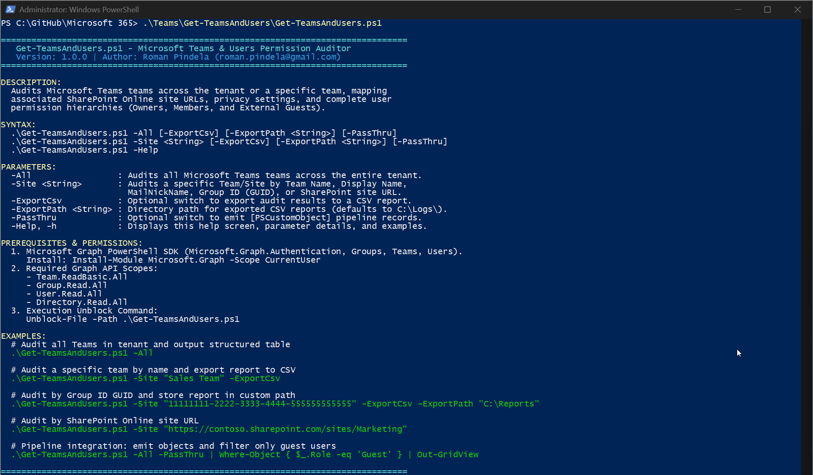
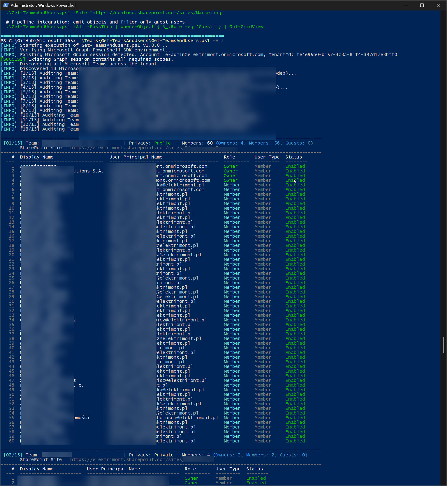
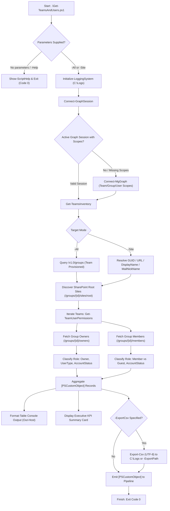

# Get-TeamsAndUsers

[](https://microsoft.com/powershell)
[](https://learn.microsoft.com/graph/)
[](https://www.microsoft.com/microsoft-365)
[](https://opensource.org/licenses/MIT)

An enterprise-grade, clean-code PowerShell automation script engineered for **Microsoft 365**, **Microsoft Teams**, and **SharePoint Online** governance. It performs comprehensive tenant-wide or site-specific inventory audits of Microsoft Teams, identifying connected SharePoint Online site collections, group privacy settings, and complete user permission hierarchies across **Owners**, **Members**, and **External Guests**.

---

## 📌 Project Metadata

* **Author**: Roman Pindela
* **Email**: [roman.pindela@gmail.com](mailto:roman.pindela@gmail.com)
* **GitHub**: [https://github.com/romanpindela](https://github.com/romanpindela)
* **Version**: `1.0.0`
* **Release Date**: 2026-10-25
* **License**: MIT
* **Target Platforms**: Windows PowerShell 5.1 & PowerShell 7+ (Cross-Platform / Dual-Compatibility)

---

## 🚀 Overview & Business Value

Managing collaboration lifecycles and permission governance across modern Microsoft 365 environments is a critical security imperative. Microsoft Teams instances create underlying Microsoft 365 Unified Groups and dedicated SharePoint Online site collections. Over time, sprawl, unmonitored external guest invitations, and orphaned owner assignments create severe compliance and data governance risks.

`Get-TeamsAndUsers.ps1` resolves these operational challenges by delivering:
1. **Unified Topology Discovery**: Correlates the Microsoft Team, underlying M365 Unified Group ID, team privacy classification (Public vs. Private), and the direct underlying SharePoint Online site URL.
2. **Explicit Role Mapping**: Distinguishes unambiguously between **Owner**, **Member**, and **Guest** accounts, eliminating role ambiguity.
3. **Account Health Forensics**: Captures User Display Name, UserPrincipalName (UPN), Entra ID User Type, and sign-in status (Enabled vs. Disabled) to immediately flag stale or disabled accounts retaining active memberships.
4. **Flexible Query Targeting**: Supports tenant-wide scanning (`-All`) or pinpoint auditing (`-Site`) by Display Name, MailNickName, Group GUID, or SharePoint site URL.
5. **DevOps & Pipeline Ready**: Emits clean, strongly-typed `[PSCustomObject]` pipeline items for downstream PowerShell scripting (`Where-Object`, `Out-GridView`, `Export-Csv`) alongside rich, color-coded console tables.
6. **Enterprise Logging**: Enforces automated audit logging to `C:\Logs` with timestamped event tracking, severity tagging, and fallback protections.

---

## 📸 Visual Overview & Live Execution

### 1. Standard Run & Interactive Help Banner
Running `Get-TeamsAndUsers.ps1` without parameters or with `-Help` displays the built-in guide, parameter descriptions, prerequisites, and operational usage examples:



### 2. Grouped Teams & Users Permissions Table
Executing an inventory audit (e.g. `.\Get-TeamsAndUsers.ps1 -All`) discovers all Teams across the tenant, resolves underlying SharePoint site URLs, renders color-coded user permissions grouped by Team, and concludes with an executive KPI summary card:



---

## 🏗️ Architecture & Execution Flow



---

## 📋 Prerequisites & Permissions

### 1. PowerShell Environment
* Windows PowerShell 5.1 or PowerShell 7+ on Windows 10, Windows 11, or Windows Server.
* Script execution unblock:
  ```powershell
  Unblock-File -Path .\Get-TeamsAndUsers.ps1
  ```

### 2. Microsoft Graph PowerShell SDK
The script leverages the official Microsoft Graph PowerShell SDK (`Microsoft.Graph.Authentication`, `Microsoft.Graph.Groups`, `Microsoft.Graph.Teams`, `Microsoft.Graph.Users`).
To install the required modules:
```powershell
Install-Module -Name Microsoft.Graph -Scope CurrentUser -Repository PSGallery -Force
```

### 3. Required Microsoft Graph Permission Scopes
The authenticating user or service account must have consent for the following delegated or application permissions:
* `Team.ReadBasic.All` — Reads names, descriptions, and settings of Teams.
* `Group.Read.All` — Reads properties, settings, and memberships of Microsoft 365 Groups.
* `User.Read.All` — Reads user profiles, account statuses (Enabled/Disabled), and user types.
* `Directory.Read.All` — Discovers directory objects and tenant organization details.

Recommended Administrator Roles: **Global Reader**, **Teams Administrator**, or **Directory Readers**.

---

## ⚙️ Parameters Reference

| Parameter | Type | Required | Default | Aliases | Description |
| :--- | :---: | :---: | :---: | :--- | :--- |
| `-All` | `Switch` | Optional* | `$false` | *None* | Audits all Microsoft Teams across the entire Microsoft 365 tenant. |
| `-Site` | `String` | Optional* | `$null` | `-Team`, `-TeamName`, `-Identity` | Audits a specific Team/Site by Team Name, Display Name, MailNickName, Group GUID, or SharePoint site URL. |
| `-ExportCsv` | `Switch` | Optional | `$false` | `-Csv`, `-Export` | Exports all audited user permission mappings to a timestamped CSV report. |
| `-ExportPath` | `String` | Optional | `C:\Logs` | `-OutputPath`, `-Path` | Target folder where generated CSV reports are saved. Defaults to `C:\Logs\` (or script directory if inaccessible). |
| `-PassThru` | `Switch` | Optional | `$false` | *None* | Emits raw structured `[PSCustomObject]` records to the pipeline for downstream cmdlets (`Where-Object`, `Out-GridView`). When omitted, displays only the visual console report. |
| `-Help` | `Switch` | Optional | `$false` | `-h` | Displays detailed built-in command help, parameter syntax, prerequisites, and examples. |

*\*Note: Execution requires either `-All` or `-Site <String>`. Running without parameters displays the help screen and terminates with code 0.*

---

## 💡 Usage Examples

### Example 1: Display Help Screen
```powershell
.\Get-TeamsAndUsers.ps1 -Help
```
*Displays syntax, operational switches, prerequisites, and operational examples.*

### Example 2: Audit All Tenant Teams
```powershell
.\Get-TeamsAndUsers.ps1 -All
```
*Queries all Microsoft Teams across the tenant, resolves associated SharePoint site URLs, maps all users (Owners, Members, Guests) grouped by team with rich coloring and numbering, and displays an executive summary.*

### Example 3: Audit a Specific Team by Name
```powershell
.\Get-TeamsAndUsers.ps1 -Site "Human Resources"
```
*Targets the "Human Resources" team, mapping all owners, members, and guest users.*

### Example 4: Audit by Group ID GUID and Export to CSV
```powershell
.\Get-TeamsAndUsers.ps1 -Site "e1234567-89ab-cdef-0123-456789abcdef" -ExportCsv
```
*Audits the team matching the specified Entra ID Group GUID and saves the output report to `C:\Logs\`.*

### Example 5: Audit by SharePoint Online URL with Custom Export Path
```powershell
.\Get-TeamsAndUsers.ps1 -Site "https://contoso.sharepoint.com/sites/Marketing" -ExportCsv -ExportPath "D:\AuditReports"
```
*Extracts the team corresponding to the SharePoint site URL and saves the resulting CSV to `D:\AuditReports`.*

### Example 6: Pipeline Integration & Filtering
```powershell
# Filter only external guest accounts across all teams and view in Out-GridView
.\Get-TeamsAndUsers.ps1 -All -PassThru | Where-Object { $_.Role -eq 'Guest' } | Out-GridView -Title "External Guests in Teams"

# Identify all teams where disabled user accounts retain membership
.\Get-TeamsAndUsers.ps1 -All -PassThru | Where-Object { $_.AccountStatus -eq 'Disabled' } | Select-Object TeamName, DisplayName, UserPrincipalName, Role
```

---

## 🖥️ Console Output Example

```text
[INFO] Starting execution of Get-TeamsAndUsers.ps1 v1.0.0...
[INFO] Verifying Microsoft Graph PowerShell SDK environment...
[INFO] Existing Microsoft Graph session detected. Account: admin@contoso.com, TenantId: 00000000-1111-2222-3333-444444444444
[SUCCESS] Existing Graph session contains all required scopes.
[INFO] Discovering all Microsoft Teams across the tenant...
[INFO] Discovered 2 Microsoft Team(s) to audit.
[INFO] [1/2] Auditing Team: 'Executive Leadership' (Group ID: 7f8a9b0c-1d2e-3f4a-5b6c-7d8e9f0a1b2c)...
[INFO] [2/2] Auditing Team: 'Global Marketing' (Group ID: 3a4b5c6d-7e8f-9a0b-1c2d-3e4f5a6b7c8d)...

===================================================================================================================
 [01/02] Team: Executive Leadership         | Privacy: Private | Members: 3 (Owners: 1, Members: 1, Guests: 1)
       SharePoint Site : https://contoso.sharepoint.com/sites/ExecutiveLeadership
-------------------------------------------------------------------------------------------------------------------
    #  Display Name                  User Principal Name                  Role       User Type  Status  
  ---  ----------------------------  -----------------------------------  ---------  ---------  --------
    1  Megan Bowen                   mbowen@contoso.com                   Owner      Member     Enabled 
    2  Alex Wilber                   awilber@contoso.com                  Member     Member     Enabled 
    3  Jane Doe (Partner)            jdoe_partner.com#EXT#@contoso.com    Guest      Guest      Enabled 

===================================================================================================================
 [02/02] Team: Global Marketing             | Privacy: Public  | Members: 3 (Owners: 1, Members: 2, Guests: 0, Disabled: 1)
       SharePoint Site : https://contoso.sharepoint.com/sites/GlobalMarketing
-------------------------------------------------------------------------------------------------------------------
    #  Display Name                  User Principal Name                  Role       User Type  Status  
  ---  ----------------------------  -----------------------------------  ---------  ---------  --------
    1  Adele Vance                   avance@contoso.com                   Owner      Member     Enabled 
    2  Diego Siciliani               dsiciliani@contoso.com               Member     Member     Enabled 
    3  Patti Fernandez               pfernandez@contoso.com               Member     Member     Disabled

================================================================================
                        AUDIT EXECUTION SUMMARY                                 
================================================================================
  Total Teams Audited        : 2
  Total User Mappings        : 6
    - Owners                 : 2
    - Members                : 3
    - Guests                 : 1
  Disabled Accounts Detected : 1
================================================================================

[SUCCESS] Audit completed successfully in 00:04.120. Total records: 6.
```

---

## 📝 Structured Logging

The script maintains an execution audit log for compliance, auditing, and troubleshooting:
* **Log File Location**:
  `C:\Logs\<yyyyMMdd-HHmmss>-Get-TeamsAndUsers-<COMPUTERNAME>-<USERNAME>.log`
* **Fallback Location**:
  If `C:\Logs\` is not writable, the log automatically redirects to:
  `%LOCALAPPDATA%\Logs\<yyyyMMdd-HHmmss>-Get-TeamsAndUsers-<COMPUTERNAME>-<USERNAME>.log`
* **Log Severity Levels**:
  * `[INFO]` — Normal operational milestones and Graph discovery steps.
  * `[SUCCESS]` — Successful authentication, queries, and file exports.
  * `[WARN]` — Recoverable conditions, reconnects, or missing matches.
  * `[ERROR]` — Fatal execution blockers or API exceptions.
  * `[DEBUG]` — Granular REST diagnostics and slug fallback evaluations.

---

## 👨‍💻 Author & Changelog

* **Author**: Roman Pindela
* **Email**: [roman.pindela@gmail.com](mailto:roman.pindela@gmail.com)
* **GitHub**: [https://github.com/romanpindela](https://github.com/romanpindela)

### Version History
* **v1.0.0 (2026-10-25)**:
  * Initial production release.
  * Tenant-wide (`-All`) and targeted (`-Site`) discovery for Microsoft Teams.
  * Automatic SharePoint Online site collection URL resolution via `/groups/{id}/sites/root`.
  * Explicit role differentiation between Owner, Member, and Guest accounts.
  * Sign-in account status detection (Enabled/Disabled) and Entra ID UserType tracking.
  * Automated CSV report generation (`-ExportCsv`, `-ExportPath`).
  * Automated Microsoft Graph session and scope validation.
  * Zero PSScriptAnalyzer warnings with Clean Code standards.
